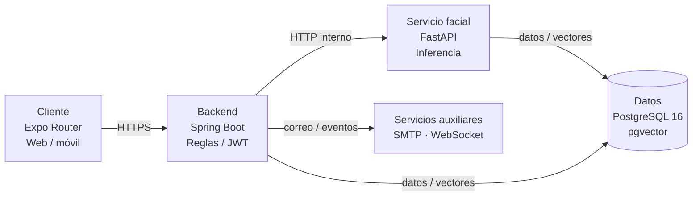

# FaceLit

## Diseño de software

**Arquitectura, componentes, navegación y comunicación**

| Corte | Fuentes técnicas |
|---|---|
| 4 noviembre 2026 | Repositorios consultados en `main`; referencias de código indicadas en el cierre. Estado de despliegue documentado al 27 de octubre. |

> **Alcance.** Describe el diseño actual y distingue implementación, decisiones de diseño y mejoras por validar. El equipo confirma que los flujos funcionales del sistema, incluida cámara, CSV, asistencia y correo, ya operan.

---

## 1. Resumen y decisiones vigentes

FaceLit es una solución cliente-servidor para preparar información académica y registrar/consultar asistencia. El cliente Expo ofrece vistas por rol; Spring Boot concentra autenticación, autorización y reglas de dominio; FastAPI encapsula la evaluación facial; PostgreSQL conserva datos relacionales y referencias vectoriales.

| Decisión | Diseño actualizado |
|---|---|
| Autoridad de dominio | Spring valida sesión, actor, permisos, contexto y reglas antes de confirmar cambios de dominio. |
| Servicio facial | El cliente envía la captura al backend. Java coordina la llamada interna a FastAPI; no describir el flujo vigente como llamada directa del cliente a FastAPI. |
| Persistencia | PostgreSQL 16 con pgvector; backend y servicio facial comparten base de datos en la implementación actual. No es persistencia independiente por servicio. |
| Arquitectura lógica | Backend modular organizado por responsabilidades, acompañado de un servicio facial separado. Los repositorios de código no equivalen a cuatro microservicios. |

> Revisión estática de código/configuración. No certifica rendimiento, exactitud biométrica, seguridad integral ni aceptación institucional.

---

## 2. Arquitectura y comunicación

### Flujo principal de captura y asistencia

1. El cliente autenticado prepara captura y retos.
2. Envía la solicitud por HTTPS al endpoint facial de Spring.
3. Spring valida autorización/contexto y llama a FastAPI por HTTP interno.
4. El servicio evalúa la secuencia y consulta referencias en PostgreSQL.
5. Spring aplica reglas de sesión, tiempos, entrada/salida y duplicados; persiste el evento.
6. El cliente presenta el resultado y las vistas consultan según el alcance autorizado.

> La llamada Java → FastAPI espera respuesta dentro del caso de uso. La inferencia se procesa secuencialmente en el flujo descrito. `async/await` en otros tramos y WebSocket no significan que toda la operación sea paralela o en segundo plano.

---

## 3. Componentes y módulos

| Componente | Responsabilidades | Límite / evidencia |
|---|---|---|
| Cliente Expo | Rutas por rol, formularios, captura, stores/hooks y llamadas HTTP. | Guards ayudan navegación; servidor decide autorización. |
| Backend Spring Boot | Autenticación JWT, roles, gestión académica, sesiones, reglas de asistencia, notificaciones y coordinación. | Monolito modular; reglas y persistencia de dominio. |
| Servicio facial FastAPI | Validación de retos, generación/comparación facial y acceso al repositorio especializado. | Servicio separado; llamada desde backend por red interna. |
| PostgreSQL + pgvector | Identidad, relaciones académicas, sesiones, eventos, referencias faciales y notificaciones. | Compartida por Java y FastAPI. Cambios versionados con Liquibase. |
| Canales auxiliares | SMTP y WebSocket para comunicaciones específicas. | Correo asíncrono solo en listeners documentados; no generalizar a todos los correos. |

### Módulos funcionales

Acceso y perfil; administración de usuarios/roles; gestión académica (programas, fichas, instructores y CSV); ambientes/sesiones; enrolamiento y registro facial; asistencia e historial; reportes; notificaciones.

---

## 4. Flujo facial y restricciones

Retos vigentes: `MOVE_UP`, `MOVE_DOWN`, `MOVE_CLOSER` y `MOVE_AWAY`. Una secuencia solicita dos retos distintos y siete imágenes por reto. Los retos antiguos retirados no deben incluirse en demostraciones ni enviarse desde un cliente actualizado.

| Parámetro | Descripción | Límite de interpretación |
|---|---|---|
| Transporte | Imágenes Base64 en solicitud JSON hacia Spring. | Contrato de esta integración, no requisito universal del reconocimiento facial. |
| Umbral | 0.65 | Valor observado de similitud para comparación. No representa 65 % de precisión. |
| Inferencia | Servicio especializado FastAPI y trabajador de embeddings. | No hay medición poblacional de exactitud en esta documentación. |

### Registro del aprendiz

Inicio de sesión → aviso y permiso de cámara → retos → solicitud al backend → verificación y persistencia coordinadas → confirmación. El detalle de retención de imágenes temporales y eliminación debe contrastarse con código y política vigentes; no inferirlo a partir de la existencia de un embedding.

### Registro de asistencia

Instructor selecciona una sesión permitida; el sistema vincula ficha, ambiente y tiempos; verifica rostro; valida autorización, ventana temporal, entrada/salida previa y duplicados; persiste y expone el resultado solo dentro del alcance autorizado.

---

## 5. Despliegue vigente

El estado reportado al 27 de octubre corresponde a un VPS Hostinger. Caddy sirve la web y actúa como proxy para API/WebSocket. Solo se publican 80/443; PostgreSQL, backend y FastAPI quedan en la red interna Docker Compose.

| Servicio | Ubicación y exposición | Verificación reportada |
|---|---|---|
| Caddy / web | Entrada HTTPS; puertos públicos 80/443. | Ruta web/login HTTP 200. |
| Backend Spring | Red privada; solicitudes vía Caddy y comunicación a FastAPI. | Ruta administrativa sin autenticar devuelve 401; WebSocket 101. |
| FastAPI facial | Red interna. | Health 200. |
| PostgreSQL 16 + pgvector | Red interna; no publicar al cliente. | 45 changesets Liquibase reportados; backend usa Hibernate `validate`. |

> Los valores de salud y rutas son chequeos técnicos reportados. El equipo confirma que login, CSV, SMTP, cámara y asistencia funcionan en el sistema actual. La restauración de respaldos debe ensayarse por separado; esto no indica una falla del flujo funcional.

---

## 6. Datos, patrones y estructura

El modelo separa cuenta/credencial/rol de vínculos académicos. El dominio incluye programas, fichas (Chip), aprendices, instructores, ambientes, sesiones, dispositivos, enrolamiento facial, eventos de asistencia, notificaciones y auditoría. La base actual se reporta con siete esquemas de dominio y 31 tablas de aplicación; objetos técnicos de Liquibase pueden aumentar el total visible.

### Patrones y mecanismos verificados

| Área | Evidencia descrita |
|---|---|
| Spring | Repository + Service Layer, eventos Observer dentro del proceso, inyección de dependencias, beans singleton gestionados por Spring, fábricas estáticas DTO y cadena de filtros. |
| Frontend | Observer explícito en stores/eventos; Context/Provider, hooks, composición; servicios HTTP como intermediación de acceso remoto. |
| FastAPI | Repository/Service, dependencia de sesión y trabajador que encapsula motor; carga diferida y caché por proceso. |
| Base de datos | Migraciones Liquibase versionadas, integridad y rollback donde esté definido. |

> **No se verificó** Strategy intercambiable por jornada, familia de adaptadores faciales OpenCV/FaceNet/DeepFace, Factory Method GoF para DTO o Singleton global entre procesos.

---

## 7. Navegación, API y decisiones de interfaz

### Perfiles de navegación

**Coordinador** administra usuarios, roles y datos académicos; **Instructor** trabaja con ambientes/sesiones y consulta asistencia de su alcance; **Aprendiz** realiza enrolamiento facial y consulta propia. Los tres comparten autenticación, perfil y notificaciones. Las rutas Expo organizan áreas de rol; autorización se debe volver a comprobar en Spring y servicios.

### Diseño de API

| Interacción | Ruta / protocolo de referencia | Responsabilidad |
|---|---|---|
| Autenticación | `/api/auth/...` | Login, privacidad y recuperación. Validar si el contrato admite documento y compatibilidad por correo. |
| Perfil / académico | `/api/profile/...`; `/api/academic/...` | Perfil, programas, fichas, personas, importación y transferencias. |
| Asistencia facial | `/api/facial/...` en Spring → FastAPI interno | Captura, enrolamiento/verificación y eventos; Spring coordina reglas de dominio. |
| Tiempo real | WebSocket a través del proxy | Notificar cambios seleccionados; no sustituye HTTP ni persistencia. |

> Los ejemplos no son un contrato OpenAPI exhaustivo. Confirmar métodos, DTO y permisos en controladores vigentes antes de integraciones externas.

---

## 8. Seguridad, brechas y aceptación

### Controles de diseño

- No exponer clave facial ni conexión PostgreSQL en el cliente.
- HTTPS en el navegador y red interna para servicios.
- FastAPI debe recibir llamadas autenticadas desde backend.
- Ejecutar Liquibase de forma coordinada y respaldar antes de cambios.
- Aplicar autorización de servidor, incluidos alcance de ficha/sesión.

### Mejoras de diseño y operación

| Pendiente | Criterio para cerrarlo |
|---|---|
| Login y requisitos de identidad | Confirmar con SRS vigente si documento debe ser exclusivo; la implementación acepta compatibilidad por correo según revisión previa. |
| Variables faciales heredadas | Revisar referencias `EXPO_PUBLIC` del README/build y comprobar bundle; no declarar eliminadas sin evidencia. |
| Operación y recuperación | El equipo confirma login, importación CSV, SMTP, cámara y asistencia funcionando; conservar evidencia de aceptación. Ensayar la restauración de un respaldo en entorno separado. |
| Privacidad biométrica | Definir retención, acceso, eliminación y autorización institucional; verificar contra operación real. |
| Calidad cuantitativa | Medir latencia, errores y exactitud con protocolo, muestra autorizada y condiciones documentadas. |

### Repositorios revisados al 4 de noviembre (HEAD local de `main`)

FaceLit `6efd92c` (`main`) · FaceLit-Backend `2ba7398` (`main`) · micro-facial `166e4a7` (`main`) · FaceLit-DB `cd069ae` (`main`). Estos identificadores fijan el código consultado; no acreditan por sí solos que esos mismos commits estén activos en producción.

---

**Conclusión.** El diseño actualizado sitúa Spring como autoridad de dominio y FastAPI como servicio facial interno, sobre despliegue Hostinger con servicios de datos privados. El equipo confirma el funcionamiento de los flujos del sistema. Quedan como mejoras la política biométrica, la restauración ensayada y la medición reproducible.
