# Diseño visual y arquitectura de información de FaceLit

Documento completo de navegación, pantallas, componentes e identidad

Revisión integral del 5 de noviembre de 2026

Valery Sinaí Trujillo Quintero, María José Rodríguez Oyola y Mariana Valenzuela Penagos. Análisis y Desarrollo de Software, ficha 3145555. Servicio Nacional de Aprendizaje SENA. Instructor del documento de diseño original, Carlos Julio Cadena.

## 1 Alcance y fuentes de la revisión

FaceLit conecta gestión académica, ambientes, registro facial y asistencia mediante áreas por rol. Este documento organiza los destinos de navegación, las 63 rutas declaradas en app, los recorridos, la identidad y los componentes. Reúne también las 16 capturas únicas que aportó el equipo para ilustrar los estados observados.

La revisión corresponde al frontend main 6efd92c con su ajuste local de consulta académica en lotes. Los contratos de permisos se contrastaron con el backend main 2ba7398. La configuración instalada y los ajustes del paquete se documentan en la carpeta 17. El SRS V4.1 es la referencia de requisitos y la carpeta 07 conserva el catálogo de evidencias.

El inventario identifica una ruta según su archivo TSX. Las entradas del menú proceden de Sidebar.tsx. Los formularios modales y las vistas reutilizadas conservan su punto de entrada contextual. Los permisos se interpretan con SecurityConfig y el servicio que atiende la operación.

## 2 Arquitectura de información y estructura común

La página se organiza en cabecera, navegación y área de tarea. La cabecera reúne la marca, el menú, idioma, tema y notificaciones. El título ubica al usuario en el módulo y la descripción explica la tarea. Búsqueda, filtros y acciones preceden al listado o formulario cuando corresponden.

| Nivel | Contenido | Función |
|---|---|---|
| Producto | Presentación, acceso y recuperación. | Explicar el sistema y autenticar al titular. |
| Rol | Panel de coordinación, instructor o aprendiz. | Presentar contexto y accesos permitidos. |
| Módulo | Usuarios, académico, ambientes, asistencia y avisos. | Reunir tareas relacionadas. |
| Registro o tarea | Detalle, formulario, consulta, captura o decisión. | Completar una acción concreta. |
| Resultado | Datos actualizados, resumen, validación o error recuperable. | Informar el estado confirmado de la operación. |

Los layouts esperan la carga de autenticación antes de mostrar contenido protegido. useRoleGuard dirige una cuenta autenticada fuera de su área hacia su panel. El rechazo de una sesión protegida por la API activa el manejo de sesión del cliente. Durante una sesión facial, el instructor usa los controles de ese flujo para continuar o salir.

## 3 Navegación por rol

### 3.1 Coordinación

Sidebar define siete entradas para coordinación. El panel ofrece además accesos rápidos y los registros abren sus detalles y formularios. Ambientes forma parte del menú y debe abrir el catálogo dentro del área administrativa cuando la sesión es válida.

| Entrada del menú | Destino | Contenido |
|---|---|---|
| Panel | /admin | Indicadores y accesos rápidos. |
| Usuarios | /admin/users | Consulta y gestión de cuentas. |
| Gestión Académica | /admin/academic | Programas, fichas, instructores, aprendices y CSV. |
| Ambientes | /admin/environments | Catálogo, capacidad, estado y vínculos de fichas. |
| Asistencias | /admin/attendance | Consultas por ficha, persona e historial. |
| Notificaciones | /notifications | Avisos y decisiones del destinatario. |
| Perfil | /profile | Datos del titular y preferencias. |

Reportes, asignaciones y decisiones de traslado se describen en el inventario como destinos contextuales. El enum de backend contempla APPRENTICE, INSTRUCTOR y COORDINATOR. Los alias heredados del cliente requieren alineación con ese contrato.

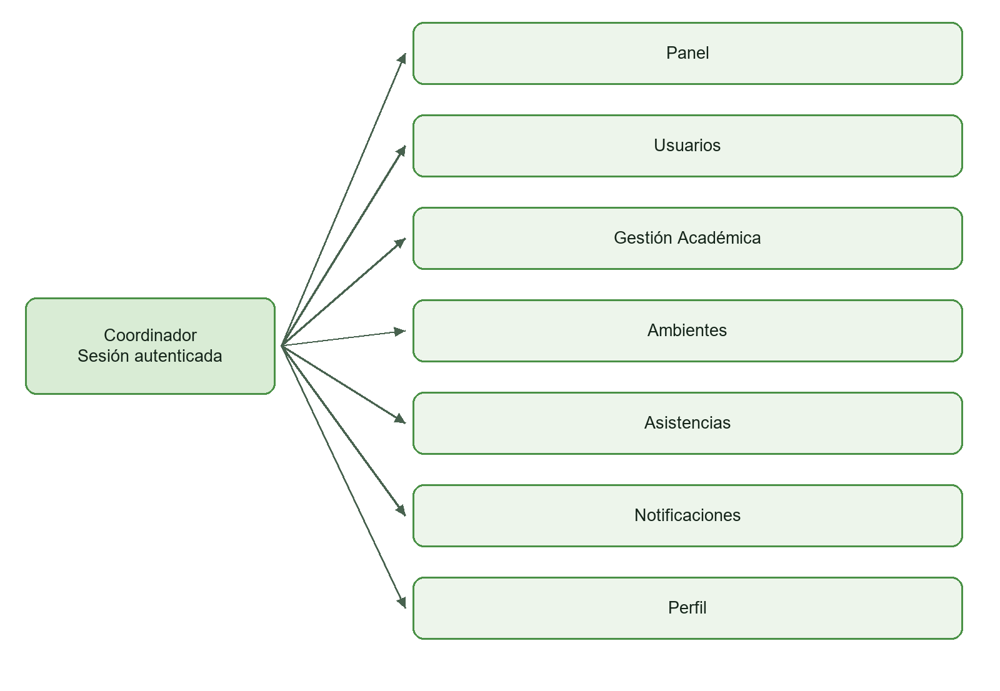

### 3.2 Instructor

El menú del instructor tiene cinco entradas. Mis fichas se abre desde las acciones rápidas del panel. El flujo Facial lleva a configuración, cámara y verificación de salida. El inventario registra también rutas de ambientes, formación y reportes declaradas en el árbol del rol.

| Entrada del menú | Destino | Contenido |
|---|---|---|
| Panel | /instructor | Formación de su alcance e indicadores. |
| Asistencias | /instructor/attendance | Consulta por ficha o aprendiz autorizado. |
| Facial | /instructor/facial | Preparación y continuidad de la sesión. |
| Notificaciones | /notifications | Bandeja del titular. |
| Perfil | /profile | Información personal y preferencias. |

Las rutas de registro de programa y ficha dentro de instructor reutilizan vistas administrativas. La escritura académica está restringida a coordinación por la API. El mapa representa las entradas principales y el inventario explica estos destinos secundarios.

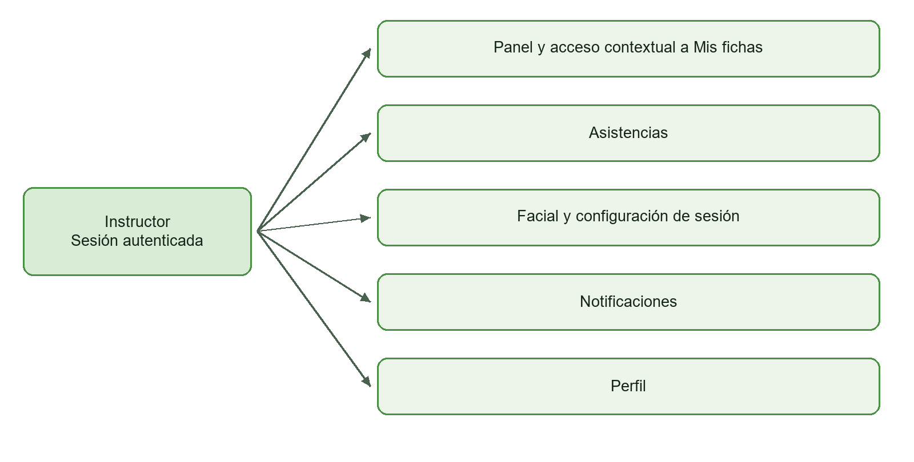

### 3.3 Aprendiz

El aprendiz tiene cinco entradas principales. El panel muestra su formación asignada. Mi Asistencia consulta registros propios por fechas y Reconocimiento Facial organiza el alta o reemplazo autorizado de la referencia.

| Entrada del menú | Destino | Contenido |
|---|---|---|
| Panel | /apprentice | Ficha, programa y accesos del titular. |
| Mi Asistencia | /apprentice/attendance | Filtro de fechas, resumen y registros propios. |
| Reconocimiento Facial | /apprentice/facial | Identidad, aviso, retos y autorización de reemplazo. |
| Notificaciones | /notifications | Avisos y respuesta a solicitudes. |
| Perfil | /profile | Identidad y rol. |

Las rutas join-ficha y transfer-request son entradas heredadas que redirigen a /apprentice/attendance. La gestión de traslados se realiza desde coordinación mediante el flujo académico.

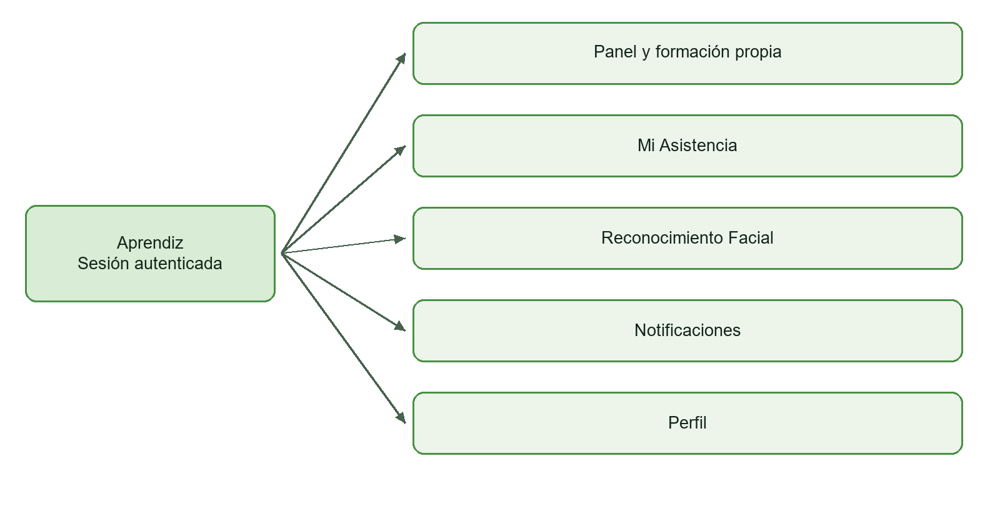

## 4 Inventario completo de rutas

Se identificaron 63 archivos de ruta, excluidos los layouts. El parámetro [id] representa el identificador del registro que se consulta. La columna de presentación distingue menú, acceso público, destinos contextuales, reutilización y redirección.

### 4.1 Acceso público

5 rutas declaradas en este grupo.

| Ruta | Pantalla o finalidad | Presentación |
|---|---|---|
| /auth/login | Inicio de sesión | Acceso público con vista reutilizada |
| /auth/new-password | Nueva contraseña | Acceso público con vista reutilizada |
| /auth/password-recovery | Solicitud de recuperación | Acceso público |
| /auth/verify-identity | Verificación del código | Acceso público |
| / | Presentación de FaceLit | Acceso público |

### 4.2 Comunes

3 rutas declaradas en este grupo.

| Ruta | Pantalla o finalidad | Presentación |
|---|---|---|
| /notifications | Bandeja de notificaciones | Menú |
| /profile | Perfil propio | Menú |
| /profile/settings | Preferencias | Desde perfil o preferencias |

### 4.3 Coordinación

27 rutas declaradas en este grupo.

| Ruta | Pantalla o finalidad | Presentación |
|---|---|---|
| /admin/academic/assignments | Asignaciones académicas | Contextual |
| /admin/academic/csv-upload | Carga CSV | Contextual con vista reutilizada |
| /admin/academic/fichas/[id] | Detalle de ficha y aprendices | Contextual con vista reutilizada |
| /admin/academic/fichas/register | Registro de ficha | Contextual |
| /admin/academic | Programas de formación | Menú con vista reutilizada |
| /admin/academic/instructors | Gestión de instructores | Contextual con vista reutilizada |
| /admin/academic/programs/[id] | Detalle de programa | Contextual |
| /admin/academic/programs/register | Registro de programa | Contextual |
| /admin/attendance/[id] | Detalle de consulta | Contextual |
| /admin/attendance/by-ficha | Consulta por ficha | Contextual con vista reutilizada |
| /admin/attendance/by-user | Consulta individual | Contextual con vista reutilizada |
| /admin/attendance/history | Historial | Contextual |
| /admin/attendance | Entrada de consulta de asistencia | Menú |
| /admin/environments/[id] | Detalle y vínculos del ambiente | Contextual |
| /admin/environments | Catálogo de ambientes | Menú |
| /admin/environments/register | Registro de ambiente | Contextual |
| /admin | Panel de coordinación | Menú |
| /admin/reports/by-ficha | Reporte de ficha | Contextual |
| /admin/reports/by-user | Reporte individual | Contextual |
| /admin/reports/calendar | Calendario de asistencia | Contextual |
| /admin/reports/excuses-review | Revisión de excusas | Contextual |
| /admin/reports | Entrada de reportes | Contextual |
| /admin/reports/my-performance | Indicadores de desempeño | Contextual |
| /admin/transfer-requests | Decisiones de traslado | Contextual |
| /admin/users/[id] | Detalle de usuario | Contextual con vista reutilizada |
| /admin/users/create | Alta administrativa | Contextual |
| /admin/users | Gestión de usuarios | Menú |

### 4.4 Instructor

23 rutas declaradas en este grupo.

| Ruta | Pantalla o finalidad | Presentación |
|---|---|---|
| /instructor/academic/fichas/[id] | Ficha autorizada | Contextual |
| /instructor/academic/fichas/register | Vista de registro reutilizada | Ruta reutilizada con escritura de coordinación |
| /instructor/academic | Mis fichas y formación | Contextual |
| /instructor/academic/programs/[id] | Programa autorizado | Contextual |
| /instructor/academic/programs/register | Vista de registro reutilizada | Ruta reutilizada con escritura de coordinación |
| /instructor/attendance/[id] | Detalle de consulta | Contextual con vista reutilizada |
| /instructor/attendance/by-ficha | Asistencia por ficha | Contextual |
| /instructor/attendance/by-user | Asistencia por aprendiz | Contextual con vista reutilizada |
| /instructor/attendance | Consulta de asistencia | Menú |
| /instructor/environments/[id] | Detalle de ambiente | Contextual |
| /instructor/environments | Consulta de ambientes | Contextual |
| /instructor/environments/register | Registro de ambiente | Contextual |
| /instructor/facial/camera | Cámara de asistencia | Contextual |
| /instructor/facial/exit | Verificación de salida | Contextual |
| /instructor/facial | Sesión facial | Menú con vista reutilizada |
| /instructor/facial/settings | Configuración de sesión | Contextual |
| /instructor | Panel del instructor | Menú |
| /instructor/reports/by-ficha | Reporte de ficha | Contextual |
| /instructor/reports/by-user | Reporte individual | Contextual |
| /instructor/reports/calendar | Calendario de asistencia | Contextual |
| /instructor/reports/excuses-review | Revisión de excusas | Contextual |
| /instructor/reports | Entrada de reportes | Contextual |
| /instructor/reports/my-performance | Indicadores de desempeño | Contextual |

### 4.5 Aprendiz

5 rutas declaradas en este grupo.

| Ruta | Pantalla o finalidad | Presentación |
|---|---|---|
| /apprentice/attendance | Mi Asistencia | Menú |
| /apprentice/facial | Referencia facial propia | Menú con vista reutilizada |
| /apprentice | Panel y formación propia | Menú |
| /apprentice/join-ficha | Redirección heredada | Redirige a Mi Asistencia |
| /apprentice/transfer-request | Redirección heredada | Redirige a Mi Asistencia |

### 4.6 Constantes de navegación y formularios

routes.ts conserva constantes para destinos como /admin/academic/programs/[id]/edit, /admin/academic/fichas/[id]/edit, /admin/facial, /facial/register, /facial/verify y /apprentice/reports. El inventario de esta edición se construye con los archivos de app. Los formularios ProgramFormModal y EnvironmentFormModal ofrecen edición dentro del contexto del listado o detalle.

Al mantener un destino, se cotejan el archivo de ruta, el punto de entrada y el permiso de API. La lista de constantes se revisa junto con los botones que las utilizan para evitar enlaces desactualizados.

## 5 Recorridos funcionales y puntos de control

### 5.1 Entrada y recuperación de acceso

La presentación conduce a login. El formulario solicita documento y contraseña y muestra la respuesta del servidor. El backend revisado también resuelve correo como identificador, diferencia registrada en el SRS. El rol recibido define el panel de destino.

La recuperación sigue solicitud, verificación de código y nueva contraseña. verify-identity consulta la verificación del servidor antes de avanzar. La pantalla debe mostrar vigencia, reenvío, validación del código y resultado de la solicitud sin perder el contexto del titular.

### 5.2 Gestión de cuentas y formación

Coordinación filtra usuarios por rol y estado, consulta un registro y abre las acciones permitidas. Gestión Académica reúne programas, fichas y personas. Los formularios conservan los datos ingresados al validar y muestran el resultado del guardado. La ficha mantiene el contexto de programa y su relación con aprendices e instructores.

### 5.3 Carga CSV y decisiones de traslado

La guía de carga presenta las columnas y los límites de 20 MB y 5.000 filas. La selección del archivo precede al procesamiento y al resumen de resultados. Las categorías distinguen creaciones, actualizaciones, referencias inválidas e inconsistencias. Las propuestas de cambio de ficha requieren una decisión explícita de coordinación.

Después de aplicar cambios, el listado se sincroniza con la API. El ajuste local reúne aprendices mediante peticiones de hasta 80 fichas por lote. El detalle de referencias rechazadas debe permitir identificar la fila y la corrección requerida.

### 5.4 Ambientes y configuración de sesión

Coordinación consulta nombre, capacidad, estado y vínculos del ambiente. El instructor prepara la sesión con ficha, ambiente, dispositivo y responsables autorizados. La configuración incluye entrada, minutos de registro, salida y cierre. La respuesta del servidor establece el contexto que utiliza la cámara.

El catálogo y la apertura de sesión tienen permisos distintos. La tabla del capítulo 6 los relaciona con los tres roles. Al recuperar una sesión activa, la interfaz conserva la identidad del ambiente y la ficha para continuar la tarea.

### 5.5 Registro y reemplazo facial del aprendiz

El aprendiz verifica su identidad, lee el aviso y habilita la cámara. El flujo usa dos retos distintos entre MOVE_UP, MOVE_DOWN, MOVE_CLOSER y MOVE_AWAY, con siete imágenes por reto. Posicionamiento, captura, validación y confirmación se presentan como estados sucesivos.

El reemplazo parte de la solicitud del titular y la decisión de coordinación. La autorización habilita el nuevo registro según el estado del servidor. La respuesta al aprendiz se consulta en su bandeja. El resultado del registro se comunica después de la confirmación.

### 5.6 Cámara de asistencia y salida del instructor

La cámara usa la sesión activa y registra los resultados devueltos por la API. Al intentar abandonar una captura activa, el recorrido conduce a la verificación de salida. Tras completar la verificación o continuar la captura, el usuario conserva un destino reconocible dentro del área del instructor.

### 5.7 Consulta de asistencia y exportación

La consulta comienza con ficha o persona y periodo autorizado. La matriz utiliza fechas y columnas de aprendices, mientras la consulta personal presenta resumen y registros del titular. La leyenda combina estado e indicador visual. El resultado vacío y la falta de fechas elegidas tienen mensajes propios.

La exportación corresponde al filtro y alcance de la vista. En una evidencia de exportación se conserva el archivo descargado junto al periodo utilizado, el conteo y la captura de consulta. El historial y los reportes derivan la asistencia recuperada por la API.

### 5.8 Notificaciones y preferencias

El contador conduce a la bandeja del usuario. Los filtros separan lectura y categorías. Las acciones de decisión aparecen cuando el tipo de aviso y el rol lo permiten. Perfil reúne datos de identidad y preferencias. El cambio de tema o idioma se guarda mediante el servicio de configuración del titular.

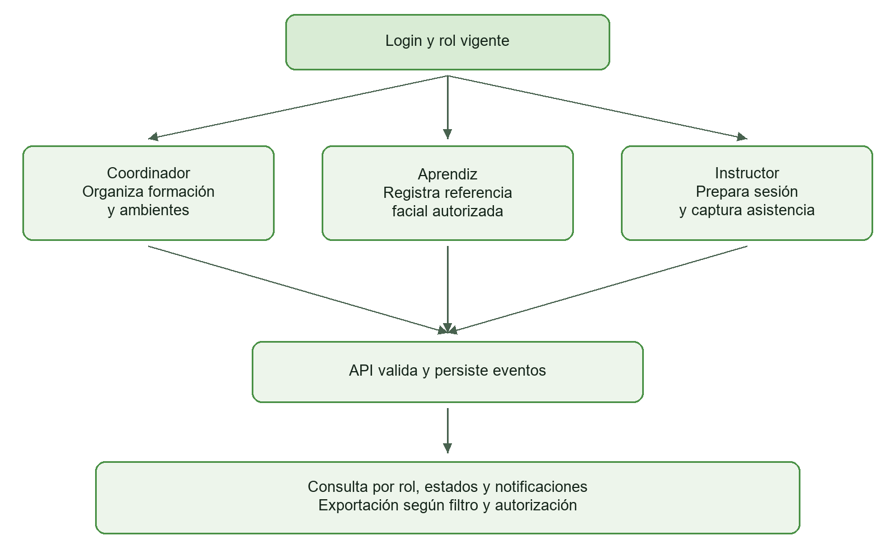

## 6 Permisos que afectan a la presentación

| Operación | Coordinador | Instructor | Aprendiz |
|---|---|---|---|
| Gestión de usuarios y escritura académica | Permitida por contrato. | Consulta autorizada. | Formación propia. |
| Consultar catálogo de ambientes | Permitido. | Permitido según alcance. | Acceso a sus datos de formación. |
| Crear ambiente mediante POST | Permitido. | Permitido por contrato actual. | Sin permiso de catálogo. |
| Editar o desactivar ambiente | Permitido. | Operación de coordinación. | Sin permiso de catálogo. |
| Vincular o retirar ficha de ambiente | Permitido. | Operación de coordinación. | Sin permiso de catálogo. |
| Preparar sesión facial | Operación del instructor. | Permitido con validación del recurso. | Consulta de asistencia propia. |
| Registrar referencia facial propia | Resuelve solicitudes. | Operación del aprendiz. | Permitido al titular autorizado. |
| Leer avisos y preferencias | Propios. | Propios. | Propios. |

La autorización definitiva corresponde a la API y al servicio. Las etiquetas y botones deben reflejar ese alcance. Una sesión válida de coordinación debe abrir Ambientes dentro de su área. Ante errores de autenticación o permiso, el mensaje debe permitir reconocer la situación y recuperar la navegación apropiada.

## 7 Identidad visual

### 7.1 Nombre y símbolo

La identidad de FaceLit combina un rostro estilizado con líneas y elementos de circuito y el nombre del producto. El rostro relaciona la marca con la identificación facial y los circuitos representan su procesamiento tecnológico. El nombre permanece legible como identificador del software en la entrada y los espacios de trabajo.

FaceLit es un proyecto académico del equipo de Análisis y Desarrollo de Software. Los documentos presentan su afiliación al SENA y la ficha 3145555 como contexto formativo. La marca del producto se aplica de manera consistente en los materiales de entrega.

### 7.2 Variantes verificadas

| Variante | Archivo del frontend | Aplicación observada |
|---|---|---|
| Marca verde | assets/images/logo2.png | LandingScreen la selecciona en tema claro. |
| Marca clara | assets/images/logo.png | LandingScreen la selecciona en tema oscuro. |

Las copias de referencia de esta carpeta están en Recursos/logo_tema_claro.png y Recursos/logo_tema_oscuro.png. Conservan los archivos originales del frontend.

### 7.3 Criterios de aplicación

- Conservar la proporción del archivo. LandingScreen utiliza resizeMode contain para ajustar la imagen al contenedor.
- Elegir la variante según la superficie y comprobar la lectura del nombre a tamaño real.
- Mantener espacio alrededor de la imagen para que los controles vecinos tengan una jerarquía clara.
- Usar los tokens de marca para botones, estados y detalles de interfaz.
- Identificar el producto como FaceLit en portada, cabecera y materiales académicos.
- Registrar la autorización correspondiente cuando una pieza se presente como avalada institucionalmente.

### 7.4 Relación con las piezas

| Pieza | Aplicación de identidad |
|---|---|
| Entrada y presentación | Logo, nombre y explicación del propósito del sistema. |
| Cabecera autenticada | Nombre del producto junto al menú y las preferencias globales. |
| Panel de rol | Bienvenida e información académica que sitúan la tarea del usuario. |
| Documento técnico | Título específico, fecha, equipo y contexto de formación. |
| Evidencia de pantalla | Conservación de la interfaz y tratamiento de los datos personales según la finalidad de entrega. |

### 7.5 Fuentes y mantenimiento

Las fuentes de esta edición son los archivos logo.png y logo2.png, LandingScreen.tsx, colors.ts y ThemeContext.tsx. Si cambian la marca o sus variantes, se actualizan las copias de Recursos, el documento conceptual, el Word y su PDF. La guía de componentes detalla la aplicación de la paleta en los dos temas.

## 8 Sistema visual y componentes

### 8.1 Estructura de la página

La pantalla autenticada se organiza con cabecera, navegación por rol y contenido de tarea. La cabecera integra marca, menú, idioma, tema y acceso a notificaciones. El contenido presenta título y contexto, filtros o instrucciones, registros o formulario y acciones. Esta jerarquía facilita reconocer dónde se encuentra el usuario y qué operación está realizando.

Sidebar.tsx define las entradas visibles del menú y distingue el destino activo. RoleTopbar conserva los controles comunes. El panel del instructor añade accesos contextuales a sus fichas. Los formularios de programa y ambiente pueden abrirse dentro de FormModal, además de las rutas de registro existentes.

### 8.2 Paleta de marca y estados

| Token | Valor | Uso |
|---|---|---|
| primary | #65B361 | Marca y acción principal. |
| primaryLight | #72C96D | Variación clara. |
| primaryDark | #4A9146 | Variación oscura. |
| primaryFaint | rgba(101,179,97,0.10) | Fondo de apoyo. |
| secondary | #F59E0B | Acento. |
| secondaryLight | #FFB74D | Variación clara de acento. |
| secondaryDark | #D97706 | Variación oscura de acento. |
| secondaryFaint | rgba(245,158,11,0.08) | Fondo de apoyo al acento. |
| success | #27AE60 | Confirmación y resultado favorable. |
| info | #4A90D9 | Información. |
| warning | #E89B2C | Advertencia. |
| danger y error | #D92027 | Error y acción destructiva. |
| successSoft | rgba(39,174,96,0.15) | Superficie semántica de éxito. |
| infoSoft | rgba(74,144,217,0.12) | Superficie informativa. |
| warningSoft | rgba(232,155,44,0.12) | Superficie de advertencia. |
| dangerSoft | rgba(217,32,39,0.12) | Superficie de error. |

### 8.3 Temas claro y oscuro

| Token | Claro | Oscuro |
|---|---|---|
| background | #F4F1EA | #000000 |
| surface y card | #FBF8F1 | #06100A |
| surfaceSecondary | #EDE7DC | #0A1710 |
| border | #DED7CC | #173522 |
| borderStrong | #CEC4B5 | #285238 |
| inputBg | #F8F5EE | #08130D |
| inputBorder | #CEC4B5 | #1B3B27 |
| text | #0F172A | #FFFFFF |
| textSecondary | #475569 | #B7C5BC |
| textMuted | #64748B | #7F9587 |
| placeholder | #94A3B8 | #587060 |
| link | #D97706 | #F59E0B |

ThemeContext deriva inputText desde text e inputPlaceholder desde placeholder. primaryDarkText usa el valor primary y secondaryDarkText usa secondary en la configuración revisada. gradientColors combina background, surface y surfaceSecondary. La barra de estado usa contenido oscuro en tema claro y contenido claro en tema oscuro.

Las pantallas consumen estos tokens desde el contexto. El significado de éxito, advertencia y error se conserva al cambiar de tema. La revisión de contraste se hace sobre la combinación real de texto, icono, fondo y tamaño.

### 8.4 Escala tipográfica

| Nombre | Tamaño en px | Uso de referencia |
|---|---|---|
| xs | 11 | Metadato breve. |
| sm | 12 | Texto auxiliar. |
| md | 13 | Descripción compacta. |
| base | 14 | Texto ordinario. |
| lg | 16 | Texto destacado. |
| xl | 18 | Subtítulo. |
| 2xl | 22 | Encabezado de sección. |
| 3xl | 26 | Título de pantalla. |
| 4xl | 32 | Encabezado principal. |
| 5xl | 38 | Presentación destacada. |

FontWeight define regular 400, medium 500, semibold 600, bold 700, extrabold 800 y black 900. Los usos de referencia organizan la lectura y se ajustan al componente y al ancho disponible.

### 8.5 Catálogo de componentes compartidos

| Componente | Responsabilidad | Estados que se revisan |
|---|---|---|
| Sidebar y RoleTopbar | Navegación, identidad de rol y controles comunes. | Abierto, cerrado y destino activo. |
| AppButton | Acción principal con gradiente y variantes outline y ghost. | Normal, presionado y deshabilitado. |
| InputField y PasswordField | Captura de datos y manejo de visibilidad de contraseña. | Vacío, valor, foco y error. |
| SelectField y SearchableSelect | Selección y búsqueda de opciones. | Cerrado, abierto, elegido y búsqueda sin coincidencias. |
| DateField y TimeInput | Selección de periodo y tiempos de sesión. | Sin selección, valor y validación. |
| FormModal | Formulario superpuesto con cierre y contenido desplazable. | Abierto, edición y confirmación. |
| AppDialog | Confirmación o comunicación de un resultado. | Confirmar, cancelar y cierre. |
| RemoteDataState | Carga, fallo y acción de reintento de datos remotos. | Procesando y error recuperable. |
| ThemeToggle y LanguageSelector | Preferencias comunes. | Tema y lenguaje elegidos. |

Los formularios específicos de programa, ambiente e instructor comparten estructura y conservan las reglas de cada entidad. Un modal de edición y una ruta de registro pueden servir al mismo caso de uso. La especificación de navegación identifica ambos puntos de entrada cuando existen.

### 8.6 Estados de interfaz y mensajes

| Estado | Presentación | Acción esperada |
|---|---|---|
| Carga | Indicador y texto de procesamiento. | Esperar y preservar el contexto. |
| Falta de selección | Instrucción junto al selector de programa o fechas. | Completar el filtro inicial. |
| Lista vacía | Explicación asociada al filtro activo. | Cambiar filtro o registrar según permiso. |
| Validación | Mensaje junto al campo y valor conservado. | Corregir el dato indicado. |
| Error remoto | Mensaje comprensible y reintento cuando corresponde. | Repetir la consulta. |
| Guardado confirmado | Resultado devuelto por el servidor y vista actualizada. | Consultar el registro. |
| Confirmación destructiva | Identidad del registro y consecuencias de la acción. | Confirmar o cancelar. |
| Captura facial | Instrucción del reto, estado de captura y validación. | Completar el reto y esperar confirmación. |
| Acceso rechazado | Estado de sesión o permiso explicado en el contexto correcto. | Autenticar o volver al área del rol. |

RemoteDataState utiliza una región accesible de actualización, estado de alerta para errores y un botón de reintento. La prueba de cada pantalla debe registrar cómo presenta esos estados y cómo recupera la tarea.

### 8.7 Adaptación de ancho y accesibilidad

Las tarjetas y formularios deben conservar su lectura al reducir el ancho. FormModal limita su altura y habilita desplazamiento. Las matrices de asistencia desplazan sus columnas horizontalmente. La cabecera y el menú deben seguir disponibles según el contexto del rol y de la sesión facial.

La revisión con teclado comprueba orden de foco, apertura y cierre de diálogos y retorno al control que los invocó. Los controles requieren una etiqueta reconocible. En tablas de asistencia, la leyenda, el texto o icono y el color comunican el estado conjuntamente. Las comprobaciones de contraste se hacen en ambos temas y con el tamaño de fuente aplicado.

Los valores de separación y ancho se definen en los estilos de cada componente. El criterio documental es conservar alineación, legibilidad y espacio de interacción en el tamaño real de uso. Las medidas se verifican en la pantalla correspondiente.

### 8.8 Idioma y persistencia

El cliente ofrece español, inglés, alemán y francés. useUserSettings mapea ES, EN, DE y FR. El enum Language del backend contiene esos valores y PR como compatibilidad. Las preferencias se guardan para el titular mediante la API. Al revisar traducciones se comprueban títulos, acciones, mensajes, fechas y textos largos dentro de botones y tablas.

### 8.9 Revisión de entrega

- Comprobar los dos temas y las cuatro opciones de idioma en las pantallas representativas.
- Abrir y cerrar el menú, navegar por los cinco accesos del instructor y el aprendiz y por los siete de coordinación.
- Revisar formularios vacíos, datos inválidos, confirmación y respuesta de guardado.
- Revisar consulta sin filtros, consulta con datos y consulta sin coincidencias.
- Registrar el estado de la cámara y la respuesta del servidor con la versión del flujo.
- Cotejar exportación y filtro utilizando el archivo descargado.
- Revisar teclado, etiquetas, contraste y desplazamiento con resultados por pantalla.

Las capturas de la carpeta 07 sustentan los estados descritos en su catálogo. Las pruebas de accesibilidad y comprensión se registran con sus propios resultados.

## 9 Especificaciones de pantalla por familia

| Familia | Contenido principal | Validación o resultado que debe comunicar |
|---|---|---|
| Acceso | Identificador, contraseña, recuperación y aviso de cuenta. | Campos requeridos, rechazo de credenciales y destino del rol. |
| Recuperación | Identidad, código, vigencia, reenvío y contraseña nueva. | Verificación del código y confirmación del cambio. |
| Usuarios | Búsqueda, filtros, rol, estado, detalle y alta. | Coincidencias, validación de identidad y resultado administrativo. |
| Programas y fichas | Código, nombre, programa asociado y relaciones. | Unicidad, referencia válida y ciclo de estado. |
| Instructores y asignaciones | Identidad, tipo y formación asociada. | Relaciones válidas y alcance del usuario que modifica. |
| Carga CSV | Archivo, guía, límites y resumen por categoría. | Filas aceptadas o rechazadas y decisiones de traslado. |
| Ambientes | Nombre, capacidad, estado y fichas vinculadas. | Valores válidos y confirmación según permiso de operación. |
| Sesión facial | Ambiente, ficha, dispositivo, responsables y tiempos. | Configuración aceptada y sesión recuperable. |
| Registro facial | Identidad, aviso, permiso de cámara y retos. | Captura, validación, error y confirmación. |
| Asistencia | Sujeto o ficha, fechas, estados y leyenda. | Filtro requerido, datos consultados y detalle. |
| Reportes | Tipo de vista, periodo, métricas y exportación. | Coherencia entre vista y archivo generado. |
| Notificaciones | Destinatario, categoría, lectura y acción. | Lectura o decisión confirmada. |
| Perfil y preferencias | Datos propios, idioma, tema y opciones informativas. | Valor aplicado y guardado para el titular. |

### 9.1 Adaptación al dispositivo

Se revisan cabecera, formularios y listados en anchos amplios y estrechos. Los filtros deben mantenerse legibles y las tablas conservar su contexto durante el desplazamiento. Los modales requieren cierre accesible y contenido desplazable. En móvil, el flujo facial debe conservar una salida reconocible hacia las opciones del instructor según las reglas de la sesión.

### 9.2 Revisión de accesibilidad y mensajes

Cada tarea se revisa mediante teclado, etiquetas de control y lectura de mensajes. Los errores indican el campo o la consulta afectada y la acción de recuperación. La prueba de contraste utiliza el tema, tamaño y estado reales. La evidencia debe incluir el resultado de la tarea y las condiciones de revisión.

## 10 Capturas de referencia por rol

El catálogo recibido contiene 17 archivos originales y 16 capturas únicas. Las dos imágenes del instructor tienen el mismo hash. Las copias de entrega de la carpeta 07 cubren datos personales y el rostro cuando corresponde. Las imágenes ilustran el estado visible y mantienen el alcance explicado en sus leyendas.

### 10.1 Coordinación

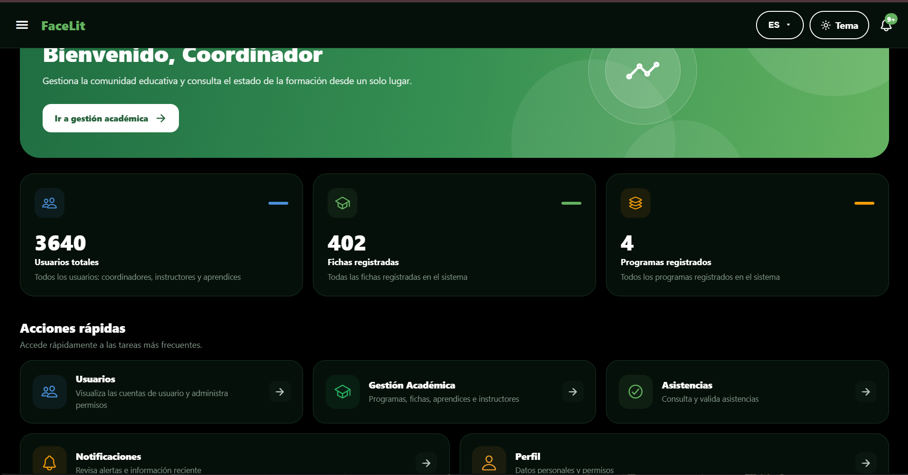

Muestra 3.640 usuarios, 402 fichas y 4 programas, además de accesos rápidos. Los totales corresponden al momento de la captura.

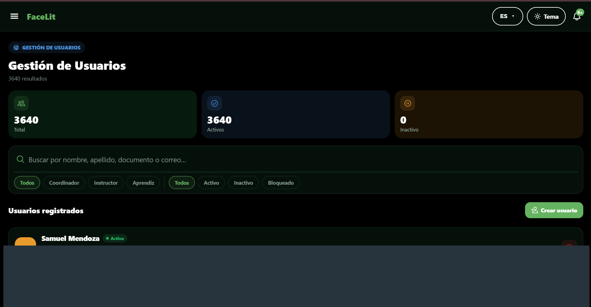

La lista devuelve 3.640 resultados. Se ven los filtros por rol y estado, el buscador y el botón Crear usuario. La captura acredita la consulta del listado.

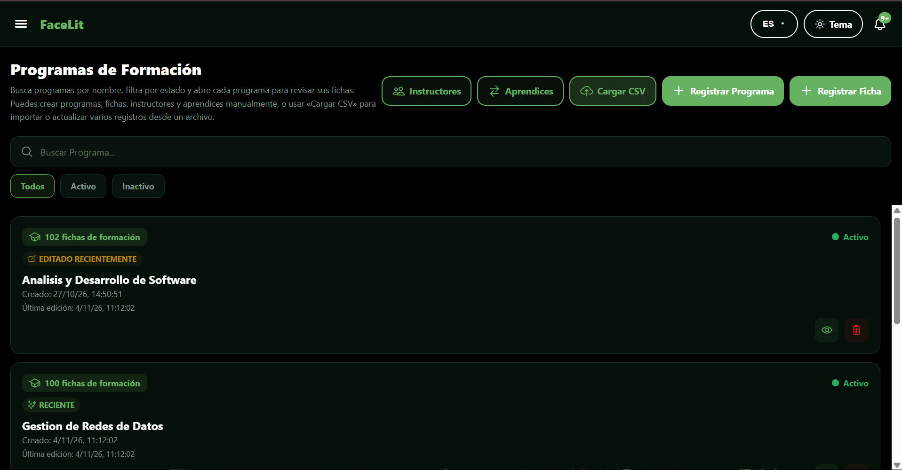

La vista muestra programas activos y sus conteos de fichas, con accesos a instructores, aprendices, CSV y formularios de registro. Se observa que el listado académico carga datos.

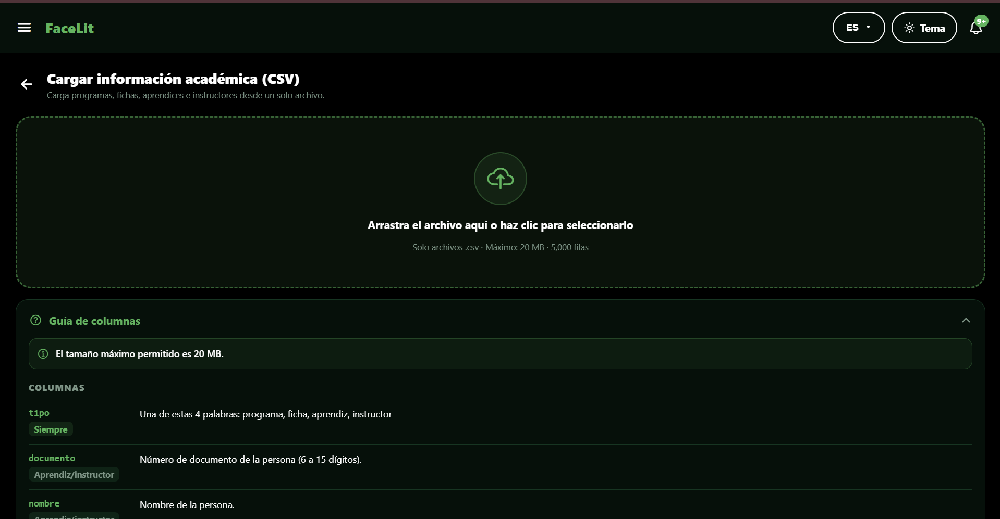

La pantalla permite arrastrar o seleccionar un archivo. Muestra el límite de 20 MB y 5.000 filas, además de la guía de columnas. La evidencia corresponde al formulario antes de seleccionar el archivo.

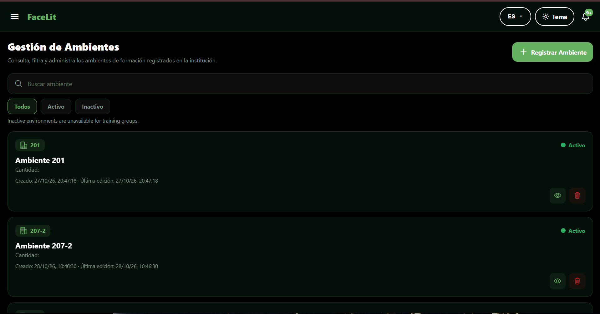

El coordinador abre la vista y consulta ambientes activos. Se ven búsqueda, filtros y el botón Registrar Ambiente. Esta captura documenta el acceso a la pantalla sin redirección al inicio de sesión.

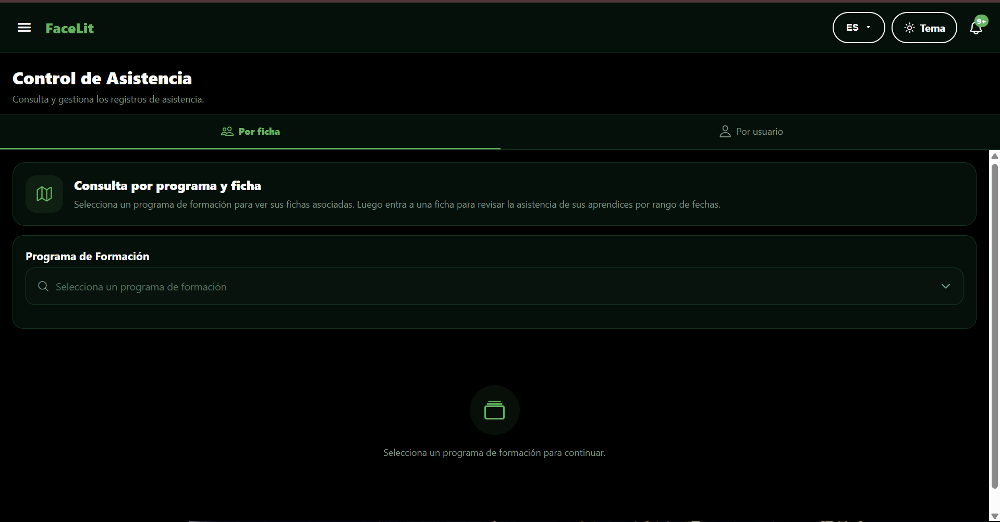

La pestaña Por ficha está abierta y pide elegir un programa de formación. Es el estado inicial de la consulta, previo a obtener una matriz.

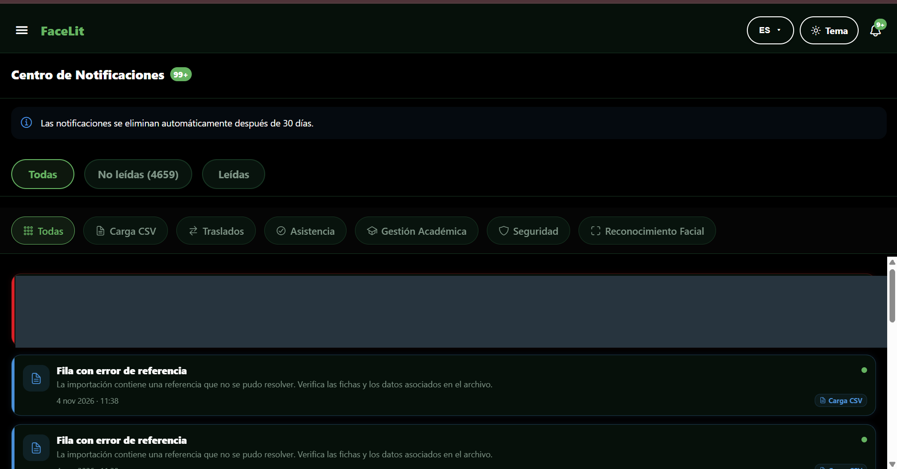

Se muestran filtros por estado y categoría. Las alertas «Fila con error de referencia» corresponden a la validación de una importación y evidencian el aviso de rechazo de filas con referencias sin resolver.

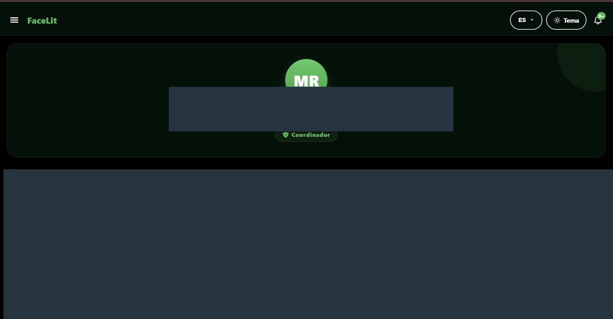

La insignia identifica el rol Coordinador y la vista muestra la sección de información personal. La imagen corresponde a una consulta del perfil.

### 10.2 Instructor

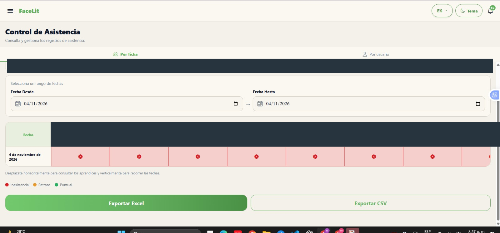

Con el rango del 4 de noviembre de 2026, la vista presenta una fila por fecha y columnas de aprendices. Las celdas rojas visibles corresponden a inasistencia según la leyenda. Se muestran los controles Exportar Excel y Exportar CSV. Para acreditar una exportación se requiere el archivo descargado.

### 10.3 Aprendiz

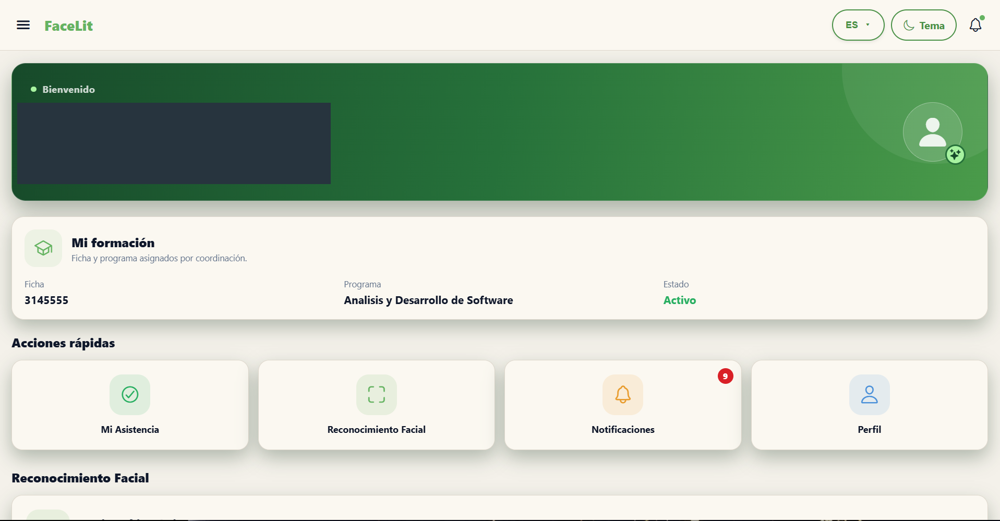

La pantalla identifica el rol Aprendiz y muestra una ficha activa del programa Análisis y Desarrollo de Software. Incluye accesos a asistencia, reconocimiento facial, notificaciones y perfil.

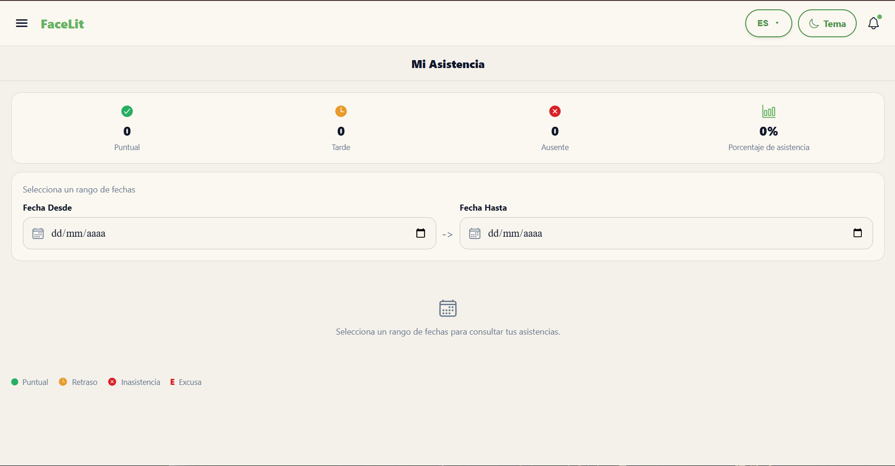

Los campos de fecha están vacíos. Los contadores en cero corresponden al estado inicial de la vista y aún se debe seleccionar un rango.

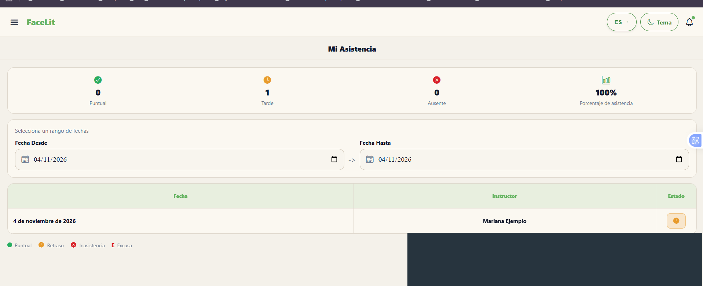

Al seleccionar el 4 de noviembre de 2026 aparece un registro con estado de retraso. El resumen muestra 0 puntuales, 1 tarde, 0 ausentes y 100 % de asistencia para ese rango.

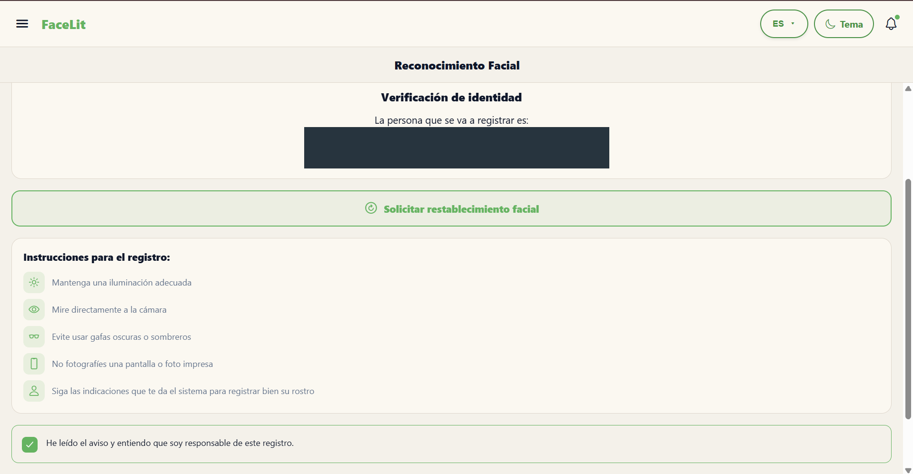

La vista muestra la verificación de identidad, la opción de solicitar restablecimiento facial, las instrucciones y la casilla del aviso marcada. Corresponde a la preparación del registro.

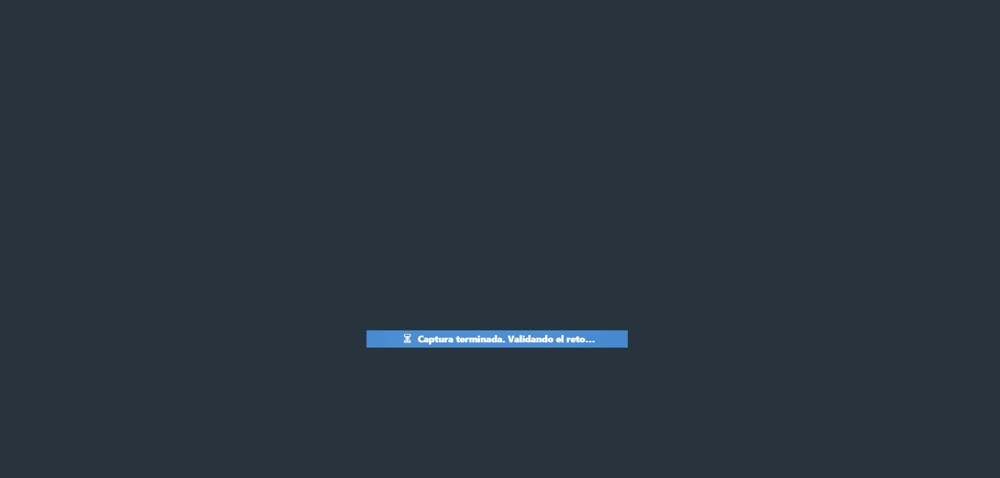

Se ve el mensaje «Captura terminada. Validando el reto…». La interfaz pasó a la validación. El resultado del reto queda fuera de esta imagen. El área de cámara se cubrió para proteger el rostro.

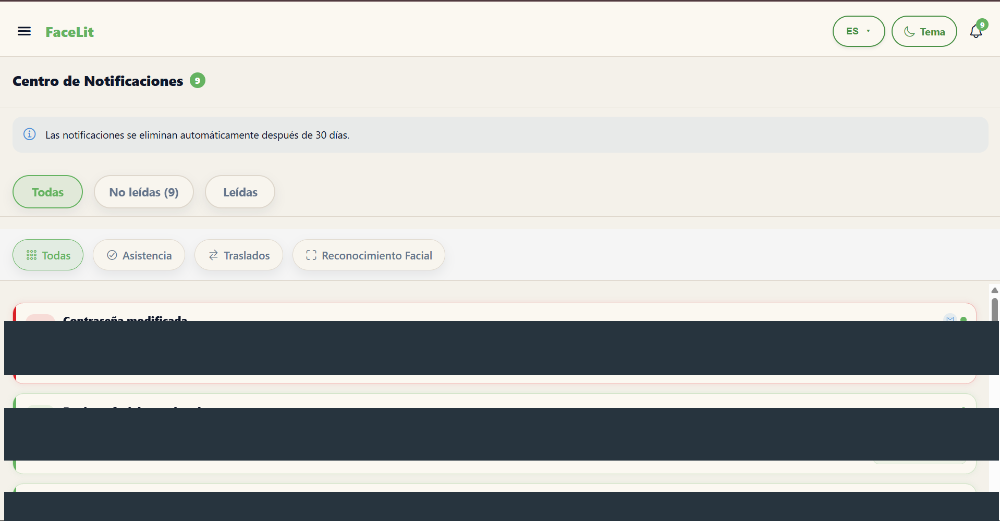

El original muestra avisos de seguridad y de reconocimiento facial, incluido «Registro facial completado» y una respuesta a la solicitud facial. Ese aviso es el resultado reportado por la interfaz. La copia de entrega cubre las zonas con información personal.

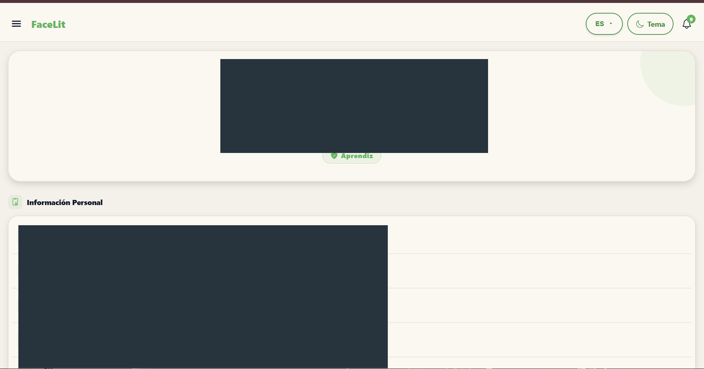

La vista muestra la insignia Aprendiz y la sección Información Personal. Se cubrieron los datos de identificación en la copia de entrega.

## 11 Trazabilidad documental

| Área de diseño | Requisitos del SRS | Evidencia o fuente |
|---|---|---|
| Acceso y roles | RF-1.1 a RF-1.4 | AuthContext, useRoleGuard, layouts y SecurityConfig. |
| Gestión académica | RF-2.1 a RF-2.3 | COO-03, COO-04 y servicios académicos. |
| Usuarios y perfil | RF-3.1 a RF-4.2 | COO-02, COO-08 y APR-07. |
| Referencia facial y solicitud | RF-5.1 y RF-5.4 | APR-04 a APR-06 y servicios faciales. |
| Ambientes y sesiones | RF-5.2, RF-6.1, RF-6.2 y RF-C2 | COO-05, EnvironmentController y flujo del instructor. |
| Asistencia y reportes | RF-7.1 a RF-7.3 y RF-9.1 | INS-01, APR-02 y APR-03. |
| Avisos y preferencias | RF-8.1 a RF-8.4, RF-C3 y RF-C4 | COO-07, APR-06 y servicios de configuración. |

El SRS V4.1 conserva la observación por requisito y sus condiciones de aceptación. El catálogo de la carpeta 07 explica la evidencia de cada imagen. El manual de instalación y la carpeta 17 reúnen configuración, versiones y despliegue.

## 12 Organización y mantenimiento de la carpeta

El Markdown conceptual es la fuente de la edición Word y PDF. Los documentos de identidad y sistema visual organizan el detalle especializado y su contenido se incorpora a esta edición completa. Recursos contiene los cuatro mapas y las dos copias de logotipo utilizadas. README identifica el orden de lectura y los archivos de entrega.

Al cambiar una ruta se revisan archivo, punto de entrada, menú y permiso. Al cambiar un componente se actualizan tokens, estados y las capturas que lo muestran. Las redirecciones heredadas y las vistas reutilizadas conservan esa clasificación en el inventario. Los cambios de alcance se contrastan con el SRS y con el contrato de API.

Esta revisión incluye la navegación comprobada en Sidebar, las 63 rutas de app, la guía de componentes, los dos temas, cuatro idiomas y las 16 capturas únicas entregadas. Las pruebas de comprensión, contraste, teclado, rendimiento y exportación se registran mediante sus resultados específicos.
