# Identidad visual de FaceLit

Revisión integral del 5 de noviembre de 2026. Se contrastaron los recursos de marca con LandingScreen.tsx y los dos temas del frontend main 6efd92c.

## Nombre y símbolo

La identidad de FaceLit combina un rostro estilizado con líneas y elementos de circuito y el nombre del producto. El rostro relaciona la marca con la identificación facial y los circuitos representan su procesamiento tecnológico. El nombre permanece legible como identificador del software en la entrada y los espacios de trabajo.

FaceLit es un proyecto académico del equipo de Análisis y Desarrollo de Software. Los documentos presentan su afiliación al SENA y la ficha 3145555 como contexto formativo. La marca del producto se aplica de manera consistente en los materiales de entrega.

## Variantes verificadas

| Variante | Archivo del frontend | Aplicación observada |
|---|---|---|
| Marca verde | assets/images/logo2.png | LandingScreen la selecciona en tema claro. |
| Marca clara | assets/images/logo.png | LandingScreen la selecciona en tema oscuro. |

Las copias de referencia de esta carpeta están en Recursos/logo_tema_claro.png y Recursos/logo_tema_oscuro.png. Conservan los archivos originales del frontend.

## Criterios de aplicación

- Conservar la proporción del archivo. LandingScreen utiliza resizeMode contain para ajustar la imagen al contenedor.
- Elegir la variante según la superficie y comprobar la lectura del nombre a tamaño real.
- Mantener espacio alrededor de la imagen para que los controles vecinos tengan una jerarquía clara.
- Usar los tokens de marca para botones, estados y detalles de interfaz.
- Identificar el producto como FaceLit en portada, cabecera y materiales académicos.
- Registrar la autorización correspondiente cuando una pieza se presente como avalada institucionalmente.

## Relación con las piezas

| Pieza | Aplicación de identidad |
|---|---|
| Entrada y presentación | Logo, nombre y explicación del propósito del sistema. |
| Cabecera autenticada | Nombre del producto junto al menú y las preferencias globales. |
| Panel de rol | Bienvenida e información académica que sitúan la tarea del usuario. |
| Documento técnico | Título específico, fecha, equipo y contexto de formación. |
| Evidencia de pantalla | Conservación de la interfaz y tratamiento de los datos personales según la finalidad de entrega. |

## Fuentes y mantenimiento

Las fuentes de esta edición son los archivos logo.png y logo2.png, LandingScreen.tsx, colors.ts y ThemeContext.tsx. Si cambian la marca o sus variantes, se actualizan las copias de Recursos, el documento conceptual, el Word y su PDF. La guía de componentes detalla la aplicación de la paleta en los dos temas.
