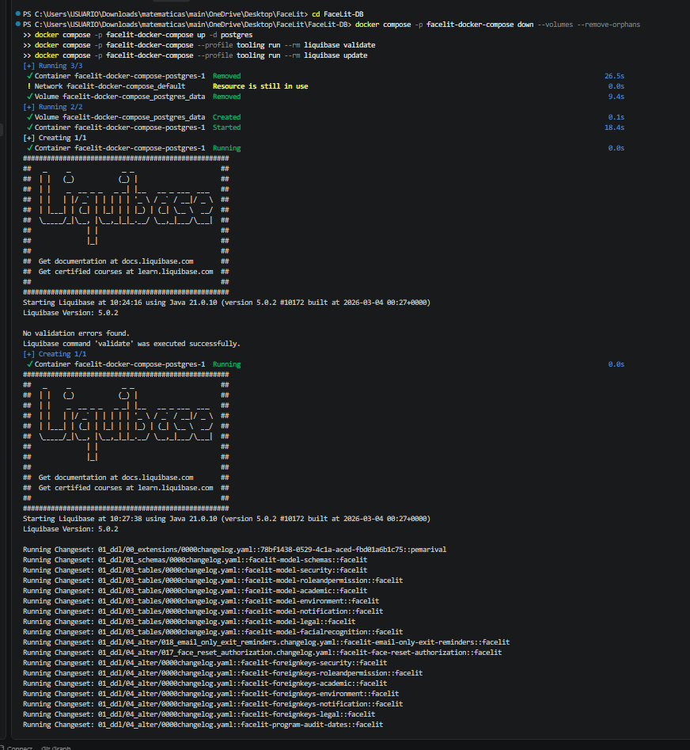
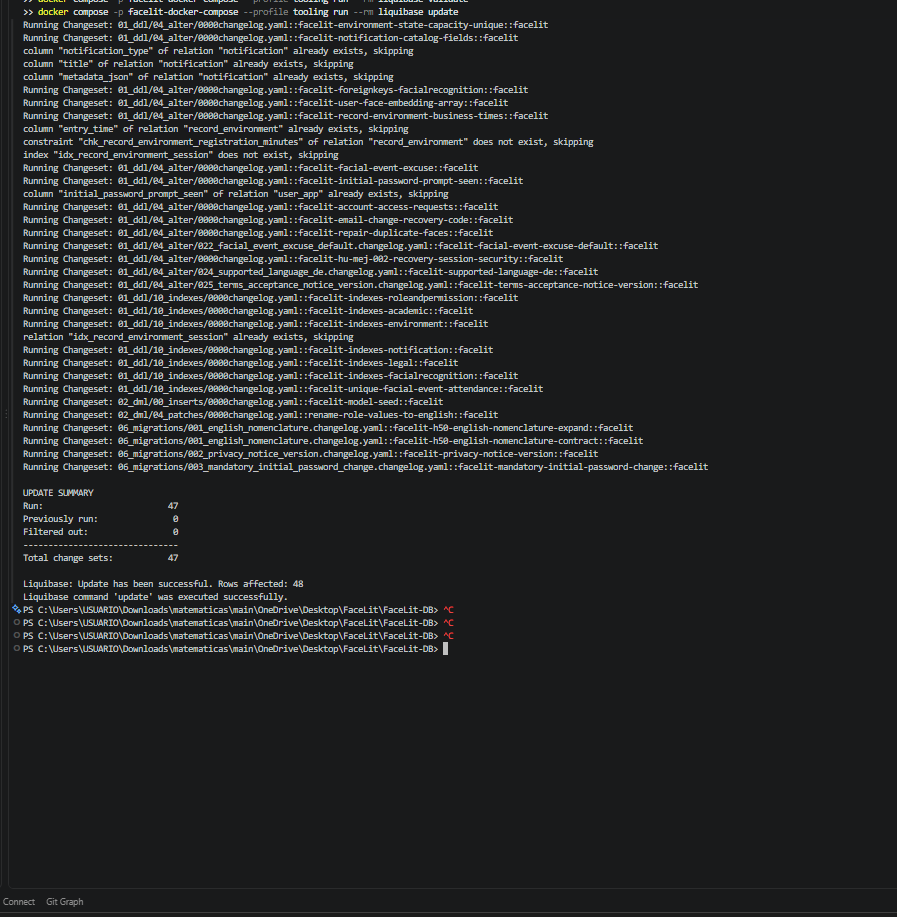
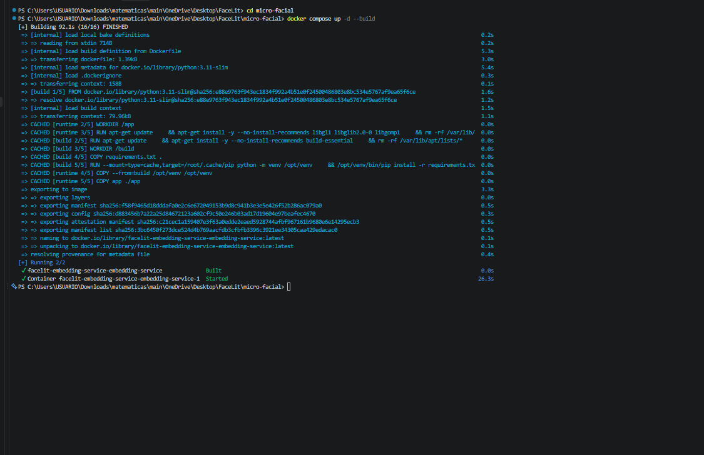
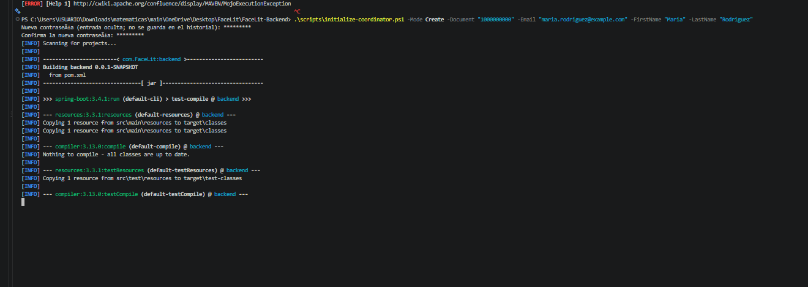
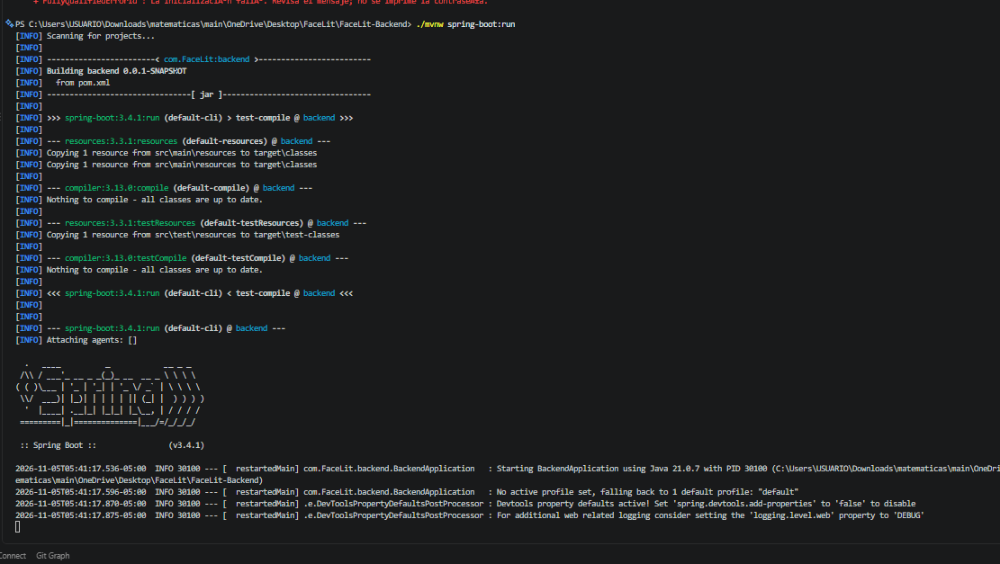
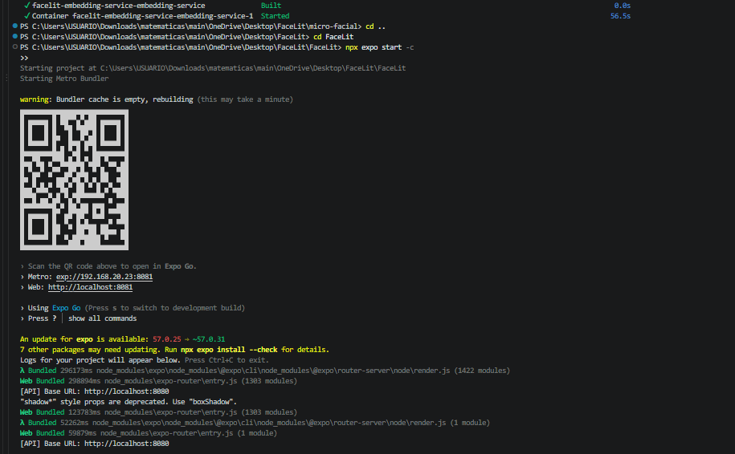

# FaceLit: registro de ejecución de la instalación local

**Responsable de la evidencia:** María José.  
**Fecha de organización del registro:** 5 de noviembre de 2026.  
**Entorno:** Windows, PowerShell y Docker Desktop; instalación local de desarrollo.  
**Carpeta de trabajo:** `C:\Users\USUARIO\Downloads\matematicas\main\OneDrive\Desktop\FaceLit`.

## 1. Propósito y alcance

Este documento organiza las respuestas visibles en las seis capturas suministradas por María José al ejecutar las cuatro capas de FaceLit. Se contrastó la configuración con el manual de instalación adjunto, actualizado el 4 de noviembre de 2026, y con los archivos locales Compose, `.env.example` y `application.yaml`.

Los bloques de salida son extractos de las capturas, no registros completos. Las plantillas de variables de la sección 3 explican la configuración necesaria; **las capturas no muestran los archivos `.env`, por lo que no se afirma que esos fueran sus valores efectivos**. No se repitió la instalación para elaborar este registro. Las capturas no incluyen el commit de cada repositorio: la versión exacta ejecutada queda sin acreditar mediante estas imágenes.

## 2. Resumen de los resultados observados

| Capa / repositorio | Resultado visible | Alcance de la evidencia |
| --- | --- | --- |
| Base de datos / `FaceLit-DB` | PostgreSQL iniciado, validación correcta y 47 cambios ejecutados | Migraciones aplicadas correctamente según Liquibase |
| Servicio facial / `micro-facial` | Imagen construida y contenedor iniciado | No se muestra todavía `/health` ni una operación facial real |
| Backend / `FaceLit-Backend` | Intento de inicialización de coordinadora con error; después comienza Spring Boot | No se muestra creación exitosa de coordinadora ni finalización del arranque de la API |
| Frontend / `FaceLit` | Expo/Metro iniciado, compilación web y URL API local en consola | No se muestra inicio de sesión ni un flujo funcional completo |

**Conclusión:** existe evidencia de ejecución de las cuatro capas y éxito de las migraciones. Estas capturas, por sí solas, aún no acreditan una prueba integral satisfactoria de instalación y funcionamiento.

## 3. Variables de entorno por capa

Estas son **plantillas para documentar el entorno local**, no una copia de los secretos usados. Los valores entre `<...>` deben obtenerse y configurarse de forma privada; no funcionan literalmente. Conservar los `.env` existentes y no subirlos a GitHub. En la entrega se incluye esta explicación de variables, no los archivos con credenciales reales.

### 3.1. `FaceLit-DB/.env`

```dotenv
POSTGRES_DB=facelit-db
POSTGRES_USER=facelit_user
POSTGRES_PASSWORD=<CONTRASENA_PRIVADA_DE_POSTGRES>
POSTGRES_PORT=5439
```

El puerto `5439` pertenece al equipo Windows; dentro de Docker, PostgreSQL escucha en `5432`. Si la instancia local se creó con otros nombres de base o usuario, usar esos mismos nombres en las demás capas. Cambiar el `.env` de un contenedor con datos existentes no demuestra que se haya cambiado la contraseña almacenada en PostgreSQL.

### 3.2. `micro-facial/.env`

```dotenv
APP_NAME=FaceLit Embedding Service
ENVIRONMENT=local
SERVICE_PORT=8090
API_KEY=<CLAVE_PRIVADA_COMPARTIDA_CON_BACKEND>
DATABASE_URL=postgresql+asyncpg://facelit_user:<CONTRASENA_CODIFICADA_PARA_URI>@postgres:5432/facelit-db
CORS_ORIGINS=http://localhost:8081,http://localhost:19006,http://localhost:3000
MIN_EMBEDDING_DIMENSION=32
MAX_EMBEDDING_DIMENSION=4096
INSIGHTFACE_MODEL_NAME=buffalo_l
INSIGHTFACE_DET_SIZE=640
INSIGHTFACE_CTX_ID=-1
INFERENCE_CACHE_SIZE=64
INFERENCE_CACHE_TTL_SECONDS=60
```

En esta ejecución se usó Docker: el host correcto de base en `DATABASE_URL` es `postgres`, en el puerto `5432`, sobre la red externa `facelit-docker-compose_default`. La plantilla del repositorio usa `localhost:5439` para ejecución nativa fuera del contenedor; no debe confundirse con el destino dentro de Docker. Codificar los caracteres especiales de la contraseña para una URI. `API_KEY` debe coincidir con `FACIAL_EMBEDDING_API_KEY` del backend.

`SERVICE_PORT` define el puerto publicado por Compose. El propio Compose establece `PRELOAD_MODEL: "true"` y conserva los modelos en un volumen. Los orígenes CORS anteriores proceden de la plantilla local; deben ajustarse a los clientes realmente autorizados. El flujo principal pasa por el backend.

### 3.3. `FaceLit-Backend/.env`

```dotenv
DB_URL=jdbc:postgresql://localhost:5439/facelit-db
DB_USERNAME=facelit_user
DB_PASSWORD=<MISMA_CONTRASENA_PRIVADA_DE_POSTGRES>
JWT_SECRET=<SECRETO_JWT_PRIVADO_SEGURO>
FACIAL_EMBEDDING_URL=http://localhost:8090
FACIAL_EMBEDDING_API_KEY=<MISMA_CLAVE_API_KEY_DEL_SERVICIO_FACIAL>
FACELIT_ACCESS_URL=http://localhost:8081
FACELIT_ALLOWED_ORIGINS=http://localhost:8081,http://localhost:19006
MAIL_USERNAME=<CUENTA_DE_CORREO_DEL_SERVICIO>
MAIL_PASSWORD=<CONTRASENA_DE_APLICACION_PRIVADA>
FACELIT_COORDINATOR_BOOTSTRAP=false
FACELIT_COORDINATOR_ROTATE_PASSWORD=false
FACELIT_COORDINATOR_EXIT_AFTER=false
```

El backend de esta prueba se ejecuta desde Windows, por eso usa `localhost:5439` para PostgreSQL y `localhost:8090` para el servicio facial. Spring carga el `.env` mediante la dependencia del proyecto. Mantener el bootstrap desactivado durante el arranque habitual.

El inicializador de coordinadora recibe documento, correo, nombre y apellido como parámetros y solicita la contraseña con entrada oculta. La configuración también contempla `FACELIT_COORDINATOR_DOCUMENT`, `FACELIT_COORDINATOR_EMAIL`, `FACELIT_COORDINATOR_FIRST_NAME`, `FACELIT_COORDINATOR_LAST_NAME` y `FACELIT_COORDINATOR_PASSWORD` para ese proceso; no se publican sus valores ni es necesario dejarlos activos para un inicio normal.

Configurar correo no prueba que Gmail acepte la autenticación ni que se haya entregado un mensaje. Estas capturas tampoco acreditan la revocación o rotación de credenciales anteriores.

### 3.4. `FaceLit/.env`

```dotenv
EXPO_PUBLIC_API_URL=http://localhost:8080
```

Esta dirección coincide con la salida visible del frontend. Es apropiada para el navegador del mismo computador. Si se usa un teléfono físico con Expo Go, `localhost` apunta al teléfono: se requiere una dirección LAN alcanzable del computador y los orígenes correspondientes en el backend. No incluir contraseñas, JWT ni claves privadas en variables `EXPO_PUBLIC_*`, porque se incorporan al cliente.

### 3.5. Correspondencias que deben conservarse

| Origen | Debe coincidir con |
| --- | --- |
| Base, usuario y contraseña de PostgreSQL | `DB_*` del backend y credenciales de `DATABASE_URL` facial |
| `API_KEY` facial | `FACIAL_EMBEDDING_API_KEY` del backend |
| Puerto publicado facial, normalmente `8090` | `FACIAL_EMBEDDING_URL` desde Windows |
| API backend, normalmente `8080` | `EXPO_PUBLIC_API_URL` |
| Origen real del navegador, aquí `http://localhost:8081` | `FACELIT_ALLOWED_ORIGINS` |

## 4. Base de datos: comandos y respuestas

**Carpeta:** `FaceLit-DB`.

### Comandos observados

El siguiente reinicio **ya fue ejecutado según la captura**. Se transcribe como antecedente: `--volumes` elimina los volúmenes gestionados por ese Compose y puede borrar datos. No es una instrucción para repetirlo ni un requisito de cada arranque.

```powershell
docker compose -p facelit-docker-compose down --volumes --remove-orphans
```

Después se ejecutaron:

```powershell
docker compose -p facelit-docker-compose up -d postgres
docker compose -p facelit-docker-compose --profile tooling run --rm liquibase validate
docker compose -p facelit-docker-compose --profile tooling run --rm liquibase update
```

### Respuestas visibles

```text
Container facelit-docker-compose-postgres-1  Removed
Network facelit-docker-compose_default  Resource is still in use
Volume facelit-docker-compose_postgres_data  Removed
Volume facelit-docker-compose_postgres_data  Created
Container facelit-docker-compose-postgres-1  Started
Liquibase Version: 5.0.2
No validation errors found.
Liquibase command 'validate' was executed successfully.
```

```text
UPDATE SUMMARY
Run:                 47
Previously run:       0
Filtered out:         0
Total change sets:   47

Liquibase: Update has been successful. Rows affected: 48
Liquibase command 'update' was executed successfully.
```

**Interpretación:** Liquibase validó el changelog y aplicó 47 cambios sin fallar en la salida final. Las 48 filas afectadas son una cifra distinta del número de cambios. Durante la actualización aparecen avisos `already exists, skipping` y `does not exist, skipping`; el resumen final confirma que no impidieron completar la actualización. La red no se eliminó porque seguía en uso; el proceso posterior continuó.

La captura no muestra las comprobaciones `status` y `update-sql` recomendadas en el manual, ni una consulta independiente de pgvector. No se registran como realizadas.





## 5. Servicio facial: comandos y respuestas

**Carpeta:** `micro-facial`.

```powershell
docker compose up -d --build
```

### Respuesta visible

```text
Building ... (16/16) FINISHED
facelit-embedding-service-embedding-service  Built
Container facelit-embedding-service-embedding-service-1  Started
```

**Interpretación:** Docker terminó la construcción de la imagen, basada en Python 3.11-slim, e inició el contenedor. Se reutilizaron varias capas de caché, por lo que esta imagen no acredita una construcción totalmente sin caché ni la descarga inicial del modelo.

`Started` es el resultado de Docker al iniciar el contenedor; no confirma por sí solo que FastAPI terminó de cargar el modelo, que `/health` respondió correctamente o que funcionó el reconocimiento facial. Esas respuestas no aparecen en las imágenes recibidas.



## 6. Backend: comandos, intento de coordinadora y arranque

**Carpeta:** `FaceLit-Backend`.

### Inicialización de coordinadora

La captura muestra el siguiente tipo de comando. Sus datos de identificación se representan mediante marcadores en esta transcripción:

```powershell
.\scripts\initialize-coordinator.ps1 -Mode Create -Document "<DOCUMENTO_DE_PRUEBA>" -Email "<CORREO_DE_PRUEBA>" -FirstName "<NOMBRE>" -LastName "<APELLIDO>"
```

Se solicitó y confirmó la contraseña con entrada oculta. Maven comenzó a procesar el proyecto `backend 0.0.1-SNAPSHOT` con el plugin Spring Boot `3.4.1`. La captura anterior también deja visible una referencia a `MojoExecutionException`; no incluye su causa completa.

En la siguiente evidencia aparece:

```text
FullyQualifiedErrorId : La inicialización falló. Revisa el mensaje; no se imprime la contraseña.
```

**Resultado del intento:** la creación de coordinadora no queda acreditada como exitosa. No es posible diagnosticar la causa concreta del error con este recorte. La compilación intermedia no demuestra que se haya creado la cuenta.



### Inicio normal del backend

Comando visible:

```powershell
./mvnw spring-boot:run
```

La forma indicada por el manual para PowerShell en Windows es ` .\mvnw.cmd spring-boot:run` (sin el espacio inicial).

Extractos de la respuesta:

```text
Building backend 0.0.1-SNAPSHOT
Nothing to compile - all classes are up to date.
:: Spring Boot :: (v3.4.1)
Starting BackendApplication using Java 21.0.7
No active profile set, falling back to 1 default profile: "default"
Devtools property defaults active!
```

**Interpretación:** Spring Boot empezó su arranque con el perfil por defecto. La imagen termina antes de la confirmación final `Started BackendApplication`, de modo que no se puede afirmar todavía que la API quedó disponible en `8080` o que validó correctamente la conexión y el esquema.

**Diferencia con el manual:** el manual toma Java 17 como referencia; la ejecución mostrada usa Java 21.0.7. Se registra esta diferencia sin atribuirle el error, porque la captura no permite establecer su causa. El proceso Liquibase de Docker mostró otra versión de Java (21.0.10), correspondiente a su propio entorno.



## 7. Frontend: comandos y respuestas

**Carpeta:** `FaceLit`, dentro de la carpeta general de trabajo.

```powershell
npx expo start -c
```

### Respuestas visibles

```text
Starting Metro Bundler
warning: Bundler cache is empty, rebuilding (this may take a minute)
Metro: exp://192.168.20.23:8081
Web: http://localhost:8081
Using Expo Go
[API] Base URL: http://localhost:8080
```

También aparecen líneas de compilación `Bundled` y `Web Bundled`, un aviso de actualización de Expo de `57.0.25` a `57.0.31`, la indicación de que siete paquetes podrían requerir actualización y la advertencia de estilos `shadow*` obsoletos con recomendación `boxShadow`.

**Interpretación:** Metro inició, mostró el QR de Expo Go y compiló los módulos web. La advertencia de caché es coherente con el parámetro `-c`. Los avisos de actualización y estilos no detuvieron la compilación visible. No se efectuaron actualizaciones para elaborar este registro.

La IP LAN corresponde a esa sesión y puede cambiar. La consola acredita la URL configurada de API, pero no una respuesta del backend ni un inicio de sesión exitoso. La imagen no muestra la ejecución previa de `npm ci`; no se registra como comprobada.



## 8. Evidencias pendientes para cerrar la prueba completa

Estos puntos describen lo que falta **en las capturas recibidas**, no afirman que el sistema necesariamente falle:

- Salida final del backend con `Started BackendApplication` y disponibilidad de su puerto; si falla, conservar el error completo y su causa.
- Resultado final de la inicialización de coordinadora o comprobación de acceso con una cuenta de prueba existente. No repetir `Create` sobre una cuenta existente sin revisar el estado de la base.
- Logs del servicio facial que acrediten su disponibilidad y respuesta de `/health`, además de una operación facial de prueba con datos ficticios.
- Evidencia de un inicio de sesión y un flujo real desde el frontend hasta el backend y la base.
- Identificación del commit y de los cambios locales usados en cada capa, para asociar la prueba a la versión entregada.

El arranque de estas capas no confirma el envío de correo, la revocación de credenciales, la aceptación del instructor ni los requisitos de videos. Los videos y sus enlaces no se modificaron. Este registro corresponde a desarrollo local y no certifica el despliegue de Hostinger.

## 9. Ubicación sugerida en la entrega

```text
04-facelit/
  05-test-documentation/
    installation-execution-record.md
    installation-evidence/
      01-database-validation.png
      02-database-migrations.png
      03-facial-container.png
      04-frontend-expo.png
      05-coordinator-attempt.png
      06-backend-start.png
```

Enviar este Markdown **junto con la carpeta `installation-evidence`**, conservando sus nombres, para que las imágenes se visualicen. Es un registro complementario de pruebas; no sustituye el manual de instalación de `08-manuals`.

### Fuentes consultadas

- `installation-manual (1).pdf`, proporcionado por la responsable: manual local actualizado el 4 de noviembre de 2026.
- Seis capturas de terminal proporcionadas para este registro, conservadas sin editar en `installation-evidence`.
- `FaceLit-DB/docker-compose.yml`.
- `micro-facial/docker-compose.yml` y `micro-facial/.env.example`.
- `FaceLit-Backend/src/main/resources/application.yaml`.
- `FaceLit/.env.example`.

La configuración documentada procede de esos archivos locales y del manual. No se inspeccionaron ni transcribieron valores privados de los `.env` efectivos.
