# FaceLit — evidencias visuales de los tres roles

Se recibieron **17 archivos** y se documentan **16 capturas únicas**: 8 de coordinación, 1 de instructor y 7 de aprendiz. Las imágenes `1.jpeg` y `2.jpeg` del instructor son idénticas según su hash SHA-256. Se conserva una sola copia de entrega, en PNG. Las copias ocultan datos personales y el rostro cuando aparecen. Los originales se mantienen en las carpetas entregadas.

El catálogo describe el estado visible en cada captura. El entorno y la versión exactos de esta entrega no se pueden atribuir a partir de las imágenes. Los resultados automatizados y el recorrido previo se documentan en [Pruebas y evidencias](reported-test-results.md) y [Capturas del recorrido aislado](https://github.com/FaceID-Proyect-2026/facelit-docs/blob/dcf81aad429eeffbbe9f9ac17d0b7946e82c3dcb/07_Pruebas/Capturas_Pantallas_FaceLit.md).

## Coordinación

### COO-01 · Panel principal

Muestra 3.640 usuarios, 402 fichas y 4 programas, además de accesos rápidos. Los totales corresponden al momento de la captura.

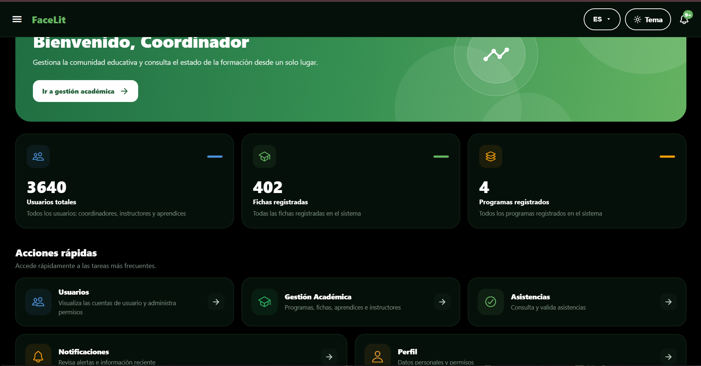

### COO-02 · Gestión de usuarios

La lista devuelve 3.640 resultados. Se ven los filtros por rol y estado, el buscador y el botón Crear usuario. La captura acredita la consulta del listado.

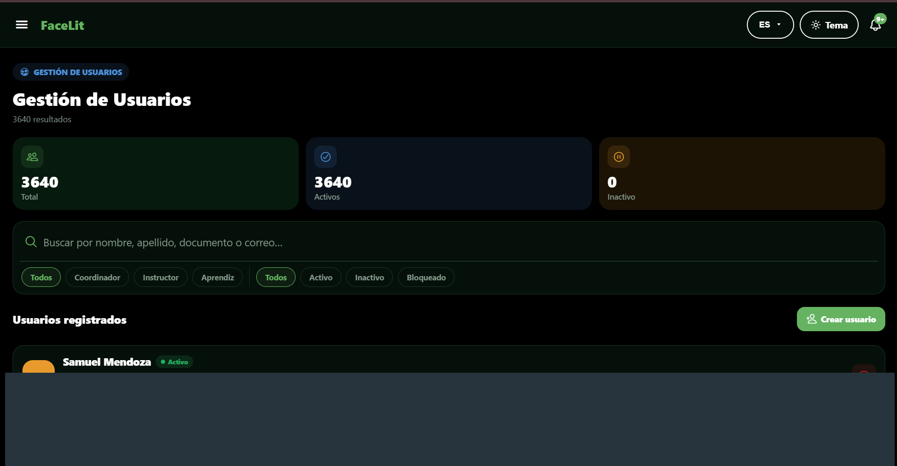

### COO-03 · Programas de formación

La vista muestra programas activos y sus conteos de fichas, con accesos a instructores, aprendices, CSV y formularios de registro. Se observa que el listado académico carga datos.

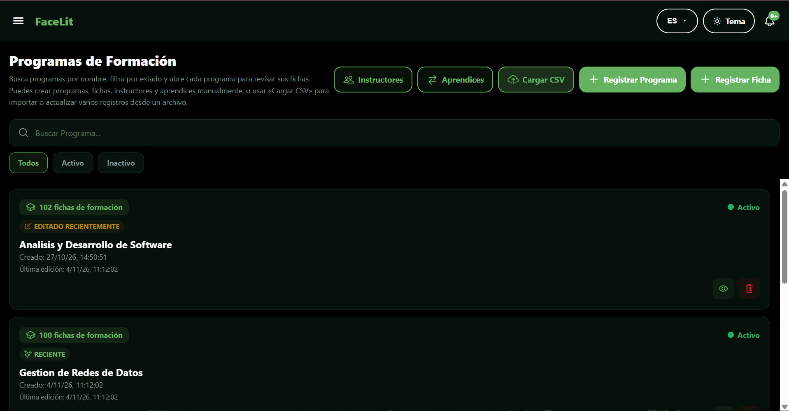

### COO-04 · Carga académica por CSV

La pantalla permite arrastrar o seleccionar un archivo. Muestra el límite de 20 MB y 5.000 filas, además de la guía de columnas. La evidencia corresponde al formulario antes de seleccionar el archivo.

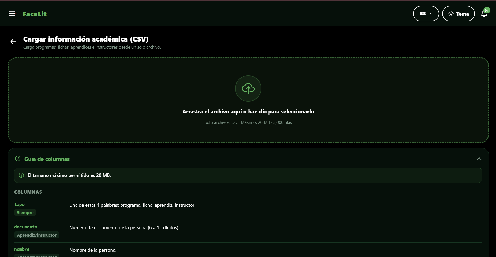

### COO-05 · Gestión de ambientes

El coordinador abre la vista y consulta ambientes activos. Se ven búsqueda, filtros y el botón Registrar Ambiente. Esta captura documenta el acceso a la pantalla sin redirección al inicio de sesión.

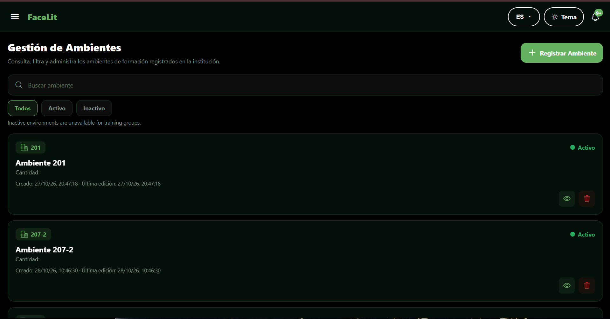

### COO-06 · Control de asistencia

La pestaña Por ficha está abierta y pide elegir un programa de formación. Es el estado inicial de la consulta, previo a obtener una matriz.

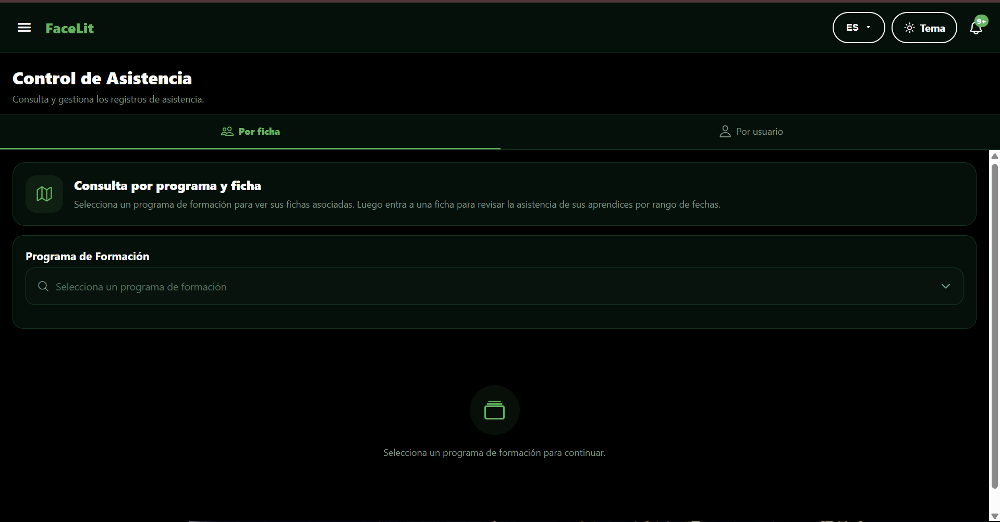

### COO-07 · Centro de notificaciones

Se muestran filtros por estado y categoría. Las alertas «Fila con error de referencia» corresponden a la validación de una importación y evidencian el aviso de rechazo de filas con referencias sin resolver.

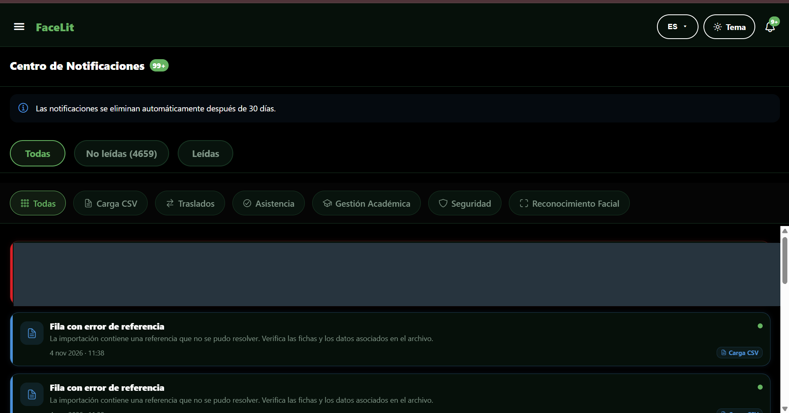

### COO-08 · Perfil

La insignia identifica el rol Coordinador y la vista muestra la sección de información personal. La imagen corresponde a una consulta del perfil.

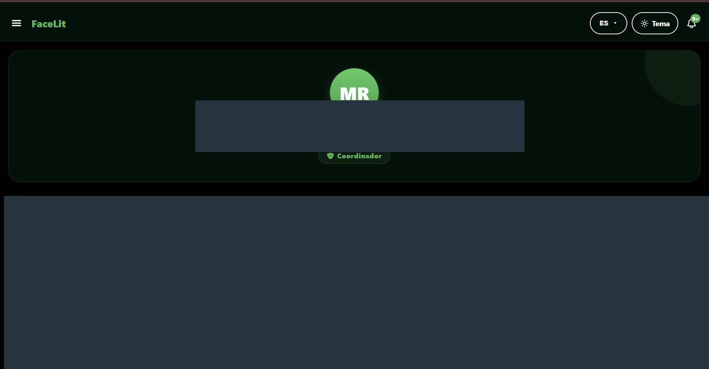

## Instructor

### INS-01 · Matriz de asistencia por ficha

Con el rango del 4 de noviembre de 2026, la vista presenta una fila por fecha y columnas de aprendices. Las celdas rojas visibles corresponden a inasistencia según la leyenda. Se muestran los controles Exportar Excel y Exportar CSV. Para acreditar una exportación se requiere el archivo descargado.

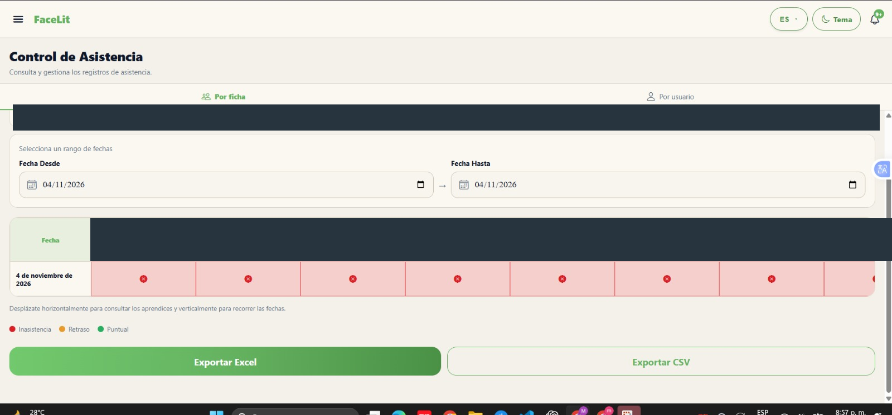

## Aprendiz

### APR-01 · Panel y formación asignada

La pantalla identifica el rol Aprendiz y muestra una ficha activa del programa Análisis y Desarrollo de Software. Incluye accesos a asistencia, reconocimiento facial, notificaciones y perfil.

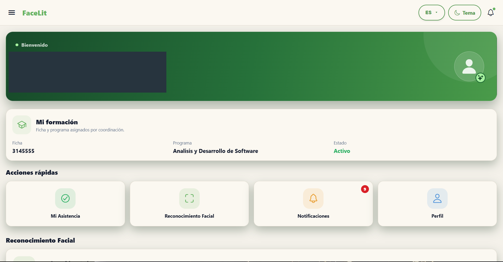

### APR-02 · Mi Asistencia antes de consultar

Los campos de fecha están vacíos. Los contadores en cero corresponden al estado inicial de la vista y aún se debe seleccionar un rango.

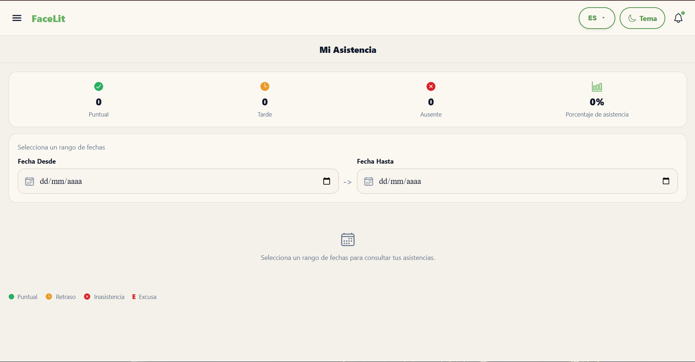

### APR-03 · Mi Asistencia después de consultar

Al seleccionar el 4 de noviembre de 2026 aparece un registro con estado de retraso. El resumen muestra 0 puntuales, 1 tarde, 0 ausentes y 100 % de asistencia para ese rango.

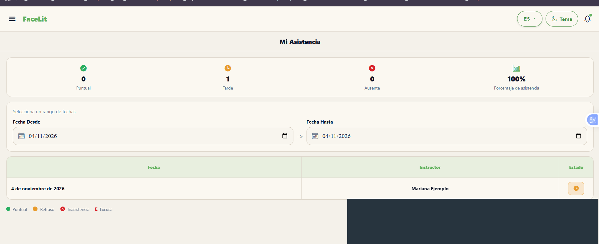

### APR-04 · Preparación del registro facial

La vista muestra la verificación de identidad, la opción de solicitar restablecimiento facial, las instrucciones y la casilla del aviso marcada. Corresponde a la preparación del registro.

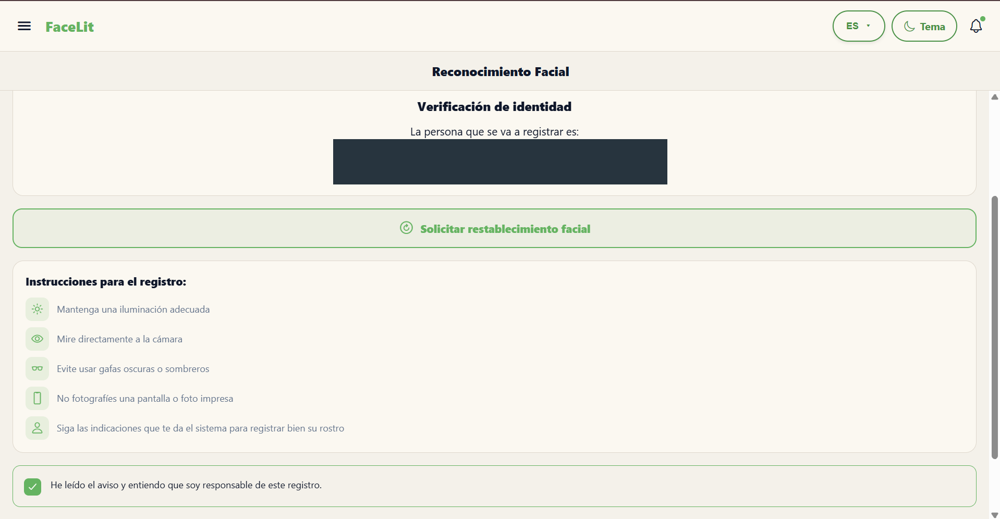

### APR-05 · Captura del reto facial

Se ve el mensaje «Captura terminada. Validando el reto…». La interfaz pasó a la validación. El resultado del reto queda fuera de esta imagen. El área de cámara se cubrió para proteger el rostro.

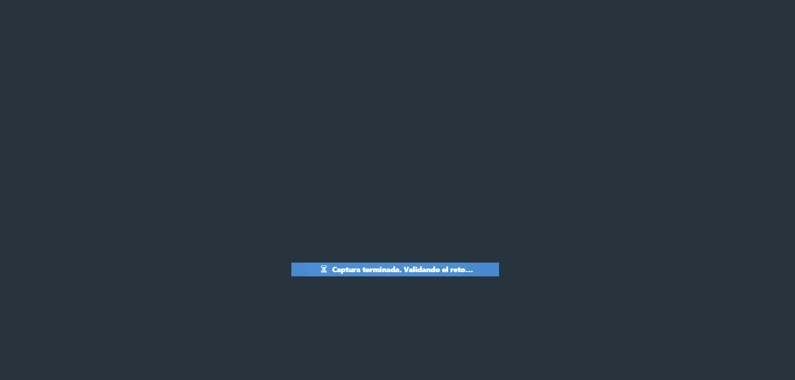

### APR-06 · Notificaciones del aprendiz

El original muestra avisos de seguridad y de reconocimiento facial, incluido «Registro facial completado» y una respuesta a la solicitud facial. Ese aviso es el resultado reportado por la interfaz. La copia de entrega cubre las zonas con información personal.

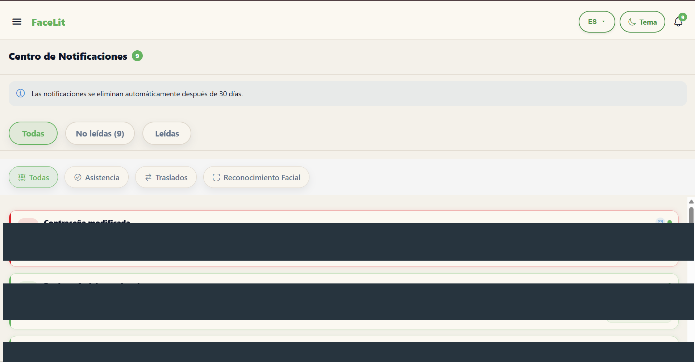

### APR-07 · Perfil del aprendiz

La vista muestra la insignia Aprendiz y la sección Información Personal. Se cubrieron los datos de identificación en la copia de entrega.

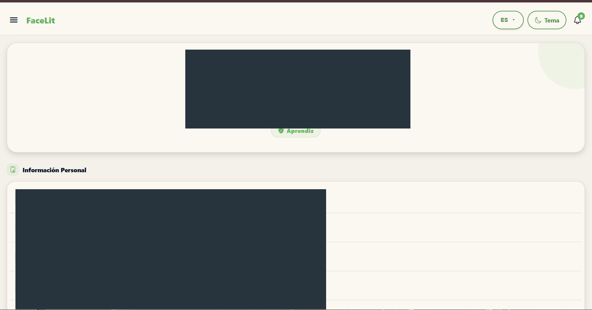

## Cómo presentar la evidencia

- **Gestión académica y CSV.** COO-03 muestra el listado con datos, COO-04 muestra el formulario y COO-07 muestra una alerta de validación. Para demostrar una importación exitosa de principio a fin, adjuntar el resumen de la carga y la consulta posterior del registro importado.
- **Asistencia.** COO-06 muestra el acceso a la consulta, INS-01 muestra una matriz y APR-02 y APR-03 muestran el estado inicial y el resultado de una consulta del aprendiz. Las imágenes no identifican un evento común entre la matriz del instructor y el registro del aprendiz.
- **Reconocimiento facial.** APR-04, APR-05 y APR-06 documentan preparación, captura en validación y un aviso de finalización, respectivamente. Las imágenes por sí solas no vinculan el aviso con la misma ejecución de la cámara.
