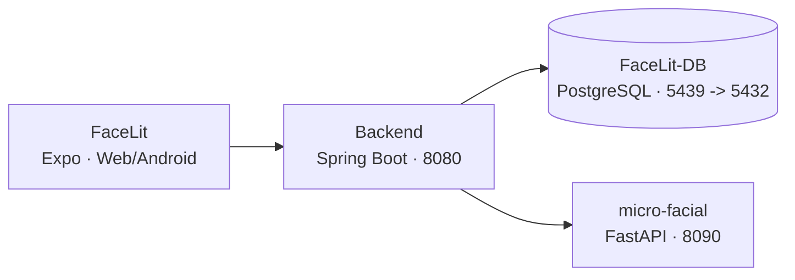

# Manual de instalación local

**FaceLit · Aplicación web/móvil, API, servicio facial y base de datos**

*FaceLit | Instalación local de desarrollo | Actualizado el 4 de noviembre de 2026*



---

## Propósito y alcance

Este documento prepara un entorno local de desarrollo con los cuatro repositorios FaceLit. Resume requisitos, configuración y el orden de arranque verificado en los archivos actuales del proyecto. No es una guía para instalar o desplegar en el VPS.

**Flujo principal:** la interfaz Expo consume la API Spring Boot; el backend usa PostgreSQL y delega operaciones biométricas al servicio FastAPI mediante una conexión interna y una clave compartida. Liquibase administra el esquema.

### Antes de comenzar

- Trabaja en ramas y revisiones compatibles entre frontend, backend, servicio facial y base de datos.
- Usa datos ficticios para pruebas; no copies secretos ni datos biométricos reales a capturas o documentos.
- Conserva cualquier archivo `.env` existente. Crea uno desde `.env.example` solo cuando no exista.
- Los comandos de Liquibase `update` cambian el esquema. Ejecutarlos únicamente contra la base local prevista.

---

## 1. Requisitos y preparación

Instala las herramientas requeridas y abre PowerShell. Verifica en cada README las instrucciones de la rama que vas a usar.

| Componente | Requisito de referencia | Uso |
|---|---|---|
| Frontend FaceLit | Node.js/npm compatibles con `package-lock`; Android SDK para build nativo | Web, Expo/Android |
| FaceLit-Backend | Java 17 y Maven Wrapper incluido | API en 8080 |
| micro-facial | Docker recomendado; imagen basada en Python 3.11 | FastAPI en 8090 |
| FaceLit-DB | Docker Desktop con Compose | PostgreSQL 16/pgvector; host 5439 |

### Obtener o actualizar los repositorios

La instalación vigente parte de `main` en los cuatro repositorios. En cada carpeta existente, revisar `git status`, ejecutar `git switch main` y actualizar con `git pull --ff-only` cuando el árbol de trabajo permita hacerlo. Registrar el resultado de `git rev-parse HEAD` para cada componente.

El despliegue de noviembre incluyó ajustes locales de FaceLit y FaceLit-DB. Su reproducción requiere el paquete y el manifiesto de esa entrega o los commits que incorporen esos ajustes. El [informe de despliegue](../06-implementation-procedure/hostinger-deployment.md) describe las diferencias respecto de GitHub.

Usa las URL de GitHub configuradas para el equipo. No mezcles archivos `.env` locales con cambios de rama; confirma que los cuatro componentes corresponden a la misma entrega.

```bash
git clone <URL-del-repositorio>
# Repositorios: FaceLit, FaceLit-Backend, micro-facial, FaceLit-DB
# Si ya existen: git status; git pull --ff-only
```

### Mapa de puertos

- 5439 en el equipo → 5432 dentro del contenedor de PostgreSQL.
- 8090 servicio facial; 8080 backend; el puerto de Expo/Metro lo asigna su herramienta.

> Con teléfono físico, `localhost` apunta al teléfono. Configura una IP o nombre LAN que el dispositivo pueda alcanzar.

---

## 2. Base de datos y migraciones

Inicia PostgreSQL antes de los otros servicios. El Compose de FaceLit-DB crea la red Docker `facelit-docker-compose_default`, que necesita el Compose independiente de micro-facial.

En PowerShell, desde la carpeta FaceLit-DB:

```powershell
if (-not (Test-Path .env)) { Copy-Item .env.example .env }
# Configurar POSTGRES_DB, POSTGRES_USER, POSTGRES_PASSWORD y POSTGRES_PORT.
docker compose -p facelit-docker-compose up -d postgres
docker compose -p facelit-docker-compose ps
docker compose -p facelit-docker-compose --profile tooling build liquibase
docker compose -p facelit-docker-compose --profile tooling run --rm liquibase validate
docker compose -p facelit-docker-compose --profile tooling run --rm liquibase status
docker compose -p facelit-docker-compose --profile tooling run --rm liquibase update-sql
```

Revisa la salida de `update-sql`. Si los cambios son los esperados y el destino es la base local, aplica las migraciones:

```powershell
docker compose -p facelit-docker-compose --profile tooling run --rm liquibase update
```

El servicio de base usa PostgreSQL 16 con pgvector. El backend arranca con validación Hibernate y Liquibase deshabilitado; por eso, el esquema debe migrarse previamente. **No uses `update` contra producción.**

### Conexión desde procesos locales

Los procesos ejecutados fuera de Docker deben usar el puerto publicado del host (normalmente 5439). Dentro de la red Docker el host de base es `postgres:5432`. Los valores exactos de base, usuario y contraseña se toman de la configuración local y nunca deben copiarse a este manual.

### Comprobación de orden

- Base saludable y puerto local disponible.
- Liquibase valida; `status`/`update-sql` no muestran cambios inesperados.
- Luego se inicia el servicio facial y, después, backend y frontend.

---

## 3. Servicio facial (FastAPI)

El Compose de micro-facial conserva el modelo descargado en un volumen e inicia la API en el puerto 8090. Requiere que el repositorio FaceLit-DB ya haya creado la red externa.

Desde la carpeta micro-facial:

```powershell
if (-not (Test-Path .env)) { Copy-Item .env.example .env }
# Edita .env localmente: DATABASE_URL, API_KEY y ajustes requeridos
docker compose build embedding-service
docker compose up -d embedding-service
docker compose logs --tail=80 embedding-service
```

Editar `DATABASE_URL` antes de iniciar el contenedor. Para el Compose anterior, su forma es `postgresql+asyncpg://<usuario>:<contraseña-codificada>@postgres:5432/<base>`. Codificar los caracteres especiales de la contraseña como parte de la URI. La plantilla usa `localhost:5439` para ejecución nativa desde Windows. En el contenedor del servicio facial, `localhost` identifica ese mismo contenedor.

`API_KEY` debe coincidir con `FACIAL_EMBEDDING_API_KEY` del backend. Configurar `ENVIRONMENT=local` en desarrollo y conservar el volumen del modelo entre reinicios.

### Opción de ejecución nativa

En Windows, las dependencias de visión por computador pueden requerir herramientas C++ y librerías nativas; se recomienda el contenedor oficial del proyecto. Si ejecutas Python localmente, usa el intérprete Python 3.11 documentado:

```powershell
python -m venv .venv
.\.venv\Scripts\Activate.ps1
python -m pip install -r requirements.txt
python -m uvicorn app.main:app --port 8090
```

El primer inicio puede tardar por la descarga y carga del modelo. La API expone `/health`; una respuesta de salud no sustituye la comprobación de una operación facial real. No utilices `tests/support/e2e_app.py` como entrypoint de la aplicación.

### Red y acceso

- El Compose del servicio se conecta a la red externa `facelit-docker-compose_default`.
- Dentro de Docker, PostgreSQL se resuelve como `postgres`; desde Windows usa `localhost` y el puerto publicado.
- Mantén el servicio facial accesible solo para los componentes que lo requieren.

---

## 4. Backend y frontend

### Backend FaceLit-Backend

Usa Java 17. El Maven Wrapper del repositorio descarga la versión de Maven necesaria. El backend lee un archivo local `.env` mediante spring-dotenv. Para una instalación nueva, crear ese archivo en FaceLit-Backend y configurar las siguientes variables con valores privados:

- `DB_URL`, `DB_USERNAME`, `DB_PASSWORD`
- `JWT_SECRET`
- `FACIAL_EMBEDDING_URL` y `FACIAL_EMBEDDING_API_KEY`
- `FACELIT_ACCESS_URL=http://localhost:8081`.
- `FACELIT_ALLOWED_ORIGINS=http://localhost:8081,http://localhost:19006`, ajustado a los orígenes exactos usados por Expo.
- `MAIL_USERNAME` y `MAIL_PASSWORD`. La configuración actual requiere estas variables y usa SMTP Gmail con STARTTLS en el puerto 587.

Con PostgreSQL en Docker y el backend ejecutado desde Windows, usar `DB_URL=jdbc:postgresql://localhost:5439/<base>`. Configurar `FACIAL_EMBEDDING_URL=http://localhost:8090`. El usuario y la contraseña JDBC deben corresponder a la instancia creada en el paso 2.

### Primer coordinador en una instalación nueva

La versión actual del backend dispone de un inicializador de coordinador. Con el esquema y las variables preparados, ejecutar desde FaceLit-Backend:

```powershell
.\scripts\initialize-coordinator.ps1 -Mode Create -Document "<documento>" -Email "<correo>" -FirstName "<nombre>" -LastName "<apellido>"
```

El script solicita y confirma la contraseña mediante entrada oculta y cierra su contexto al terminar. El modo Create corresponde a una base que aún requiere su primer coordinador. Para rotar las credenciales de un coordinador existente, usar el modo Rotate según el README del backend y verificar su identidad. Mantener el bootstrap desactivado durante el arranque habitual.

Después, iniciar normalmente el backend:

```powershell
.\mvnw.cmd spring-boot:run
```

El servicio escucha normalmente en 8080. Para acceso facial, la URL interna y la clave deben apuntar al microservicio del mismo entorno. El correo depende de SMTP configurado; no se considera verificado por el solo arranque.

### Frontend FaceLit

Usa Node.js/npm compatibles con el lockfile actual. Configura `EXPO_PUBLIC_API_URL` con una dirección alcanzable desde el navegador o dispositivo. Las variables `EXPO_PUBLIC` se incluyen en el bundle y no deben contener credenciales privadas.

```bash
npm ci
npm run web
# Alternativas disponibles en package.json:
npm run start:lan
npm run android
```

Antes de iniciar Expo, copiar `.env.example` a `.env` cuando corresponda y configurar `EXPO_PUBLIC_API_URL=http://localhost:8080` para el navegador del mismo equipo. Verificar en la salida de Expo el puerto real del frontend y agregar ese origen a `FACELIT_ALLOWED_ORIGINS`. Reiniciar el backend después de cambiar su configuración.

Reinicia Expo después de cambiar la configuración. Para un móvil físico, `localhost` no corresponde al computador; usa una dirección LAN. Android nativo requiere el toolchain correspondiente. Expo Go y los túneles son herramientas de desarrollo; no son el servidor de producción.

### Nota de compatibilidad

> El README frontend aún documenta variables `EXPO_PUBLIC_EMBEDDING_API_URL` y `EXPO_PUBLIC_EMBEDDING_API_KEY` heredadas, mientras que el flujo facial actual revisado pasa por el backend. Confirma requisitos del build de la rama exacta y nunca incluyas claves privadas en `EXPO_PUBLIC`.

---

## 5. Verificación y solución de problemas

**Arranque sugerido:** PostgreSQL → migraciones → servicio facial → backend → frontend. Comprueba los logs de cada proceso antes de avanzar.

### Lista de comprobación

- PostgreSQL saludable, pgvector disponible y puerto 5439 accesible desde el host.
- Liquibase `validate` correcto y migraciones aplicadas al entorno local previsto.
- FastAPI inicia con su configuración y modelo; `/health` responde.
- Backend inicia y valida el esquema existente; no crea tablas automáticamente.
- Frontend resuelve la URL API desde el tipo de dispositivo que se está usando.
- Demuestra login y un flujo con cuentas/datos ficticios. Evalúa cámara, correo y persistencia por separado.

### Problemas frecuentes

| Síntoma | Revisar |
|---|---|
| Backend no inicia | Variables `DB_*`, conexión PostgreSQL, puerto y cambios Liquibase requeridos por esta versión. |
| Microservicio no inicia | Red externa, archivo `.env`, clave, acceso a PostgreSQL, dependencias y descarga/carga de modelo. |
| Frontend no conecta | `EXPO_PUBLIC_API_URL`, firewall, IP LAN y que API y dispositivo puedan comunicarse. Reinicia Expo tras cambiar variables. |
| Falla facial pero login funciona | URL/clave backend→FastAPI, logs de ambos servicios, modelo y disponibilidad de la base. |
| Cámara web no disponible | Permiso del navegador, cámara y HTTPS según el entorno. |
| Migración inesperada | Detén `update`, revisa `update-sql` y confirma que DATABASE/URL corresponde a la instancia local. |
| Ambientes devuelve al login | Comprobar el estado HTTP de la API y el rol de la sesión. Confirmar que la imagen activa incorpora las reglas de coordinación de la revisión elegida. Un 401 dispara el rechazo de sesión del cliente. |
| La web abre, pero login indica error de conexión | Revisar la URL API incorporada al bundle y el origen permitido por el backend. En una exportación web, reconstruir después de cambiar `EXPO_PUBLIC_API_URL`. |

### Detener el entorno

```bash
docker compose down
```

Ejecuta el comando dentro del repositorio/Compose correspondiente. **No agregues `-v`** salvo que quieras borrar los volúmenes y los datos locales. Para cerrar los servicios, detén primero frontend/backend y luego servicios Docker.

---

**Referencia documental:** README, application.yaml y archivos Compose de los cuatro repositorios. Actualización documental del 4 de noviembre de 2026. Los comandos se contrastaron con los archivos locales revisados.


## Compatibilidad de migraciones y configuración de entrega

El changelog local incluye la migración 025 del aviso de privacidad y la 026 del índice de aceptación por usuario y versión. El changelog maestro enlaza también los cambios de nomenclatura, compatibilidad de versión del aviso y cambio obligatorio de contraseña inicial en `06_migrations`. Ejecutar Liquibase desde el changelog maestro de la revisión seleccionada y revisar su resultado completo.

La instalación local y la publicación en Hostinger tienen configuraciones distintas de red y dominio. Para publicar en `https://facelit.tech`, el build del frontend, el dominio de Caddy y los orígenes del backend deben corresponder al mismo entorno. Conservar el manifiesto y las imágenes de la entrega permite identificar qué versión se instaló. El procedimiento de producción y los ajustes locales de noviembre se detallan en la carpeta 17.
