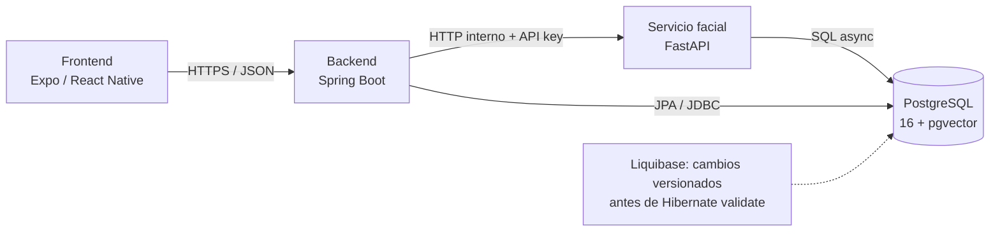

# Manual técnico

## FaceLit

**Arquitectura, configuración, interfaces y diagnóstico**

*Documentación de desarrollo y soporte*

| Corte | Repositorios revisados |
|---|---|
| 4 de noviembre de 2026 | HEAD locales de `main`: FaceLit `6efd92c` · FaceLit-Backend `2ba7398` · micro-facial `166e4a7` · FaceLit-DB `cd069ae` |

**Dirigido a:** desarrollo y soporte técnico
**Programa:** SENA · Análisis y Desarrollo de Software
**Instructor:** José de Jesús Motta

> Este manual documenta el estado del código y el despliegue reportado. El equipo confirma que los flujos funcionales operan al 4 de noviembre; este documento no mide precisión biométrica. Las credenciales reales se configuran fuera del repositorio.

---

## 1. Arquitectura del sistema

El cliente usa HTTPS con Spring Boot. El backend llama a FastAPI por HTTP interno con clave de servicio. Spring y FastAPI acceden a PostgreSQL. Liquibase aplica los cambios de esquema antes de la validación de Hibernate.

### Responsabilidad por componente

| Componente | Tecnologías | Responsabilidad |
|---|---|---|
| FaceLit | Expo / React Native, TypeScript/JavaScript | Rutas y pantallas por rol, cámara, estado cliente y llamadas HTTP. |
| FaceLit-Backend | Java 17, Spring Boot 3.4.1 | Monolito modular: autenticación, académico, sesiones, asistencia y notificaciones. |
| micro-facial | Python 3.11, FastAPI, InsightFace/ONNX, MediaPipe | Liveness, embeddings, comparación y persistencia facial. |
| FaceLit-DB | PostgreSQL 16, pgvector, Liquibase | Esquemas y evolución versionada; no expone API. |

> El backend Java se compila/despliega como una unidad con módulos internos. El microservicio facial es otro componente desplegable, pero comparte PostgreSQL con Java; la base de datos no está separada por servicio.

---

## 2. Interfaces y flujo facial

| Desde / hacia | Protocolo | Responsabilidad |
|---|---|---|
| Frontend → Backend | HTTPS / JSON; JWT cuando aplica; WebSocket para eventos seleccionados. | API de producto y permisos. |
| Backend → FastAPI | HTTP por red interna; `X-API-Key` privada; `RestClient` espera respuesta. | Coordina evaluación facial y liveness. |
| Backend → PostgreSQL | JPA/Hibernate y JDBC. | Reglas y persistencia de dominio. |
| FastAPI → PostgreSQL | SQLAlchemy `AsyncSession` / asyncpg. | Referencias faciales, comparación y registros del servicio. |
| Liquibase → PostgreSQL | Changesets versionados. | Cambios de esquema antes de Hibernate `validate`. |

### Registro facial y asistencia

El cliente envía imágenes Base64 dentro de JSON al backend. En registro, `POST /api/facial/embeddings/from-image` valida al usuario autenticado y delega al microservicio; en asistencia, el backend comprueba actor, sesión, ventana temporal y duplicados antes de persistir. La clave de servicio no debe enviarse desde el cliente.

| Parámetro | Estado vigente | Límite |
|---|---|---|
| Retos | `MOVE_UP`, `MOVE_DOWN`, `MOVE_CLOSER`, `MOVE_AWAY`. | Dos retos distintos por secuencia; siete imágenes por reto. |
| Similitud | Umbral predeterminado 0.65. | Valor de similitud, no porcentaje de precisión. |
| Modelo | InsightFace `buffalo_l` sobre ONNX/CPU; MediaPipe aporta métricas faciales según flujo. | No hay evaluación biométrica representativa ni garantía anti-spoof. |

> La inferencia es secuencial dentro de la solicitud. El uso de `async` para I/O de base no vuelve automáticamente asíncrono o no bloqueante el cálculo CPU.

---

## 3. Base de datos y backend

FaceLit-DB define siete esquemas de dominio y 31 tablas de aplicación. Liquibase conserva el historial de cambios; Hibernate usa `ddl-auto: validate`. No cambiar a `create` para ocultar una migración faltante.

| Esquema | Dominio principal |
|---|---|
| `security` | Cuentas, credenciales, recuperación y configuración. |
| `roleandpermission` | Roles, permisos y asignaciones. |
| `academic` | Programas, fichas (Chip), instructores y aprendices. |
| `environment` | Ambientes y sesiones. |
| `notification` / `legal` | Notificaciones, correo y aceptación de términos. |
| `facialrecognition` | Dispositivos, embeddings, eventos, logs y reinicio facial. |

### H-50 y contrato canónico

Tras la migración de contrato, los nombres canónicos son `role_name`, `description` y `assigned_at`. Las categorías son `SECURITY`, `ACADEMIC`, `ATTENDANCE`, `FACIAL_RECOGNITION` y `TRANSFER`. La expansión/contracción conserva compatibilidad temporal y dispone de rollback por etapa; no ejecutar la contracción con consumidores antiguos.

### Buenas prácticas para cambios de esquema

Agregar changesets nuevos en el changelog maestro; no editar los ya aplicados; validar y respaldar antes de `update`; aplicar migraciones antes de arrancar el backend; verificar restricciones e índices y ensayar restauración en un entorno separado. El informe de despliegue del 27 de octubre registra 45 changesets aplicados.

---

## 4. Backend y rutas principales

| Área / paquete | Función |
|---|---|
| `auth/` | Acceso JWT, recuperación, usuarios, roles y perfil. |
| `academic/` | Programas, fichas, personas, importación CSV y cambios. |
| `environment/` | Ambientes y sesiones académicas. |
| `facial/` | Enrolamiento, eventos, estado/matriz de asistencia y cliente FastAPI. |
| `notification/` y `realtime/` | Bandeja, correo y WebSocket. |
| `config/` y `shared/` | Filtros, seguridad, errores y utilidades compartidas. |

La secuencia usual es controller → DTO/validación → service → repository → PostgreSQL. Los permisos se vuelven a verificar en el servidor; los guards de interfaz no son control de acceso.

### Rutas de referencia observadas

| Método y ruta | Uso / notas |
|---|---|
| `POST /api/auth/login` | Inicio de sesión y emisión de JWT. |
| `POST /api/facial/embeddings/from-image` | Enrolamiento vía backend; autoriza rostro propio y delega a FastAPI. |
| `POST /api/facial/embeddings/liveness-check` | Validación de secuencia de liveness. |
| `POST /api/facial/events/from-image` | Captura de asistencia por imagen. |
| `GET /api/facial/events/attendance-status` | Consulta de estado de asistencia. |
| `GET /api/facial/events/attendance-matrix` | Matriz de asistencia por los filtros permitidos. |
| `/api/academic/...` y `/api/facial/...` | Consultar controladores/DTO para métodos, parámetros y autorización exactos antes de integrar. |

> Rutas internas FastAPI incluyen `/api/v1/facial-embeddings/from-image`, `/verify-session` y `/liveness-check`. No exponerlas como API pública de frontend.

---

## 5. Frontend y microservicio facial

### Árbol del frontend

| Ruta | Responsabilidad |
|---|---|
| `app/` | Navegación Expo y pantallas de Coordinador, Instructor y Aprendiz. |
| `features/` | Hooks, stores y componentes por función: autenticación, académico, facial, asistencia, notificaciones. |
| `shared/services/` | Axios, autenticación, configuración de API y servicios HTTP. |
| `shared/contexts/` y `shared/i18n/` | Sesión/tema/idioma; recursos en español, inglés, alemán y francés. |

Variables `EXPO_PUBLIC` se incorporan al bundle: `EXPO_PUBLIC_API_URL` es pública y no debe contener secretos. El README frontend aún tiene referencias a variables faciales directas heredadas; el servicio facial actual usa Axios hacia Spring.

### Árbol del microservicio

| Ruta | Responsabilidad |
|---|---|
| `app/api/v1/routes/` | Endpoints y dependencias de sesión. |
| `app/schemas/` | Contratos Pydantic. |
| `app/services/` | Reglas, liveness, generación/persistencia de embeddings. |
| `app/repositories/` | Consultas de datos. |
| `app/workers/` | InsightFace/ONNX, decodificación y extracción facial. |
| `app/core/` y `app/db/` | Configuración, engine y `AsyncSession`. |

> La configuración exige `DATABASE_URL`. La `API_KEY` debe estar definida y no vacía en producción; el valor por defecto está vacío, lo que no es una configuración segura para publicar el servicio. El trabajador puede precargar modelo según `PRELOAD_MODEL`.

---

## 6. Configuración y ejecución

### Variables por servicio (nombres, sin valores secretos)

| Servicio | Variables principales |
|---|---|
| Spring Boot | `DB_URL`, `DB_USERNAME`, `DB_PASSWORD`, `JWT_SECRET`, `MAIL_USERNAME`, `MAIL_PASSWORD`, `FACIAL_EMBEDDING_URL`, `FACIAL_EMBEDDING_API_KEY`, `FACELIT_ACCESS_URL`, `FACELIT_ALLOWED_ORIGINS`. |
| FastAPI | `DATABASE_URL`, `API_KEY`, `CORS_ORIGINS`, `PRELOAD_MODEL`; threshold/liveness/model según `app/core/config.py`. |
| Expo | `EXPO_PUBLIC_API_URL`: URL pública compilada del backend; nunca secretos. |

### Entorno local

1. Iniciar PostgreSQL local desde FaceLit-DB con Docker Compose (puerto host 5439 → contenedor 5432).
2. Ejecutar Liquibase `validate` y luego `update` con el changelog maestro.
3. Configurar `DATABASE_URL`/`API_KEY` e iniciar FastAPI según README del repositorio.
4. Configurar variables Spring e iniciar con Maven Wrapper, en puerto 8080.
5. Configurar `EXPO_PUBLIC_API_URL` y arrancar Expo.

Revisar los README y lockfiles actuales para las dependencias exactas antes de ejecutar; los Compose de base y facial tienen requisitos de red y orden propios.

### Despliegue Hostinger

Docker Compose coordina `postgres`, `migrate`, `facial`, `backend` y `web` en el VPS Hostinger. Caddy sirve `https://facelit.tech/` y hace proxy de API/WebSocket; solo `web` publica 80/443. PostgreSQL, Spring Boot y FastAPI permanecen en red interna. Healthchecks: PostgreSQL y `/health` facial.

### Configuración del APK para distribución

> Para generar un APK conectado a Hostinger, configurar `EXPO_PUBLIC_API_URL=https://facelit.tech` en el perfil EAS elegido y reconstruirlo. El perfil `preview` del código revisado conserva una URL heredada; el release web instalado en el VPS usa el dominio de Hostinger. Probar el APK generado en el dispositivo objetivo.

---

## 7. Seguridad, diagnóstico y soporte

| Síntoma | Revisar en orden |
|---|---|
| Hibernate schema validation falla | Versión del changelog y migración pendiente; aplicar changeset compatible antes de reiniciar. |
| Backend no llega a FastAPI | DNS de red Compose, salud del contenedor, `FACIAL_EMBEDDING_URL` y API key privada coincidente. |
| Navegador recibe 502 | Estado/logs de backend y facial; después reglas proxy Caddy y ruta solicitada. |
| WebSocket no conecta | HTTPS/origen permitido, ruta proxy y handshake WebSocket. |
| Asistencia no se guarda | Respuesta facial, usuario/actor, sesión/ventana, reglas de entrada-salida, transacción e idempotencia. |
| Cámara no aparece | HTTPS válido, permiso navegador/dispositivo, plataforma y estado de stream. |

### Controles que no deben debilitarse

- No exponer PostgreSQL ni FastAPI públicamente; conservar Caddy como entrada HTTPS.
- No incluir API key, DB password, JWT secret o SMTP password en código, logs, `EXPO_PUBLIC`, PDF ni capturas.
- Revisar autorización por rol y alcance de recurso en backend.
- No registrar imágenes, embeddings ni identificadores personales durante diagnóstico.
- No cambiar Hibernate `validate` a `create` para resolver una migración faltante.

### Seguridad biométrica

El umbral 0.65 es similitud, no precisión. No hay estudio biométrico representativo ni garantía anti-spoof. Definir autorización, finalidad, retención/eliminación y responder a incidentes con la política institucional; no describir embeddings como anónimos.

---

## 8. Verificación y límites operativos

| Evidencia reportada al corte | Alcance de la evidencia |
|---|---|
| Microservicio: 123 aprobadas; 1 prueba PostgreSQL opcional omitida. | Pruebas de reglas/retos con fixtures; el equipo confirma la operación de la cámara. No es un estudio de precisión biométrica. |
| Frontend: 120 aprobadas en 13 suites; seis scripts de regresión. | Cobertura automatizada parcial; el equipo confirma cámara y SMTP funcionando en el sistema. |
| Integración HTTP: 19 checks faciales y flujos relacionados. | DB desechable con 45 migraciones; inferencia controlada y correo simulado. |
| Hostinger: web/login 200, health facial 200, admin sin token 401, WebSocket 101. | Chequeos técnicos; el equipo confirma aparte el funcionamiento de login, CSV, SMTP, cámara y asistencia. |

### Estado funcional actualizado al 4 de noviembre

El equipo confirma que login, carga CSV, SMTP, cámara física, registro y asistencia funcionan en el sistema actual. Como verificaciones complementarias se mantienen el ensayo de restauración de backup en un entorno separado y la prueba del APK exacto si se presenta soporte Android. Las suites antiguas conservan el alcance y las limitaciones de su propia ejecución.

Antes de solicitar soporte, registrar repositorio/rama/SHA, entorno (local o VPS), paso reproducible, hora, endpoint, resultado esperado/observado y logs redactados. No adjuntar `.env`, tokens, imágenes faciales, embeddings, documentos ni datos reales.

---

Los SHA de portada identifican los HEAD locales de `main`. Para identificar una publicación concreta, consultar el manifiesto del release y el [procedimiento de despliegue](../06-implementation-procedure/hostinger-deployment.md).

Los resultados de pruebas y las comprobaciones del VPS corresponden al informe del 27 de octubre de 2026. Para integraciones o métodos no enumerados, verificar controlador, DTO, permisos y README del SHA que se vaya a compilar.

## Antecedente local de registro y consentimiento del 4 de noviembre de 2026

Una revisión anterior de archivos fuera del `main` consultado identificó endpoints públicos de registro/verificación/reenvío bajo `/api/auth`, aceptación de términos y operaciones de consentimiento bajo `/api/consent`. Los códigos de correo y tokens de consentimiento expiran a los cinco minutos según los servicios revisados. La implementación aún requiere completar y verificar el mapeo de `notice_version`, las tablas legales, autorización de endpoints y pruebas de integración. No usar esta nota como contrato de una versión desplegada.
