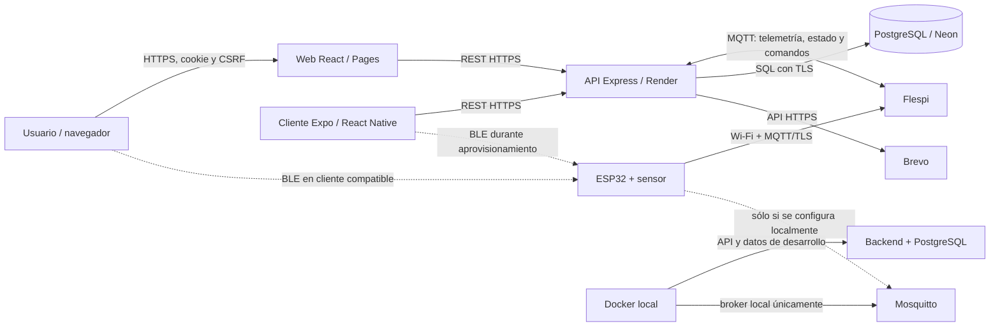
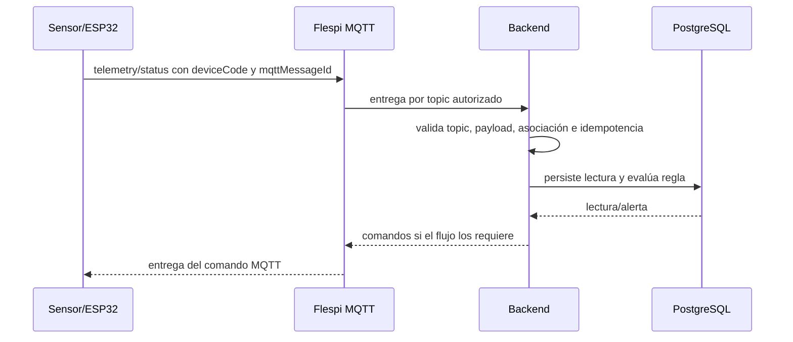

# Arquitectura de HidroSmart

Vista lógica de PT_HS `main`, SHA `32be1cf787f20120dfd3b4cc72226dab55d88216`, consultada el 2026-11-05. HU-21 separa la carga del perfil de las consultas de hogares y dispositivos; no cambia las capas ni los límites arquitectónicos descritos aquí. Los repositorios de componentes separados son referencias de trazabilidad y pueden divergir; consulta el [índice de entrega](../README.md) antes de tratarlos como una misma versión.

## Vista de contexto

## Límites de los componentes

| Capa | Responsabilidad |
| --- | --- |
| Cliente web/móvil | Interfaz, solicitudes REST autenticadas y gestión de flujos del usuario. BLE depende del navegador o de una compilación móvil con módulo nativo. |
| API | Valida sesión, CSRF, permisos y reglas; coordina hogares, dispositivos, reportes y soporte; procesa MQTT y solicita correo a Brevo. |
| Broker | Transporta mensajes. Flespi es el destino TLS documentado para producción; Mosquitto es el servicio de desarrollo local. |
| PostgreSQL | Persiste entidades, lecturas, auditoría y reglas. Las migraciones Liquibase son la fuente del esquema; RLS y funciones limitan acceso. |
| ESP32 | Lee pulsos, calcula caudal, se aprovisiona por BLE y comunica telemetría/estado por Wi-Fi y MQTT. |

## Flujo de identidad y vinculación

1. El usuario obtiene un hogar y una membresía con permisos.
2. Vincula un deviceCode lógico preasignado. El código debe existir en el conjunto de datos de la versión de base de datos usada.
3. La placa reporta su hardwareId. El backend valida la asociación y transmite el comando correspondiente por MQTT.
4. Para configurar la red, un cliente BLE compatible entrega la configuración al ESP32; BLE no es el canal de telemetría.
5. La desvinculación elimina el enlace hogar-dispositivo y solicita reactivar
   BLE. En el firmware integrado documentado por PT_HS, se conserva la red
   Wi-Fi en NVS y se borra solo la asociación; valida por separado el firmware
   de cada repositorio antes de asumir el mismo comportamiento.

## Flujo de medición y alertas

El intervalo esperado de publicación configurado es de aproximadamente cinco segundos; la conectividad real puede retrasar o perder mensajes. Una respuesta del broker no demuestra que la API haya almacenado cada lectura.

## Modo de vigilancia

La opción de pausar la contabilización de consumo no es un interruptor eléctrico. En la versión de integración revisada, **measurementEnabled=false** congela el aumento de litros, pero deja el ESP32, el sensor, Wi-Fi y MQTT en marcha para que el backend evalúe el flujo y las reglas de fuga.

## Seguridad documentada

- Sesión web en cookies y token CSRF para operaciones mutables.
- Autorización en el backend y aislamiento de datos en PostgreSQL.
- TLS para las conexiones externas declaradas en la guía de despliegue.
- Credenciales de broker, correo y base de datos deben residir en secretos del entorno; no incluir valores en documentos.
- Los diagramas son contratos de diseño y no reemplazan validación de despliegue ni pruebas con hardware.

## Desarrollo local frente a servicios externos

Docker ofrece componentes locales de desarrollo. No se debe confundir la dirección interna de un contenedor con un host accesible desde el ESP32. Para una placa física, el broker/servidor debe ser alcanzable desde su red. Consulta [Operación local](../06-implementation-procedure/implementation-operation.md) y [Despliegue](../06-implementation-procedure/deployment.md).

En la configuración local documentada en PT_HS, PostgreSQL y la API se
publican solo en `localhost`, y el frontend llega a la API a través de Nginx.
Mosquitto es el broker local de desarrollo; Flespi/TLS es el broker externo
descrito para producción. Esta topología documentada no confirma por sí sola
el estado de los servicios desplegados.
