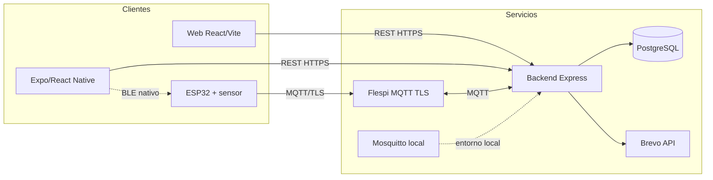

# Diagrama de componentes

Vista lógica de PT_HS `main`, SHA `32be1cf787f20120dfd3b4cc72226dab55d88216`, consultada el 2026-11-05. HU-21 cambia la carga del perfil dentro del frontend, no los componentes principales representados.
El archivo editable es [component-diagram.drawio](component-diagram.drawio).

| Componente | Responsabilidad |
| --- | --- |
| Web | Presentación y solicitudes REST. |
| Cliente Expo | Cliente móvil; el aprovisionamiento BLE requiere build nativo y soporte BLE. |
| ESP32 / caudalímetro | Pulsos, caudal, Wi-Fi, provisioning BLE y mensajes MQTT. |
| Backend | Sesión, CSRF, permisos, lógica del dominio, ingesta MQTT, alertas y correo. |
| PostgreSQL | Persistencia, funciones, roles y RLS administrados por Liquibase. |
| Flespi | Broker MQTT TLS externo documentado para la integración. |
| Mosquitto | Broker incluido en el entorno Docker local; no debe etiquetarse como broker de producción. |
| Brevo | Servicio HTTP de correo transaccional. |

## Diferencias entre las copias
El firmware integrado acepta actualmente un solo código lógico activo: `HS-7A3F91C8D2E4`. Los scripts DML del monorepo conservan preasignaciones y correcciones históricas para otros códigos; eso no significa que existan cuatro sensores físicos ni que los cuatro estén activos en el ambiente. Antes de describir el estado de Neon, verificar los changesets aplicados y las filas activas de `device.device`.

Las ramas de BK_HS, FT_HS, BD_HS y Firmaware_HS son repositorios separados para trazabilidad y no se deben asumir sincronizados con este commit. La tabla de fuentes en el [índice de entrega](../../README.md) registra las revisiones locales consultadas.

El `deviceCode` identifica el dispositivo lógico vinculado a un hogar; `hardwareId` identifica la placa. Este diagrama representa arquitectura de código, no una prueba de ACL, token Flespi ni funcionamiento físico.
