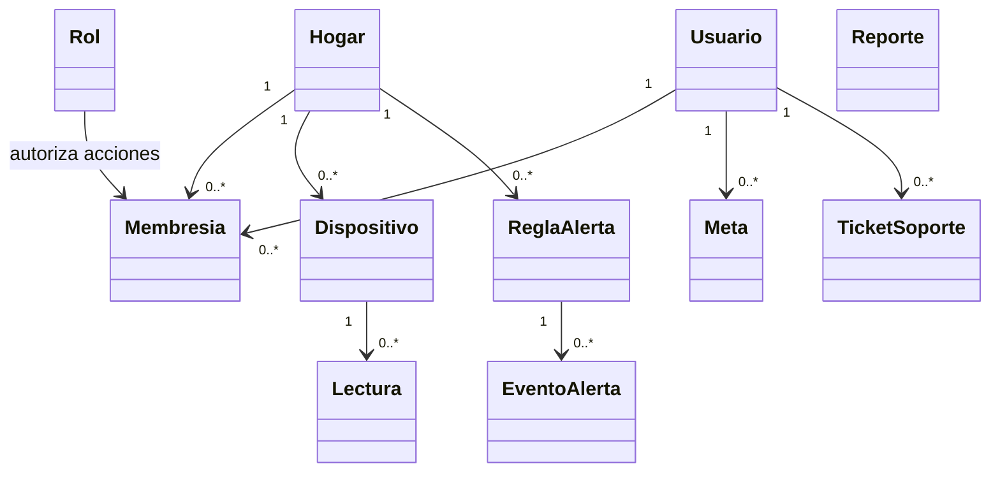

# Diagrama de dominio

El archivo editable es [domain-diagram.drawio](domain-diagram.drawio).
Esta vista de negocio no pretende reemplazar el MER físico.

La cardinalidad mostrada es conceptual y debe cotejarse con el MER/Liquibase
antes de usarla como esquema físico. Las tablas completas están en el
[diccionario implementado](../database-schema-inventory.md).
La vista es conceptual. El esquema de base de datos documentado para esta entrega se inventarió desde PT_HS `main` (`32be1cf787f20120dfd3b4cc72226dab55d88216`); la rama separada BD_HS y sus migraciones pueden diferir en identidad y contenido. HU-21 no modificó el esquema. Ninguna de estas vistas confirma qué migraciones están aplicadas en Neon.
tienen inventarios distintos; esta vista no afirma que cada relación esté
aplicada en Neon.
