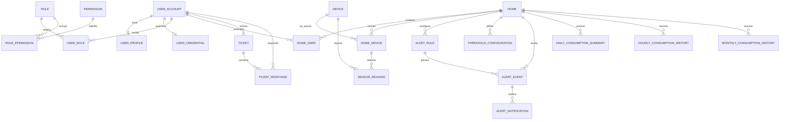

# Modelo entidad-relación vigente de HidroSmart

Descripción estática de las migraciones incluidas en PT_HS/BD_HS, `main`, SHA `32be1cf787f20120dfd3b4cc72226dab55d88216`, consultadas el 2026-11-05. HU-21 solo modificó la carga del perfil en el frontend; las migraciones incluidas no cambiaron. Esto describe archivos versionados; no confirma que Neon u otro entorno tenga aplicados todos los changesets. Comprueba cada entorno con `liquibase status --verbose` y `DATABASECHANGELOG`.

El corte contiene 57 declaraciones de tablas en nueve esquemas según `CREATE TABLE` bajo `BD_HS/01_ddl`. El conteo y los nombres completos están en el [inventario de tablas](database-schema-inventory.md). El diagrama Mermaid de esta página es un resumen conceptual; no sustituye el DDL ni representa todas las tablas. El [diagrama de dominio editable](diagrams/domain-diagram.drawio) es otra vista conceptual, no un MER físico.

Este paquete no incluye un MER físico editable ni una comparación automatizada completa de todas las claves foráneas. Las relaciones Mermaid de esta guía son representativas. Para columnas, nullabilidad, claves, `ON DELETE`, restricciones e integridad referencial, prevalecen los SQL de `PT_HS/BD_HS/01_ddl`; los conteos que aparecían en cortes de la rama separada BD_HS no se extrapolan a esta versión.

## Relaciones principales

El Mermaid resume relaciones centrales; no sustituye constraints ni acciones `ON DELETE`. `home_device` representa el vínculo entre hogar y equipo. La lectura valida el par `(home_id, device_id)` y un índice parcial limita a una asociación activa por dispositivo.

## `user_account` — Identidad y autenticación

`email_verification_token` , `login_attempt` , `password_policy` , `password_reset_token` , `permission` , `role` , `role_permission` , `session` , `token` , `user_account` , `user_credential` , `user_mfa` , `user_profile` , `user_role`

## `preference` — Preferencias

`currency` , `language` , `theme` , `user_preference`

## `home` — Hogares y membresías

`home` , `home_device` , `home_member_request` , `home_user` , `home_user_function` , `saving_goal` , `vacation_mode`

## `device` — IoT y actuadores

`actuator_command` , `actuator_state` , `calibration_history` , `device` , `device_history` , `logical_device_group_member` , `device_telemetry_history`

## `consumption` — Medición y consumo

`consumption_prediction` , `daily_consumption_summary` , `hourly_consumption_history` , `monthly_consumption_history` , `sensor_reading`

## `alert_rate` — Alertas y tarifas

`alert_event` , `alert_notification` , `alert_rule` , `estratos` , `home_rate` , `reference_rate` , `threshold_configuration`

## `analytics_support` — Analítica y soporte

`generated_report` , `recommendation` , `recommendation_category` , `ticket` , `ticket_category` , `ticket_priority` , `ticket_response` , `ticket_status` , `user_recommendation`

## `audit` — Auditoría

`audit_log` , `log_error`

## `privacy` — Privacidad

`arco_request` , `user_consent`

## Distinciones del modelo

- `home.home_user` representa membresía del hogar; `user_account.user_role` asigna roles funcionales globales. Los roles técnicos de PostgreSQL son otro nivel de autorización.
- `device.device.code` es el código lógico; el identificador físico se reclama en el flujo de aprovisionamiento.
- `measurement_enabled` controla la contabilización. Con la medición pausada, el dispositivo puede seguir enviando telemetría para vigilar fugas.
- Las tablas de resumen y vistas materializadas son datos derivados; no sustituyen `consumption.sensor_reading`.
- Los modelos antiguos que usan `medidor`, `configuracion_seguridad`, `usuario_2fa` o nombres ajenos al DDL actual no deben guiar nuevas migraciones.

El orden fuente lo definen `BD_HS/changelog-master.yaml` y sus includes. No edites ni renumeres changesets ya aplicados; agrega migraciones nuevas. `04_tcl` es mantenimiento manual y `05_rollbacks` contiene reversas específicas, no forma parte del `update` normal.
