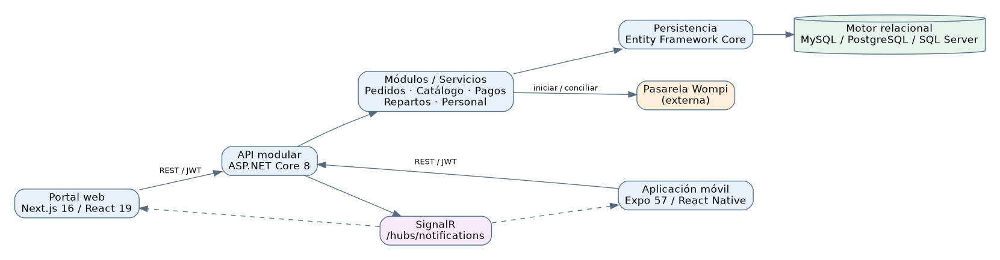
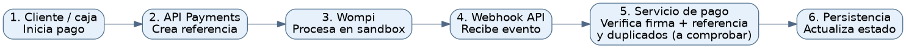
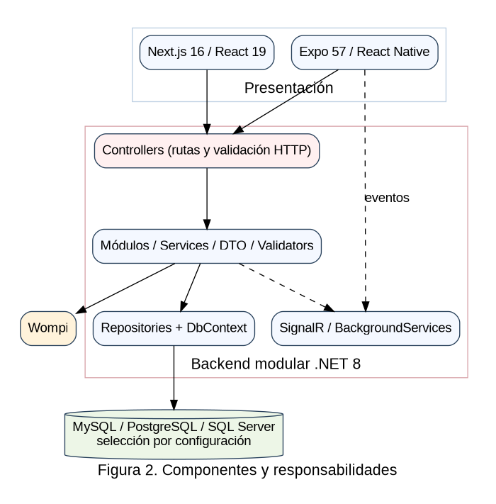
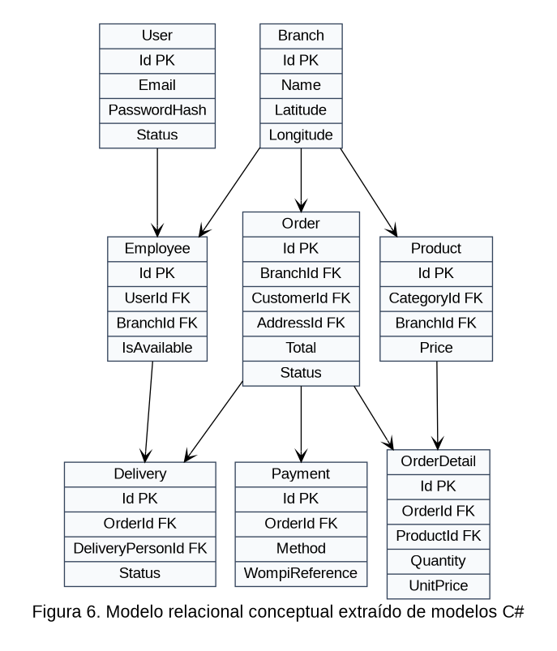
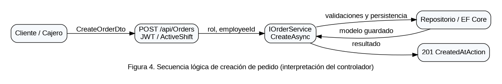
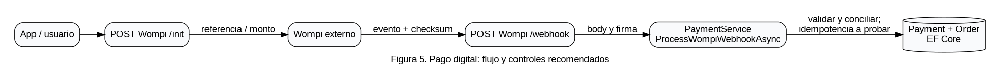
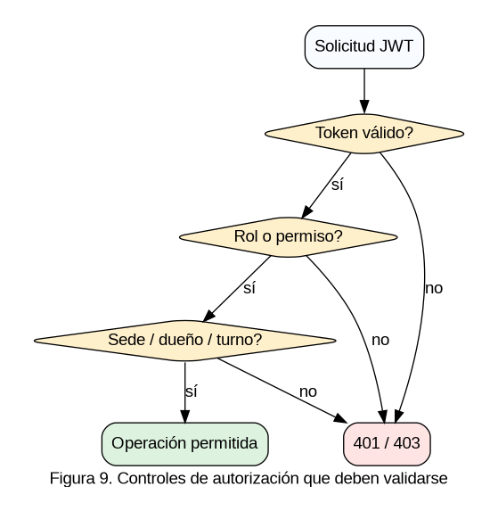

# Diseño y arquitectura del software

**Proyecto:** SaborExpress | **Autor / integrante:** Yerson Stiven Cuellar Rubiano | **Ficha:** 3145555 | **Fecha:** 14 de octubre de 2026 | **Versión documental:** 4.0

**Estado de la evidencia:** inspección documental y estática del código. Las pruebas de ejecución y los datos institucionales no aportados no se presumen realizados.

## 1. Visión de arquitectura

SaborExpress presenta tres repositorios de software separados y un repositorio documental. El backend es **una aplicación ASP.NET Core modular**, no diez microservicios ni una infraestructura distribuida comprobada. El frontend web administra vistas de negocio; el móvil utiliza Expo Router y módulos por función.

*Figura 1. Vista lógica propuesta a partir de estructuras y configuraciones de los repositorios. No representa una topología de producción verificada.*

## 2. Vista de desarrollo (Kruchten, 1995)

| Componente | Estructura real | Responsabilidad |
| --- | --- | --- |
| API | Controllers/ | Frontera HTTP |
| API | Modules/*/DTOs | Contratos de entrada/salida |
| API | Modules/*/Services | Lógica de dominio |
| API | Modules/*/Repositories | Persistencia |
| API | Data/Configurations | Mapeos EF Core |
| Web | src/app/*/page.tsx | Páginas de Next.js |
| Web | src/features, src/components | Funciones e interfaz |
| Móvil | src/features/* | Vistas, hooks, servicios |
| Móvil | app.json, package.json | Runtime Expo y dependencias |

## 3. Vista de ejecución

Inicio de API: `Program.cs` registra CORS, controladores, JWT, autorización (`ActiveShift`), DbContext, dependencias, clientes HTTP, Swagger, SignalR y servicios hospedados (turnos, enlaces de cocina, expiración de rol, sincronización de Wompi). También ejecuta `MigrateAsync` y seeders de permisos, rol cliente y gerente inicial. En producción se recomienda separar migraciones y seeds de arranque automático y auditar la idempotencia.

## 4. Vista lógica de negocio

Dominios observados: identidad y roles; sedes; usuarios, clientes y empleados; horarios; catálogos y menú; mesas; pedidos/detalles e historial; pagos; domicilios; notificaciones; preferencias; reseñas y facturas. Las clases Entity Framework enlazan pedidos con sede, cliente, dirección, empleado y mesa, además de colecciones de detalles, estados y pagos.

## 5. Vista de despliegue (objetivo, pendiente de verificar)

**Desarrollo local:** `Next.js → ASP.NET Core API → motor relacional`; aplicación móvil usa URL de red accesible desde dispositivo, no `localhost` del teléfono. **Producción propuesta:** HTTPS, dominio y proxy de capa 7, backend .NET, DB administrada o aislada, almacenamiento protegido y monitoreo. No existe en la evidencia una definición definitiva de infraestructura productiva.

## 6. Secuencia transaccional crítica

La pasarela puede confirmar asíncronamente. El webhook `POST /api/Payments/wompi/webhook` admite acceso anónimo a nivel de controlador para permitir notificaciones de Wompi; el **servicio** debe comprobar checksum/firma, correspondencia de referencia, idempotencia y validez de estados. No se documenta como seguro por el mero hecho de existir.

## 7. Decisiones arquitectónicas (ADR)

| ADR | Decisión | Justificación | Estado |
| --- | --- | --- | --- |
| ADR-001 | Mantener API modular .NET | Código actual y costo de despliegue | Constatada como arquitectura actual |
| ADR-002 | Clientes web y móvil separados | Flujos operativos distintos | Constatado |
| ADR-003 | Contratos REST y canal SignalR | Datos + avisos en vivo | Registrado, no medido |
| ADR-004 | DB provider configurable | Código soporta tres proveedores | Soporte real a validar |
| ADR-005 | Wompi para cobros | Controlador y DTO identificados | Sandbox pendiente |
| ADR-006 | Secrets solo por env o Secret Manager | Seguridad y despliegue | Recomendación |

## 8. Análisis de amenazas y mitigaciones

Autorización de objeto: validar propietario y sede para cada ID proporcionado. Webhook: firma y replay protection. Datos: proteger contraseñas BCrypt, tokens y documentos; jamás registrar bodies sensibles completos. CORS: acotar orígenes al ambiente. Migraciones: respaldo y rollback antes de producción. Imágenes: límites MIME/tamaño, sanitización y rutas no predecibles. Evaluar riesgos según OWASP API Security Top 10 2023.

## 8. Vistas arquitectónicas profesionales

Se sigue el principio de varias vistas complementarias propuesto por Kruchten (1995), sin confundir vista de código con evidencia del despliegue real.

### 8.1. Contexto

Clientes, colaboradores y gerencia consumen clientes móvil y web. La API intermedia identidad, catálogos, órdenes, pagos y notificaciones. Wompi envía eventos de pago al servidor.

**Relación con objetivos de calidad:** separar acceso, reglas y persistencia facilita revisión, pruebas y trazabilidad. Las cualidades de seguridad y disponibilidad se verifican mediante ensayos, no por la sola separación de carpetas.

### 8.2. Lógica

Controllers constituyen límites HTTP, Modules agrupaciones de dominio, Services reglas de negocio, Repositories persistencia, DTOs contratos; AppDbContext agrega DbSet y configuraciones EF.

**Relación con objetivos de calidad:** separar acceso, reglas y persistencia facilita revisión, pruebas y trazabilidad. Las cualidades de seguridad y disponibilidad se verifican mediante ensayos, no por la sola separación de carpetas.

### 8.3. Desarrollo

Tres repositorios separados: SaborExpressBack (.NET), SaborExpressWeb (Next.js) y SaborExpressMovil (Expo). La documentación es cuarto repositorio. Sin evidencia de monorepo.

**Relación con objetivos de calidad:** separar acceso, reglas y persistencia facilita revisión, pruebas y trazabilidad. Las cualidades de seguridad y disponibilidad se verifican mediante ensayos, no por la sola separación de carpetas.

### 8.4. Procesos

ASP.NET recibe peticiones síncronas; hospeda tareas WompiPendingPaymentsSyncService, KitchenLinkNotifierBackgroundService, ShiftReminderBackgroundService y RoleExpirationBackgroundService. SignalR gestiona eventos conectados.

**Relación con objetivos de calidad:** separar acceso, reglas y persistencia facilita revisión, pruebas y trazabilidad. Las cualidades de seguridad y disponibilidad se verifican mediante ensayos, no por la sola separación de carpetas.

### 8.5. Despliegue

Topología de desarrollo o producción propuesta: reverse proxy HTTPS; frontend Next.js; API ASP.NET Core; motor de BD; almacenamiento; secretos; supervisión y copias. Ninguna topología de nube se declara desplegada.

**Relación con objetivos de calidad:** separar acceso, reglas y persistencia facilita revisión, pruebas y trazabilidad. Las cualidades de seguridad y disponibilidad se verifican mediante ensayos, no por la sola separación de carpetas.

## 9. Decisiones arquitectónicas (ADR) y alternativas

| ADR | Decisión observada | Justificación técnica | Riesgo y acción |
| --- | --- | --- | --- |
| ADR-01 | API modular ASP.NET Core 8 | Conserva contratos y un punto de entrada para web/móvil | Acoplamiento entre módulos; vigilar referencias circulares |
| ADR-02 | EF Core con tres proveedores configurables | Interfaz homogénea de acceso relacional | Migraciones SQL pueden diferir; pruebas por proveedor |
| ADR-03 | JWT Bearer y roles | Identidad propagable entre clientes | Expiración, revocación y BOLA; pruebas negativas |
| ADR-04 | SignalR para notificaciones | Actualización reactiva de vistas | Reconciliar tras desconexión; no garantiza entrega |
| ADR-05 | Wompi webhook + sincronización | Separar intención de pago de resultado financiero | Validación checksum e idempotencia |
| ADR-06 | Tres repositorios independientes | Ciclos de entrega por plataforma | Versionado cruzado y compatibilidad de API |

## 10. Flujos de secuencia y estados

**Pedido:** Cliente → catálogo → validación de sede → POST Orders → Service → Repository → BD → respuesta. El servidor debería recalcular precios y tasas vigentes al persistir, y el frontend debe mostrar la respuesta, no recalcular una verdad monetaria paralela.

**Cobro externo:** Cliente/Cajero → Payments/Wompi init → referencia única → página/QR Wompi → transacción externa → evento POST webhook → verificación de firma → consulta de estado persistente → transición de pago y pedido → publicación de evento. Se debe demostrar que eventos duplicados no generan pagos duplicados.

**Entregas:** Gerente crea asignación Delivery; repartidor consulta sus entregas; informa eventos de estado; cliente visualiza resultado y puede calificar cuando la entrega sea válida. La API debe autorizar cada solicitud con propiedad, rol y sede; ocultar botones no constituye un control de seguridad.

**Notificaciones:** Registro del evento de negocio → hub SignalR → suscripciones autorizadas → cliente. Si se pierde la conexión, un GET del estado actual debe actuar como fuente de verdad.

**Máquinas de estados:** los conjuntos exactos de enum se deben extraer de `Modules/Orders/Enum`, `Modules/Payments/Enum` y `Modules/Deliveries/Enum` antes de aprobar el diagrama definitivo. No se inventan estados no extraídos.

## 11. Despliegue, seguridad y observabilidad previstos

**Segmentación:** limitar la base de datos a red privada; no publicar puertos de administración directamente; configurar proxy HTTPS y CORS con orígenes de producción explícitos, retirando permisividad prevista para localhost/devtunnels/red local.

**Gestión de secretos:** configuración segura fuera del repositorio para cadenas de conexión, claves JWT, credenciales de correo, token Wompi y claves de evento. Escanear historiales Git; rotar los secretos expuestos sin publicarlos en documentación.

**Logs y trazas:** incluir correlation-id por petición, id de pedido, referencia de pago ofuscada, tiempos de operaciones y excepciones sin contraseñas, direcciones ni tokens. Alerta ante errores de webhook, fallos de migración, retrasos de confirmación y desconexiones repetidas.

**Disponibilidad:** preparar backups cifrados, restauración ensayada, procedimiento de actualización y vuelta atrás por versión. Acordar RPO/RTO con el dueño del sistema antes de fijar compromisos.

**Diagrama de contexto, componentes y secuencias:** ver archivos `.mmd` y `.png` asociados; son modelos técnicos de análisis, no planos certificados de infraestructura desplegada.

## 12. Riesgos de diseño y controles

| Riesgo | Amenaza | Control sugerido | Verificación |
| --- | --- | --- | --- |
| SEC-01 | IDOR sobre recursos de cliente o sede | autorización a nivel objeto en servicio | cliente A consulta ID de cliente B |
| SEC-02 | Webhook Wompi falsificado | checksum según documentación Wompi | firma adulterada rechazada |
| SEC-03 | Evento duplicado | unicidad por transacción + transacción BD | repetir mismo payload dos veces |
| SEC-04 | Errores de startup por migraciones | migrar en paso controlado | arranque BD vacía y rollback |
| SEC-05 | CORS permisivo en despliegue | lista controlada por ambiente | intento con origin externo |
| SEC-06 | Fuga de JWT o datos personales | secretos/PII fuera de logs | escaneo automatizado y revisión |
| SEC-07 | Desincronización móvil | reconciliación REST y errores offline | corte/reconexión de red |
| SEC-08 | Compatibilidad proveedor DB | CI por motor soportado | migraciones y queries reales |

## Fuentes primarias de implementación

- API: https://github.com/yersonct/SaborExpressBack/tree/main
- Web: https://github.com/yersonct/SaborExpressWeb/tree/main
- Móvil: https://github.com/yersonct/SaborExpressMovil/tree/main
- Referencia de presentación: https://github.com/jsgh1/SRD-v1/tree/dev/docs/docs-SRD

**Control documental:** documento elaborado a partir del estado observado en octubre de 2026. Antes de entregar, verificar el commit exacto, responsable, revisión del instructor y cualquier cambio posterior del código.

## 15. Diagramas de diseño arquitectónico

*Nota. Elaboración para el estudio de caso SaborExpress; las figuras no certifican operaciones desplegadas.*

*Nota. Elaboración para el estudio de caso SaborExpress; las figuras no certifican operaciones desplegadas.*

*Nota. Elaboración para el estudio de caso SaborExpress; las figuras no certifican operaciones desplegadas.*

*Nota. Elaboración para el estudio de caso SaborExpress; las figuras no certifican operaciones desplegadas.*

*Nota. Elaboración para el estudio de caso SaborExpress; las figuras no certifican operaciones desplegadas.*
## 16. Patrones de diseño y justificación

**Arquitectura modular en capas:** ASP.NET Core recibe solicitudes en Controllers; las interfaces y Services gestionan reglas de negocio; Repositories y `DbContext` encapsulan consultas y cambios persistentes. Esta división permite pruebas unitarias sobre servicios con repositorios simulados y pruebas de integración sobre EF Core real. Es incorrecto caracterizar toda la aplicación como microservicios si solo hay un ejecutable API.

**DTO y validadores:** los mensajes externos no deberían exponer todas las propiedades persistentes. `CreateOrderDto`, `UpdateOrderStatusDto` y `InitWompiPaymentDto` son contratos con escenarios de validación diferenciados. El cliente transmite intención; el backend calcula montos y verifica permisos. En particular, el DTO de entrada no debe ser confiable para fijar el importe final.

**Consistencia:** operaciones compuestas pedido–detalle, pago–pedido y asignación–reparto pueden requerir transacciones. Las señales SignalR se publican después de persistir, o con un mecanismo de salida confiable si la operación lo requiere. La presencia de SignalR en Program.cs no equivale a un bus de eventos confiable.

**Arquitectura evolutiva:** exportar OpenAPI en pipeline CI, agregar versiones explícitas a eventos de notificaciones, registrar cambios incompatibles y garantizar convivencia de móviles que tardan en actualizarse.

## 17. Atributos de calidad y decisiones

| Calidad | Decisión | Evidencia de verificación que falta |
|---|---|---|
| Seguridad | Verificación JWT+rol+recurso+turno | Pruebas 401/403, acceso entre sedes |
| Confiabilidad | Persistir antes de notificar | Falla de red durante la transacción |
| Mantenibilidad | Separar HTTP, servicios y datos | Cobertura de pruebas y métricas |
| Rendimiento | Paginación e índices por sede/fecha | EXPLAIN y cargas reales |
| Compatibilidad | Contratos estables para web y móvil | Pactos de API y pruebas regresión |
| Observabilidad | Correlación de solicitud y evento Wompi | Dashboard y trazas de integración |
