# Análisis del Software - EcoRuteando
## Diagramas de Secuencia y Casos de Uso

# Suite Maestra de Diagramas de Secuencia UML — EcoRuteando

Este documento recopila la modelación dinámica temporal completa mediante **12 Diagramas de Secuencia UML 2.5** para el proyecto **EcoRuteando**, cubriendo de extremo a extremo todas las interacciones críticas de la plataforma.

---

## Índice General de Diagramas de Secuencia

| ID | Flujo del Sistema | Casos de Uso Vinculados | Requisitos Funcionales |
| :---: | :--- | :--- | :--- |
| **DS01** | Registro de Usuario con Hash Argon2id y Envío OTP | CU01, CU15 | RF01, RF04, RF08 |
| **DS02** | Inicio de Sesión y Emisión de Token JWT | CU05 | RF02, RF04, RF24 |
| **DS03** | Recuperación de Contraseña Criptográfica | CU02 | RF03, RF04 |
| **DS04** | Planificación de Ruta en Auto y Cálculo de CO₂ | CU03, CU06, CU16, CU27 | RF09, RF10, RF11, RF13, RF26, RF27 |
| **DS05** | Desplazamiento Peatonal Cero Emisiones | CU03, CU06, CU16 | RF09, RF10, RF11 |
| **DS06** | Asistencia de Navegación por Voz (TTS) y GPS | CU25 | RF25, RF28 |
| **DS07** | Consulta Geoespacial de Puntos de Interés (POIs) | CU17 | RF15 |
| **DS08** | Registro de Reporte Ciudadano con Captura GPS | CU07, CU18 | RF17, RF18, RF25 |
| **DS09** | Validación Comunitaria por Votos y Auto-Cierre | CU22 | RF18, RF22 |
| **DS10** | Calificación y Retroalimentación de Trayectos | CU09, CU11 | RF14, RF16 |
| **DS11** | Exportación de Historial y Reportes (PDF/Excel) | CU08, CU19 | RF20, RF22, RF29 |
| **DS12** | Gestión Administrativa y Auditoría de Seguridad | CU24, CU28 | RF21, RF23, RF24 |

---

### DS01: Registro de Nuevo Usuario con Hash Argon2id y Envío de Correo OTP
- **Casos de Uso:** `CU01, CU15` | **Requisitos:** `RF01, RF04, RF08`
- **Descripción:** Modela el flujo de registro, validación de contraseña robusta, aplicación de hash con salt mediante Argon2id, almacenamiento seguro y despacho de código de verificación vía SMTP.

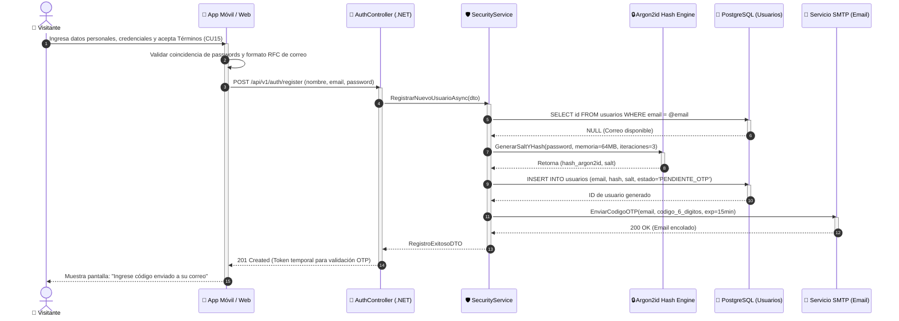

---

### DS02: Inicio de Sesión, Validación de Credenciales y Emisión de Token JWT
- **Casos de Uso:** `CU05` | **Requisitos:** `RF02, RF04, RF24`
- **Descripción:** Verificación criptográfica de credenciales, protección contra ataques de fuerza bruta mediante bloqueo temporal tras 5 intentos y expedición de token JWT con expiración controlada.

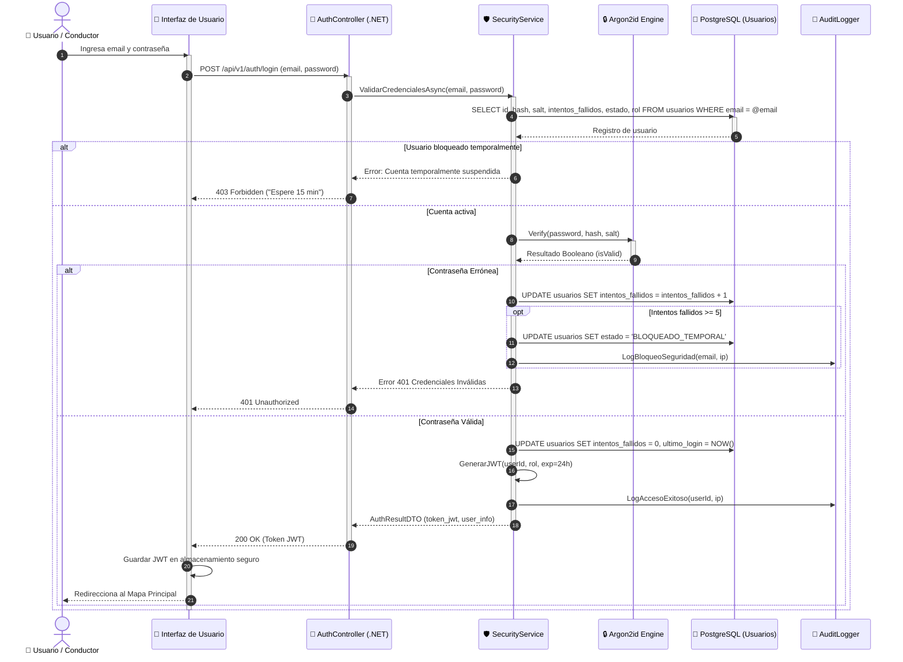

---

### DS03: Recuperación de Contraseña con Token Temporal Criptográfico
- **Casos de Uso:** `CU02` | **Requisitos:** `RF03, RF04`
- **Descripción:** Generación de token firmado de restablecimiento con expiración corta, envío por SMTP y actualización de contraseña previa verificación.

```mermaid
sequenceDiagram
    autonumber
    actor U as 👤 Usuario
    participant UI as 📱 App Móvil / Web
    participant AuthCtrl as 🚪 AuthController (.NET)
    participant TokenSvc as 🔑 TokenService
    participant DB as 💾 PostgreSQL (Tokens / Usuarios)
    participant SMTP as 📧 Servicio SMTP

    U->>UI: Solicita "Olvidé mi contraseña" e ingresa correo
    activate UI
    UI->>AuthCtrl: POST /api/v1/auth/forgot-password (email)
    activate AuthCtrl
    AuthCtrl->>TokenSvc: GenerarTokenRestablecimiento(email)
    activate TokenSvc
    TokenSvc->>DB: INSERT INTO reset_tokens (user_id, token_hash, exp=1h, usado=false)
    activate DB
    DB-->>TokenSvc: Token persistido
    deactivate DB
    TokenSvc->>SMTP: EnviarEmailRecuperacion(email, reset_link_con_token)
    activate SMTP
    SMTP-->>TokenSvc: Email despachado
    deactivate SMTP
    TokenSvc-->>AuthCtrl: Proceso completado
    deactivate TokenSvc
    AuthCtrl-->>UI: 200 OK ("Si el correo existe, recibirá instrucciones")
    deactivate AuthCtrl
    UI-->>U: Aviso visual informativo

    Note over U, UI: El usuario abre el enlace recibido en su correo
    U->>UI: Ingresa nueva contraseña y token
    UI->>AuthCtrl: POST /api/v1/auth/reset-password (token, new_password)
    activate AuthCtrl
    AuthCtrl->>DB: Validar token no expirado y no usado
    activate DB
    DB-->>AuthCtrl: Token válido
    AuthCtrl->>DB: UPDATE usuarios SET hash = nuevo_hash, salt = nuevo_salt; UPDATE reset_tokens SET usado=true
    deactivate DB
    AuthCtrl-->>UI: 200 OK ("Contraseña actualizada exitosamente")
    deactivate AuthCtrl
    UI-->>U: Notifica éxito y redirige a Iniciar Sesión
    deactivate UI
```

---

### DS04: Planificación de Ruta Óptima en Auto Particular, Cálculo de CO₂ y Respaldo PostGIS
- **Casos de Uso:** `CU03, CU06, CU16, CU27` | **Requisitos:** `RF09, RF10, RF11, RF13, RF26, RF27`
- **Descripción:** Cálculo de trayectos vehiculares eficientes, consulta a la API GIS, estimación de combustible y CO₂ evitado vs. promedio de la ciudad y persistencia en base de datos geoespacial.

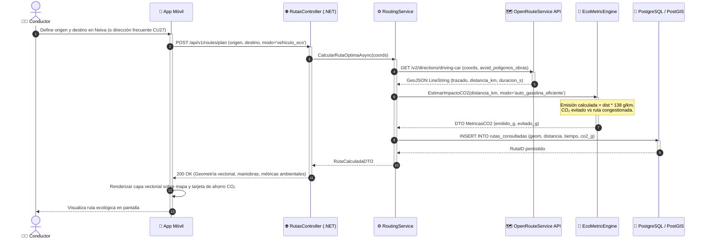

---

### DS05: Desplazamiento a Pie (Modo Peatonal Cero Emisiones) y Comparativa Ambiental
- **Casos de Uso:** `CU03, CU06, CU16` | **Requisitos:** `RF09, RF10, RF11`
- **Descripción:** Resolución de rutas a pie priorizando andenes y zonas seguras peatonales de Neiva, computando 0 gramos de CO₂ emitidos y calculando el 100% de emisiones evitadas.

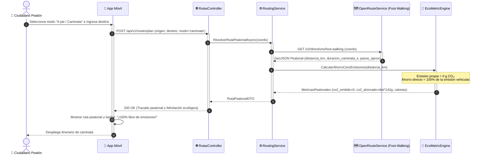

---

### DS06: Navegación Guiada por GPS con Asistencia Auditiva Text-to-Speech (TTS)
- **Casos de Uso:** `CU25` | **Requisitos:** `RF25, RF28`
- **Descripción:** Ciclo continuo de telemetría GPS, seguimiento de la posición en tiempo real, detección de proximidad a maniobras de giro y síntesis auditiva en cabina mediante el motor TTS nativo.

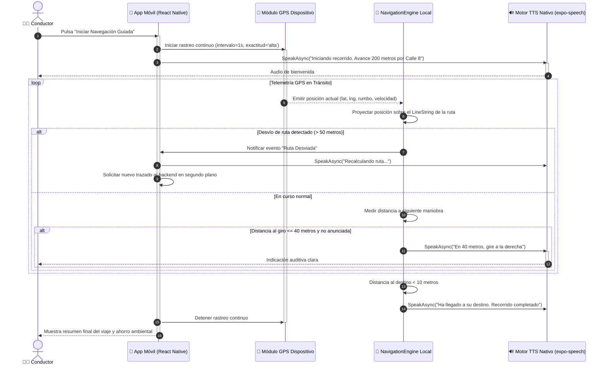

---

### DS07: Consulta Geoespacial de Puntos de Interés (POIs) e Inserción como Parada
- **Casos de Uso:** `CU17` | **Requisitos:** `RF15`
- **Descripción:** Filtrado espacial por categoría y radio de proximidad utilizando funciones ST_DWithin de PostGIS, permitiendo agregar talleres o parqueaderos como paradas intermedias en la ruta.

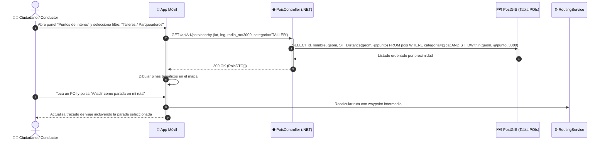

---

### DS08: Registro de Reporte Ciudadano con Captura Satelital GPS y Notificación Push
- **Casos de Uso:** `CU07, CU18` | **Requisitos:** `RF17, RF18, RF25`
- **Descripción:** Georreferenciación de obstáculos en vía, validación de polígono urbano, almacenamiento en PostGIS y difusión push inmediata a conductores que transiten a menos de 3 km.

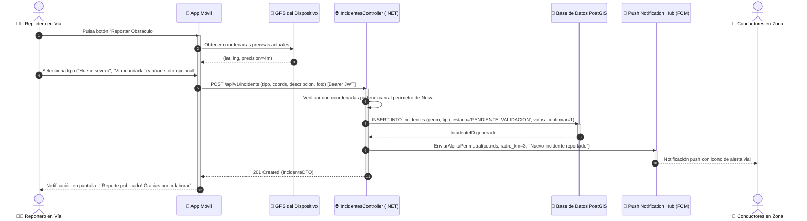

---

### DS09: Validación Comunitaria de Incidentes por Votación en Tiempo Real y Auto-Cierre
- **Casos de Uso:** `CU22` | **Requisitos:** `RF18, RF22`
- **Descripción:** Ciclo colaborativo de votación donde conductores cercanos confirman o descartan reportes, automatizando el archivo o retiro del marcador sin intervención humana.

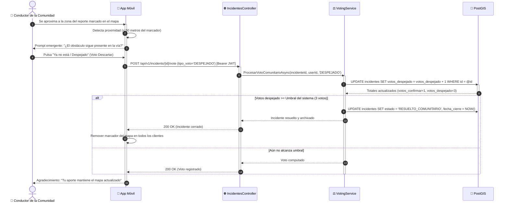

---

### DS10: Consulta, Calificación y Retroalimentación de Trayecto con Estrellas
- **Casos de Uso:** `CU09, CU11` | **Requisitos:** `RF14, RF16`
- **Descripción:** Al finalizar un recorrido, el usuario califica el estado de la vía de 1 a 5 estrellas, redacta observaciones de seguridad y opcionalmente guarda el trayecto como favorito con un alias.

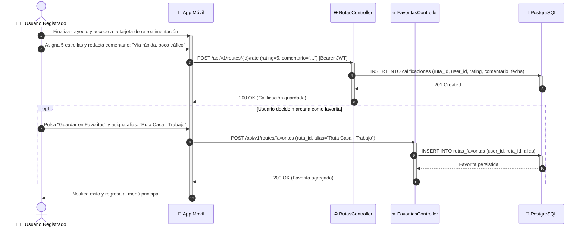

---

### DS11: Generación y Exportación de Historial y Reportes Estadísticos en PDF y Excel
- **Casos de Uso:** `CU08, CU19` | **Requisitos:** `RF20, RF22, RF29`
- **Descripción:** Procesamiento de consultas complejas de trayectos por rango temporal, agregación de métricas de CO₂ y compilación de archivos descargables en formatos PDF y Excel (.xlsx).

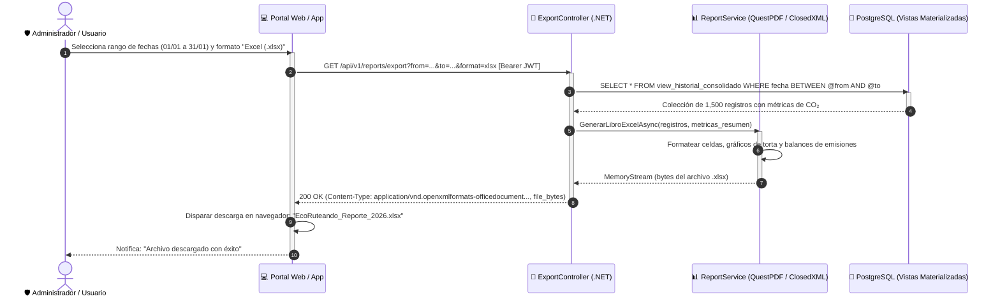

---

### DS12: Gestión Administrativa de Usuarios, Modificación de Roles y Log de Auditoría
- **Casos de Uso:** `CU24, CU28` | **Requisitos:** `RF21, RF23, RF24`
- **Descripción:** Supervisión administrativa de usuarios, revocación o asignación de privilegios de moderador/administrador y registro inmutable en bitácora de auditoría de seguridad.

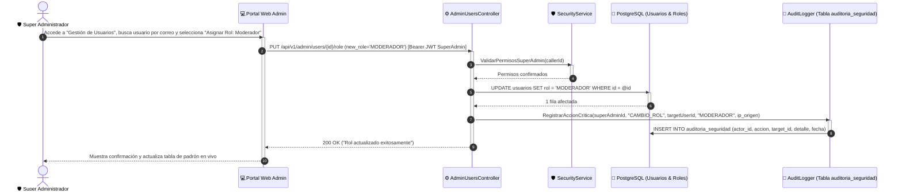

---


### DS01-registro-de-usuario-argon2id-y-otp.md
# DS01: Registro de Nuevo Usuario con Hash Argon2id y Envío de Correo OTP

| Campo | Especificación |
| :--- | :--- |
| **Identificador** | DS01 |
| **Nombre** | DS01: Registro de Nuevo Usuario con Hash Argon2id y Envío de Correo OTP |
| **Casos de Uso Vinculados** | CU01, CU15 |
| **Requisitos Funcionales** | RF01, RF04, RF08 |

---

### Descripción del Flujo
Modela el flujo de registro, validación de contraseña robusta, aplicación de hash con salt mediante Argon2id, almacenamiento seguro y despacho de código de verificación vía SMTP.

---

### Diagrama de Secuencia UML


### DS02-inicio-de-sesion-y-emision-jwt.md
# DS02: Inicio de Sesión, Validación de Credenciales y Emisión de Token JWT

| Campo | Especificación |
| :--- | :--- |
| **Identificador** | DS02 |
| **Nombre** | DS02: Inicio de Sesión, Validación de Credenciales y Emisión de Token JWT |
| **Casos de Uso Vinculados** | CU05 |
| **Requisitos Funcionales** | RF02, RF04, RF24 |

---

### Descripción del Flujo
Verificación criptográfica de credenciales, protección contra ataques de fuerza bruta mediante bloqueo temporal tras 5 intentos y expedición de token JWT con expiración controlada.

---

### Diagrama de Secuencia UML


### DS03-recuperacion-de-contrasena.md
# DS03: Recuperación de Contraseña con Token Temporal Criptográfico

| Campo | Especificación |
| :--- | :--- |
| **Identificador** | DS03 |
| **Nombre** | DS03: Recuperación de Contraseña con Token Temporal Criptográfico |
| **Casos de Uso Vinculados** | CU02 |
| **Requisitos Funcionales** | RF03, RF04 |

---

### Descripción del Flujo
Generación de token firmado de restablecimiento con expiración corta, envío por SMTP y actualización de contraseña previa verificación.

---

### Diagrama de Secuencia UML

```mermaid
sequenceDiagram
    autonumber
    actor U as 👤 Usuario
    participant UI as 📱 App Móvil / Web
    participant AuthCtrl as 🚪 AuthController (.NET)
    participant TokenSvc as 🔑 TokenService
    participant DB as 💾 PostgreSQL (Tokens / Usuarios)
    participant SMTP as 📧 Servicio SMTP

    U->>UI: Solicita "Olvidé mi contraseña" e ingresa correo
    activate UI
    UI->>AuthCtrl: POST /api/v1/auth/forgot-password (email)
    activate AuthCtrl
    AuthCtrl->>TokenSvc: GenerarTokenRestablecimiento(email)
    activate TokenSvc
    TokenSvc->>DB: INSERT INTO reset_tokens (user_id, token_hash, exp=1h, usado=false)
    activate DB
    DB-->>TokenSvc: Token persistido
    deactivate DB
    TokenSvc->>SMTP: EnviarEmailRecuperacion(email, reset_link_con_token)
    activate SMTP
    SMTP-->>TokenSvc: Email despachado
    deactivate SMTP
    TokenSvc-->>AuthCtrl: Proceso completado
    deactivate TokenSvc
    AuthCtrl-->>UI: 200 OK ("Si el correo existe, recibirá instrucciones")
    deactivate AuthCtrl
    UI-->>U: Aviso visual informativo

    Note over U, UI: El usuario abre el enlace recibido en su correo
    U->>UI: Ingresa nueva contraseña y token
    UI->>AuthCtrl: POST /api/v1/auth/reset-password (token, new_password)
    activate AuthCtrl
    AuthCtrl->>DB: Validar token no expirado y no usado
    activate DB
    DB-->>AuthCtrl: Token válido
    AuthCtrl->>DB: UPDATE usuarios SET hash = nuevo_hash, salt = nuevo_salt; UPDATE reset_tokens SET usado=true
    deactivate DB
    AuthCtrl-->>UI: 200 OK ("Contraseña actualizada exitosamente")
    deactivate AuthCtrl
    UI-->>U: Notifica éxito y redirige a Iniciar Sesión
    deactivate UI
```


### DS04-planificacion-de-ruta-vehiculo-y-co2.md
# DS04: Planificación de Ruta Óptima en Auto Particular, Cálculo de CO₂ y Respaldo PostGIS

| Campo | Especificación |
| :--- | :--- |
| **Identificador** | DS04 |
| **Nombre** | DS04: Planificación de Ruta Óptima en Auto Particular, Cálculo de CO₂ y Respaldo PostGIS |
| **Casos de Uso Vinculados** | CU03, CU06, CU16, CU27 |
| **Requisitos Funcionales** | RF09, RF10, RF11, RF13, RF26, RF27 |

---

### Descripción del Flujo
Cálculo de trayectos vehiculares eficientes, consulta a la API GIS, estimación de combustible y CO₂ evitado vs. promedio de la ciudad y persistencia en base de datos geoespacial.

---

### Diagrama de Secuencia UML


### DS05-desplazamiento-peatonal-cero-emisiones.md
# DS05: Desplazamiento a Pie (Modo Peatonal Cero Emisiones) y Comparativa Ambiental

| Campo | Especificación |
| :--- | :--- |
| **Identificador** | DS05 |
| **Nombre** | DS05: Desplazamiento a Pie (Modo Peatonal Cero Emisiones) y Comparativa Ambiental |
| **Casos de Uso Vinculados** | CU03, CU06, CU16 |
| **Requisitos Funcionales** | RF09, RF10, RF11 |

---

### Descripción del Flujo
Resolución de rutas a pie priorizando andenes y zonas seguras peatonales de Neiva, computando 0 gramos de CO₂ emitidos y calculando el 100% de emisiones evitadas.

---

### Diagrama de Secuencia UML


### DS06-asistencia-de-navegacion-por-voz-tts.md
# DS06: Navegación Guiada por GPS con Asistencia Auditiva Text-to-Speech (TTS)

| Campo | Especificación |
| :--- | :--- |
| **Identificador** | DS06 |
| **Nombre** | DS06: Navegación Guiada por GPS con Asistencia Auditiva Text-to-Speech (TTS) |
| **Casos de Uso Vinculados** | CU25 |
| **Requisitos Funcionales** | RF25, RF28 |

---

### Descripción del Flujo
Ciclo continuo de telemetría GPS, seguimiento de la posición en tiempo real, detección de proximidad a maniobras de giro y síntesis auditiva en cabina mediante el motor TTS nativo.

---

### Diagrama de Secuencia UML


### DS07-consulta-de-puntos-de-interes-pois.md
# DS07: Consulta Geoespacial de Puntos de Interés (POIs) e Inserción como Parada

| Campo | Especificación |
| :--- | :--- |
| **Identificador** | DS07 |
| **Nombre** | DS07: Consulta Geoespacial de Puntos de Interés (POIs) e Inserción como Parada |
| **Casos de Uso Vinculados** | CU17 |
| **Requisitos Funcionales** | RF15 |

---

### Descripción del Flujo
Filtrado espacial por categoría y radio de proximidad utilizando funciones ST_DWithin de PostGIS, permitiendo agregar talleres o parqueaderos como paradas intermedias en la ruta.

---

### Diagrama de Secuencia UML


### DS08-registro-de-reporte-ciudadano-gps.md
# DS08: Registro de Reporte Ciudadano con Captura Satelital GPS y Notificación Push

| Campo | Especificación |
| :--- | :--- |
| **Identificador** | DS08 |
| **Nombre** | DS08: Registro de Reporte Ciudadano con Captura Satelital GPS y Notificación Push |
| **Casos de Uso Vinculados** | CU07, CU18 |
| **Requisitos Funcionales** | RF17, RF18, RF25 |

---

### Descripción del Flujo
Georreferenciación de obstáculos en vía, validación de polígono urbano, almacenamiento en PostGIS y difusión push inmediata a conductores que transiten a menos de 3 km.

---

### Diagrama de Secuencia UML


### DS09-validacion-comunitaria-por-votos.md
# DS09: Validación Comunitaria de Incidentes por Votación en Tiempo Real y Auto-Cierre

| Campo | Especificación |
| :--- | :--- |
| **Identificador** | DS09 |
| **Nombre** | DS09: Validación Comunitaria de Incidentes por Votación en Tiempo Real y Auto-Cierre |
| **Casos de Uso Vinculados** | CU22 |
| **Requisitos Funcionales** | RF18, RF22 |

---

### Descripción del Flujo
Ciclo colaborativo de votación donde conductores cercanos confirman o descartan reportes, automatizando el archivo o retiro del marcador sin intervención humana.

---

### Diagrama de Secuencia UML

```mermaid
sequenceDiagram
    autonumber
    actor C as 👥 Conductor de la Comunidad
    participant UI as 📱 App Móvil
    participant IncCtrl as 🌐 IncidentesController
    participant VoteSvc as ⚖️ VotingService
    participant PostGIS as 💾 PostGIS

    C->>UI: Se aproxima a la zona del reporte marcado en el mapa
    activate UI
    UI->>UI: Detecta proximidad (< 50 metros del marcador)
    UI-->>C: Prompt emergente: "¿El obstáculo sigue presente en la vía?"
    C->>UI: Pulsa "Ya no está / Despejado" (Voto Descartar)
    UI->>IncCtrl: POST /api/v1/incidents/{id}/vote (tipo_voto='DESPEJADO') [Bearer JWT]
    activate IncCtrl
    IncCtrl->>VoteSvc: ProcesarVotoComunitarioAsync(incidenteId, userId, 'DESPEJADO')
    activate VoteSvc
    VoteSvc->>PostGIS: UPDATE incidentes SET votos_despejado = votos_despejado + 1 WHERE id = @id
    activate PostGIS
    PostGIS-->>VoteSvc: Totales actualizados (votos_confirmar=1, votos_despejado=3)
    deactivate PostGIS
    alt Votos despejado >= Umbral del sistema (3 votos)
        VoteSvc->>PostGIS: UPDATE incidentes SET estado = 'RESUELTO_COMUNITARIO', fecha_cierre = NOW()
        VoteSvc-->>IncCtrl: Incidente resuelto y archivado
        IncCtrl-->>UI: 200 OK (Incidente cerrado)
        UI->>UI: Remover marcador del mapa en todos los clientes
    else Aún no alcanza umbral
        VoteSvc-->>IncCtrl: Voto computado
        IncCtrl-->>UI: 200 OK (Voto registrado)
    end
    deactivate VoteSvc
    deactivate IncCtrl
    UI-->>C: Agradecimiento: "Tu aporte mantiene el mapa actualizado"
    deactivate UI
```


### DS10-calificacion-y-retroalimentacion-de-rutas.md
# DS10: Consulta, Calificación y Retroalimentación de Trayecto con Estrellas

| Campo | Especificación |
| :--- | :--- |
| **Identificador** | DS10 |
| **Nombre** | DS10: Consulta, Calificación y Retroalimentación de Trayecto con Estrellas |
| **Casos de Uso Vinculados** | CU09, CU11 |
| **Requisitos Funcionales** | RF14, RF16 |

---

### Descripción del Flujo
Al finalizar un recorrido, el usuario califica el estado de la vía de 1 a 5 estrellas, redacta observaciones de seguridad y opcionalmente guarda el trayecto como favorito con un alias.

---

### Diagrama de Secuencia UML

```mermaid
sequenceDiagram
    autonumber
    actor U as 🧑‍💼 Usuario Registrado
    participant UI as 📱 App Móvil
    participant RutasCtrl as 🌐 RutasController
    participant FavCtrl as ⭐ FavoritasController
    participant DB as 💾 PostgreSQL

    U->>UI: Finaliza trayecto y accede a la tarjeta de retroalimentación
    activate UI
    U->>UI: Asigna 5 estrellas y redacta comentario: "Vía rápida, poco tráfico"
    UI->>RutasCtrl: POST /api/v1/routes/{id}/rate (rating=5, comentario="...") [Bearer JWT]
    activate RutasCtrl
    RutasCtrl->>DB: INSERT INTO calificaciones (ruta_id, user_id, rating, comentario, fecha)
    activate DB
    DB-->>RutasCtrl: 201 Created
    deactivate DB
    RutasCtrl-->>UI: 200 OK (Calificación guardada)
    deactivate RutasCtrl

    opt Usuario decide marcarla como favorita
        U->>UI: Pulsa "Guardar en Favoritas" y asigna alias: "Ruta Casa - Trabajo"
        UI->>FavCtrl: POST /api/v1/routes/favorites (ruta_id, alias="Ruta Casa - Trabajo")
        activate FavCtrl
        FavCtrl->>DB: INSERT INTO rutas_favoritas (user_id, ruta_id, alias)
        activate DB
        DB-->>FavCtrl: Favorita persistida
        deactivate DB
        FavCtrl-->>UI: 200 OK (Favorita agregada)
        deactivate FavCtrl
    end
    UI-->>U: Notifica éxito y regresa al menú principal
    deactivate UI
```


### DS11-exportacion-de-historial-y-reportes.md
# DS11: Generación y Exportación de Historial y Reportes Estadísticos en PDF y Excel

| Campo | Especificación |
| :--- | :--- |
| **Identificador** | DS11 |
| **Nombre** | DS11: Generación y Exportación de Historial y Reportes Estadísticos en PDF y Excel |
| **Casos de Uso Vinculados** | CU08, CU19 |
| **Requisitos Funcionales** | RF20, RF22, RF29 |

---

### Descripción del Flujo
Procesamiento de consultas complejas de trayectos por rango temporal, agregación de métricas de CO₂ y compilación de archivos descargables en formatos PDF y Excel (.xlsx).

---

### Diagrama de Secuencia UML

```mermaid
sequenceDiagram
    autonumber
    actor A as 🛡️ Administrador / Usuario
    participant UI as 💻 Portal Web / App
    participant ExportCtrl as 📄 ExportController (.NET)
    participant ReportEngine as 📊 ReportService (QuestPDF / ClosedXML)
    participant DB as 💾 PostgreSQL (Vistas Materializadas)

    A->>UI: Selecciona rango de fechas (01/01 a 31/01) y formato "Excel (.xlsx)"
    activate UI
    UI->>ExportCtrl: GET /api/v1/reports/export?from=...&to=...&format=xlsx [Bearer JWT]
    activate ExportCtrl
    ExportCtrl->>DB: SELECT * FROM view_historial_consolidado WHERE fecha BETWEEN @from AND @to
    activate DB
    DB-->>ExportCtrl: Colección de 1,500 registros con métricas de CO₂
    deactivate DB
    ExportCtrl->>ReportEngine: GenerarLibroExcelAsync(registros, metricas_resumen)
    activate ReportEngine
    ReportEngine->>ReportEngine: Formatear celdas, gráficos de torta y balances de emisiones
    ReportEngine-->>ExportCtrl: MemoryStream (bytes del archivo .xlsx)
    deactivate ReportEngine
    ExportCtrl-->>UI: 200 OK (Content-Type: application/vnd.openxmlformats-officedocument..., file_bytes)
    deactivate ExportCtrl
    UI->>UI: Disparar descarga en navegador: "EcoRuteando_Reporte_2026.xlsx"
    UI-->>A: Notifica: "Archivo descargado con éxito"
    deactivate UI
```


### DS12-gestion-administrativa-y-auditoria.md
# DS12: Gestión Administrativa de Usuarios, Modificación de Roles y Log de Auditoría

| Campo | Especificación |
| :--- | :--- |
| **Identificador** | DS12 |
| **Nombre** | DS12: Gestión Administrativa de Usuarios, Modificación de Roles y Log de Auditoría |
| **Casos de Uso Vinculados** | CU24, CU28 |
| **Requisitos Funcionales** | RF21, RF23, RF24 |

---

### Descripción del Flujo
Supervisión administrativa de usuarios, revocación o asignación de privilegios de moderador/administrador y registro inmutable en bitácora de auditoría de seguridad.

---

### Diagrama de Secuencia UML

```mermaid
sequenceDiagram
    autonumber
    actor SuperAdmin as 🛡️ Super Administrador
    participant WebUI as 💻 Portal Web Admin
    participant AdminCtrl as ⚙️ AdminUsersController
    participant SecSvc as 🛡️ SecurityService
    participant DB as 💾 PostgreSQL (Usuarios & Roles)
    participant AuditLog as 📝 AuditLogger (Tabla auditoria_seguridad)

    SuperAdmin->>WebUI: Accede a "Gestión de Usuarios", busca usuario por correo y selecciona "Asignar Rol: Moderador"
    activate WebUI
    WebUI->>AdminCtrl: PUT /api/v1/admin/users/{id}/role (new_role='MODERADOR') [Bearer JWT SuperAdmin]
    activate AdminCtrl
    AdminCtrl->>SecSvc: ValidarPermisosSuperAdmin(callerId)
    activate SecSvc
    SecSvc-->>AdminCtrl: Permisos confirmados
    deactivate SecSvc
    AdminCtrl->>DB: UPDATE usuarios SET rol = 'MODERADOR' WHERE id = @id
    activate DB
    DB-->>AdminCtrl: 1 fila afectada
    deactivate DB
    AdminCtrl->>AuditLog: RegistrarAccionCritica(superAdminId, "CAMBIO_ROL", targetUserId, "MODERADOR", ip_origen)
    activate AuditLog
    AuditLog->>DB: INSERT INTO auditoria_seguridad (actor_id, accion, target_id, detalle, fecha)
    deactivate AuditLog
    AdminCtrl-->>WebUI: 200 OK ("Rol actualizado exitosamente")
    deactivate AdminCtrl
    WebUI-->>SuperAdmin: Muestra confirmación y actualiza tabla de padrón en vivo
    deactivate WebUI
```


## Diagramas de Transición de Estados


### TE01-ciclo-de-vida-de-ruta-vehicular.md
# TE01: Ciclo de Vida de una Ruta / Trayecto en Vehículo Particular

| Campo | Especificación |
| :--- | :--- |
| **Identificador** | TE01 |
| **Nombre** | TE01: Ciclo de Vida de una Ruta / Trayecto en Vehículo Particular |
| **Requisitos Funcionales** | RF09, RF10, RF11, RF12, RF14, RF28 |

---

### Descripción de la Máquina de Estados
Estados formales por los que transita una ruta en automóvil eficiente: desde su formulación inicial hasta su ejecución asistida por voz y almacenamiento histórico para balances ambientales.

---

### Diagrama de Transición de Estados UML (Statechart)

```mermaid
stateDiagram-v2
    [*] --> Borrador: Usuario ingresa origen y destino
    
    Borrador --> SolicitandoCalculo: Pulsa "Calcular Ruta"
    SolicitandoCalculo --> Calculada: API ORS responde + Cálculo CO₂ completado
    SolicitandoCalculo --> ErrorCalculo: Timeout de red / Coordenadas inalcanzables
    ErrorCalculo --> Borrador: Reintentar con nuevos puntos

    Calculada --> EnNavegacion: Conductor pulsa "Iniciar Recorrido"
    Calculada --> Descartada: Usuario cancela antes de iniciar

    state EnNavegacion {
        [*] --> GuiadoActivo: Conectar GPS y encender motor TTS
        GuiadoActivo --> Recalculando: Desvío detectado > 50m
        Recalculando --> GuiadoActivo: Nuevo trazado sincronizado
        GuiadoActivo --> ManiobraProxima: Distancia a giro < 40m
        ManiobraProxima --> GuiadoActivo: Locución TTS reproducida
    }

    EnNavegacion --> Completada: Conductor arriba al punto de destino
    EnNavegacion --> Cancelada: Conductor interrumpe el viaje manualmente

    Cancelada --> GuardadaHistorial: Guardar tramo parcial recorrido
    Completada --> GuardadaHistorial: Persistir trayecto final + CO₂ en PostgreSQL

    state GuardadaHistorial {
        [*] --> NoCalificada
        NoCalificada --> Calificada: Usuario califica con estrellas (CU09)
        NoCalificada --> MarcadaFavorita: Usuario pulsa "Añadir a Favoritas" (CU11)
        Calificada --> MarcadaFavorita: Usuario pulsa "Añadir a Favoritas" (CU11)
    }

    GuardadaHistorial --> Exportada: Usuario exporta a PDF o Excel (CU19)
    Descartada --> [*]
    Exportada --> [*]
```


### TE02-ciclo-de-vida-de-trayecto-peatonal.md
# TE02: Ciclo de Vida del Trayecto Peatonal / Caminata a Pie

| Campo | Especificación |
| :--- | :--- |
| **Identificador** | TE02 |
| **Nombre** | TE02: Ciclo de Vida del Trayecto Peatonal / Caminata a Pie |
| **Requisitos Funcionales** | RF09, RF10, RF11, RF12 |

---

### Descripción de la Máquina de Estados
Ciclo de estados para desplazamientos a pie: cálculo de andenes peatonales, métrica de 0 g CO₂ emitidos, pausa de caminata y consolidación en el podio ecológico.

---

### Diagrama de Transición de Estados UML (Statechart)

```mermaid
stateDiagram-v2
    [*] --> PlanificandoCaminata: Usuario selecciona modo "A pie"
    PlanificandoCaminata --> TrazadoResuelto: Algoritmo peatonal asigna sendero seguro
    
    TrazadoResuelto --> CaminandoActivo: Pulsa "Comenzar Caminata"
    TrazadoResuelto --> Cancelado: Descarta itinerario

    state CaminandoActivo {
        [*] --> Cronometrando: Contador de pasos y tiempo en marcha
        Cronometrando --> Pausado: Usuario pulsa botón de pausa temporal
        Pausado --> Cronometrando: Reanuda desplazamiento
    }

    CaminandoActivo --> CaminataFinalizada: Arriba a destino peatonal
    CaminandoActivo --> Interrumpido: Usuario detiene registro antes de llegar

    CaminataFinalizada --> ConsolidadoEcologico: Se registra 100% CO₂ evitado vs auto
    Interrumpido --> ConsolidadoEcologico: Se computa el tramo parcial caminado

    ConsolidadoEcologico --> GuardadoHistorial: Persistido en perfil para métricas de salud
    GuardadoHistorial --> [*]
    Cancelado --> [*]
```


### TE03-ciclo-de-vida-de-reporte-ciudadano.md
# TE03: Ciclo de Vida del Reporte Ciudadano de Obstáculo / Incidente

| Campo | Especificación |
| :--- | :--- |
| **Identificador** | TE03 |
| **Nombre** | TE03: Ciclo de Vida del Reporte Ciudadano de Obstáculo / Incidente |
| **Requisitos Funcionales** | RF17, RF18, RF24 |

---

### Descripción de la Máquina de Estados
Estados de los reportes viales: desde su creación georreferenciada con GPS, su confirmación por consenso de otros conductores y su retiro o archivado por expiración temporal.

---

### Diagrama de Transición de Estados UML (Statechart)

```mermaid
stateDiagram-v2
    [*] --> CapturandoGPS: Usuario pulsa "Reportar Obstáculo"
    CapturandoGPS --> BorradorReporte: Coordenadas fijadas + Foto opcional
    
    BorradorReporte --> PendienteValidacion: Usuario confirma y envía reporte
    BorradorReporte --> Cancelado: Usuario aborta envío

    state PendienteValidacion {
        [*] --> VisibleLocal: Visible con pin amarillo de precaución
        VisibleLocal --> RecibiendoVotos: Notificación push despachada a zona
    }

    PendienteValidacion --> ConfirmadoComunidad: Votos "Confirmar" >= 3
    PendienteValidacion --> VerificadoOficial: Administrador valida reporte (CU24)
    PendienteValidacion --> DescartadoFalso: Votos "Descartar" >= 3 o Reporte Spam

    state ConfirmadoComunidad {
        [*] --> MarcadorRojo: Marcador visual de alta severidad en mapa
        MarcadorRojo --> VotoResolucion: Conductor reporta "Ya no está / Despejado"
    }

    ConfirmadoComunidad --> ResueltoComunidad: Votos "Despejado" >= 3
    ConfirmadoComunidad --> ExpiradoTemporal: Tiempo sin actividad > 24 horas
    VerificadoOficial --> CerradoAdmin: Moderador marca vía despejada

    ResueltoComunidad --> Archivado: Ocultar de mapa y preservar para estadísticas
    ExpiradoTemporal --> Archivado: Marcar inactivo
    CerradoAdmin --> Archivado: Marcar verificado y cerrado
    DescartadoFalso --> [*]
    Cancelado --> [*]
    Archivado --> [*]
```


### TE04-ciclo-de-vida-de-cuenta-de-usuario.md
# TE04: Ciclo de Vida de la Cuenta de Usuario

| Campo | Especificación |
| :--- | :--- |
| **Identificador** | TE04 |
| **Nombre** | TE04: Ciclo de Vida de la Cuenta de Usuario |
| **Requisitos Funcionales** | RF01, RF02, RF04, RF06, RF07 |

---

### Descripción de la Máquina de Estados
Ciclo completo de identidad digital: modo invitado local, registro con verificación OTP, sesión activa con token JWT, congelamiento preventivo por ataques de fuerza bruta y baja definitiva.

---

### Diagrama de Transición de Estados UML (Statechart)

```mermaid
stateDiagram-v2
    [*] --> Invitado: Abre app sin iniciar sesión (CU14)
    
    Invitado --> Registrando: Pulsa "Crear Cuenta"
    Registrando --> PendienteVerificacion: Formulario enviado + Hash Argon2id
    
    PendienteVerificacion --> Activo: Ingresa código OTP de correo exitosamente
    PendienteVerificacion --> ExpiradoRegistro: Código vence tras 15 minutos sin verificar
    ExpiradoRegistro --> Registrando: Solicitar reenvío de código

    state Activo {
        [*] --> Operativo
        Operativo --> PerfilModificado: Actualiza datos o avatar (CU12)
        PerfilModificado --> Operativo
    }

    Activo --> BloqueadoTemporal: 5 intentos fallidos consecutivos de contraseña
    BloqueadoTemporal --> Activo: Transcurren 15 minutos de enfriamiento
    BloqueadoTemporal --> RestableciendoClave: Solicita recuperación por email (CU02)
    RestableciendoClave --> Activo: Clave redefinida exitosamente

    Activo --> Eliminado: Usuario solicita baja voluntaria (CU13)
    Eliminado --> [*]: Credenciales destruidas y datos anonimizados para CO₂ global
```


### TE05-ciclo-de-vida-de-sesion-y-token-jwt.md
# TE05: Ciclo de Vida de la Sesión y Token de Autenticación (JWT y Refresh Token)

| Campo | Especificación |
| :--- | :--- |
| **Identificador** | TE05 |
| **Nombre** | TE05: Ciclo de Vida de la Sesión y Token de Autenticación (JWT y Refresh Token) |
| **Requisitos Funcionales** | RF02, RF04 |

---

### Descripción de la Máquina de Estados
Estados temporales de tokens de acceso: emisión inicial con claims de rol, estado activo durante 24 horas, renovación en segundo plano con refresh token y expiración o revocación definitiva.

---

### Diagrama de Transición de Estados UML (Statechart)

```mermaid
stateDiagram-v2
    [*] --> NoAutenticado: Inicio de la aplicación
    
    NoAutenticado --> Autenticando: Envío de credenciales de acceso
    Autenticando --> NoAutenticado: Fallo de credenciales (401)
    Autenticando --> TokenEmitido: Credenciales verificadas con Argon2id

    state TokenEmitido {
        [*] --> TokenActivo: JWT almacenado en SecureStore (TTL 24h)
        TokenActivo --> TokenPorExpirar: Tiempo restante < 1 hora
        TokenPorExpirar --> RenovandoToken: Petición interceptada con Refresh Token
        RenovandoToken --> TokenActivo: Nuevo Access Token emitido sin desloguear
        RenovandoToken --> TokenExpirado: Refresh Token inválido o revocado
    }

    TokenActivo --> SesionCerrada: Usuario presiona "Cerrar Sesión"
    TokenActivo --> TokenRevocado: Administrador invalida sesiones por seguridad
    TokenPorExpirar --> TokenExpirado: Cumple 24h sin renovación

    SesionCerrada --> NoAutenticado: Token borrado de memoria local
    TokenRevocado --> NoAutenticado: Forzar pantalla de login
    TokenExpirado --> NoAutenticado: Redirección inmediata a autenticación
    NoAutenticado --> [*]
```


### TE06-ciclo-de-vida-de-ticket-de-soporte.md
# TE06: Ciclo de Vida de un Ticket de Soporte Técnico y Mesa de Ayuda

| Campo | Especificación |
| :--- | :--- |
| **Identificador** | TE06 |
| **Nombre** | TE06: Ciclo de Vida de un Ticket de Soporte Técnico y Mesa de Ayuda |
| **Requisitos Funcionales** | RF30 |

---

### Descripción de la Máquina de Estados
Gestión formal de incidencias técnicas: radicación ciudadana, asignación al equipo de soporte, fase de investigación, respuesta al usuario y cierre con encuesta de satisfacción.

---

### Diagrama de Transición de Estados UML (Statechart)

```mermaid
stateDiagram-v2
    [*] --> RadicandoTicket: Usuario redacta solicitud de ayuda (CU23)
    RadicandoTicket --> AbiertoPendiente: Ticket registrado con código único de seguimiento
    
    AbiertoPendiente --> EnAtencion: Asignado a agente de soporte técnico
    
    state EnAtencion {
        [*] --> InvestigandoFallo: Revisión de logs y capturas adjuntas
        InvestigandoFallo --> EsperandoRespuestaUsuario: Agente solicita más información
        EsperandoRespuestaUsuario --> InvestigandoFallo: Usuario aporta datos requeridos
    }

    EnAtencion --> Resuelto: Agente remite solución o corrección del sistema
    
    Resuelto --> CerradoConforme: Usuario valida y acepta solución
    Resuelto --> Reabierto: Usuario indica persistencia del problema
    Reabierto --> EnAtencion: Reingresa al ciclo de análisis

    Resuelto --> CerradoAutomatico: 5 días sin réplica tras emitir respuesta
    CerradoConforme --> [*]
    CerradoAutomatico --> [*]
```


### TE07-ciclo-de-vida-de-notificacion-del-sistema.md
# TE07: Ciclo de Vida de una Notificación del Sistema (Push / In-App)

| Campo | Especificación |
| :--- | :--- |
| **Identificador** | TE07 |
| **Nombre** | TE07: Ciclo de Vida de una Notificación del Sistema (Push / In-App) |
| **Requisitos Funcionales** | RF25 |

---

### Descripción de la Máquina de Estados
Ciclo de comunicaciones del sistema: redacción administrativa, programación horaria, encolado en Firebase Cloud Messaging, entrega al dispositivo móvil y lectura por el destinatario.

---

### Diagrama de Transición de Estados UML (Statechart)

```mermaid
stateDiagram-v2
    [*] --> RedactandoNotificacion: Admin prepara título, mensaje y audiencia objetivo
    RedactandoNotificacion --> Descartada: Cancela antes de guardar
    
    RedactandoNotificacion --> Programada: Fecha de despacho configurada a futuro
    RedactandoNotificacion --> EnColaEnvio: Despacho instantáneo solicitado

    Programada --> EnColaEnvio: El temporizador del servidor alcanza la hora fijada
    
    state EnColaEnvio {
        [*] --> ProcesandoSegmento: Filtro de tokens FCM por ciudad o rol
        ProcesandoSegmento --> EnviandoPush: Despacho a servidores de Google / Apple
    }

    EnColaEnvio --> EntregadaAlDispositivo: Handshake exitoso con el sistema operativo
    EnColaEnvio --> ErrorDespacho: Falla de red en API de notificaciones
    ErrorDespacho --> EnColaEnvio: Reintento controlado (máx 3)

    EntregadaAlDispositivo --> NoLeida: Notificación visible en bandeja del teléfono
    NoLeida --> Leida: Usuario toca la notificación y abre la app
    NoLeida --> ExpiradaBandeja: Transcurren 30 días sin interacción

    Leida --> Archivada: Guardada en historial de alertas
    ExpiradaBandeja --> Archivada
    Archivada --> [*]
    Descartada --> [*]
```


### TE08-ciclo-de-vida-de-parametros-del-sistema.md
# TE08: Ciclo de Vida de Parámetros Operativos del Sistema

| Campo | Especificación |
| :--- | :--- |
| **Identificador** | TE08 |
| **Nombre** | TE08: Ciclo de Vida de Parámetros Operativos del Sistema |
| **Requisitos Funcionales** | RF23, RF24 |

---

### Descripción de la Máquina de Estados
Manejo de variables globales de entorno: factores de cálculo de CO₂, límites geográficos, valores por defecto de fábrica, validación de rangos numéricos y propagación en caliente en caché.

---

### Diagrama de Transición de Estados UML (Statechart)

```mermaid
stateDiagram-v2
    [*] --> ValorPredeterminado: Inicialización de fábrica en base de datos
    
    ValorPredeterminado --> EnEdicion: Administrador modifica variable en panel web (CU28)
    
    state EnEdicion {
        [*] --> ValidandoSintaxis: Chequeo de tipo de dato y no nulo
        ValidandoSintaxis --> ValidandoRango: Chequeo de límites físicos (ej. CO₂ > 0)
    }

    EnEdicion --> InvalidoRechazado: Valor fuera de rango permitido (Error visual)
    InvalidoRechazado --> EnEdicion: Administrador corrige el número ingresado

    EnEdicion --> ConfirmadoSeguridad: Administrador valida en modal de confirmación
    ConfirmadoSeguridad --> PersistidoEnBD: Transacción UPDATE en tabla configuracion_sistema
    
    PersistidoEnBD --> PropagadoEnMemoria: Backend invalida caché IMemoryCache y recarga variables
    PersistidoEnBD --> Auditado: Registro automático en tabla auditoria_seguridad (RF24)

    PropagadoEnMemoria --> OperativoEnProduccion: Variable activa para todas las peticiones móviles
    
    OperativoEnProduccion --> EnEdicion: Nueva modificación solicitada
    OperativoEnProduccion --> RestaurandoFabrica: Administrador pulsa "Restablecer Valores por Defecto"
    RestaurandoFabrica --> ValorPredeterminado: Variables sobreescritas a línea base inicial
```
